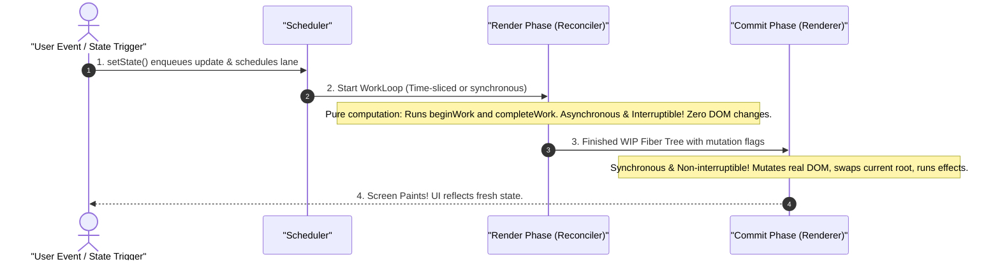
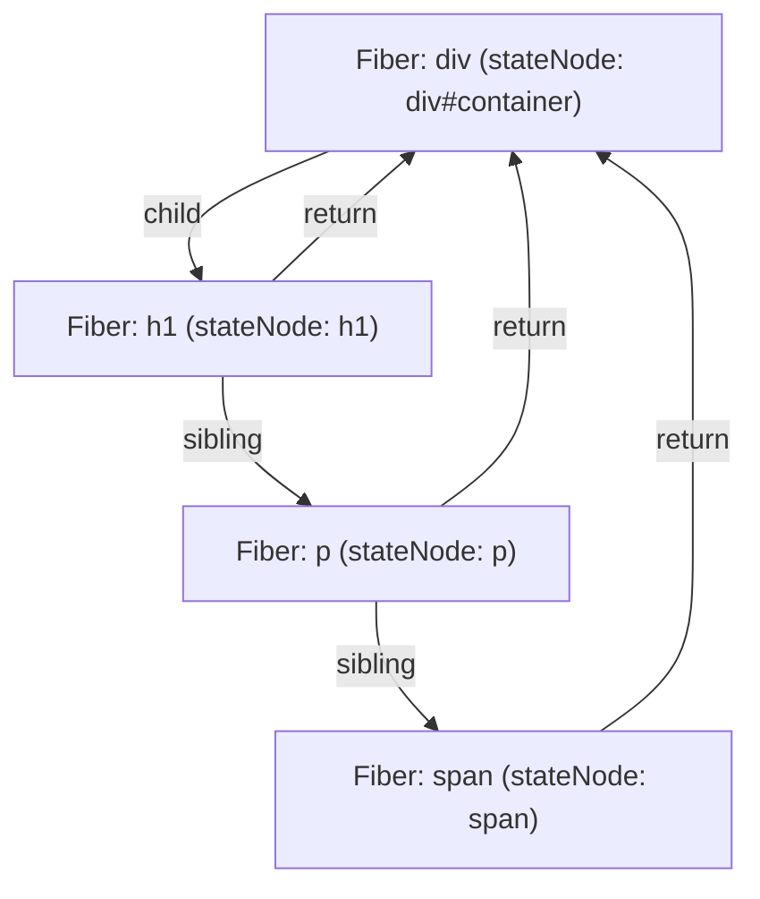
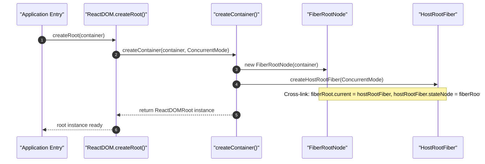

# React Internals Deep Dive: The Source Code Walkthrough

> **A Comprehensive, Line-by-Line Architectural Deep Dive into React 18 & 19 Internals (Fiber Architecture, The WorkLoop, Reconciliation, Hooks Engine, Scheduler & Concurrency)**
>
> *Inspired by and expanding upon JSer.dev's React Source Code Walkthrough series with production-grade diagrams, structural breakdown, and execution walkthroughs.*

---

## Table of Contents

- [Module 00: The Mental Model & Reconciler Architecture](#module-00-the-mental-model--reconciler-architecture)
  - [1. Why React is Not a DOM Library (Core vs Reconciler vs Renderer)](#1-why-react-is-not-a-dom-library-core-vs-reconciler-vs-renderer)
  - [2. The Stack Reconciler (React 15) vs The Fiber Reconciler (React 16+)](#2-the-stack-reconciler-react-15-vs-the-fiber-reconciler-react-16)
  - [3. The Three High-Level Phases: Trigger, Render, Commit](#3-the-three-high-level-phases-trigger-render-commit)
  - [Quiz 00: Mental Model & Architecture](#quiz-00-mental-model--architecture)
- [Module 01: The Core Data Structure — The Fiber Node](#module-01-the-core-data-structure--the-fiber-node)
  - [1. What is a Fiber? (Unit of Work + Component Instance + Call Frame)](#1-what-is-a-fiber-unit-of-work--component-instance--call-frame)
  - [2. Deep-Dive into Fiber Properties & Fields](#2-deep-dive-into-fiber-properties--fields)
  - [3. The Double Buffering Pattern: `current` vs `workInProgress` (WIP)](#3-the-double-buffering-pattern-current-vs-workinprogress-wip)
  - [4. The Linked List Tree Representation (child, sibling, return)](#4-the-linked-list-tree-representation-child-sibling-return)
  - [Quiz 01: Fiber Node Anatomy & Double Buffering](#quiz-01-fiber-node-anatomy--double-buffering)
- [Module 02: Initial Mount & Root Initialization (`createRoot`)](#module-02-initial-mount--root-initialization-createroot)
  - [1. What Happens When You Call `createRoot(container)`?](#1-what-happens-when-you-call-createrootcontainer)
  - [2. `FiberRootNode` vs `HostRootFiber`](#2-fiberrootnode-vs-hostrootfiber)
  - [3. Calling `root.render(<App />)`: Creation of the Root Update](#3-calling-rootrenderapp--creation-of-the-root-update)
  - [4. Transitioning into the Scheduler](#4-transitioning-into-the-scheduler)
  - [Quiz 02: Root Initialization & Update Enqueueing](#quiz-02-root-initialization--update-enqueueing)
- [Module 03: The WorkLoop & Fiber Tree Traversal](#module-03-the-workloop--fiber-tree-traversal)
  - [1. The Heart of React: `workLoopSync` vs `workLoopConcurrent`](#1-the-heart-of-react-workloopsync-vs-workloopconcurrent)
  - [2. Depth-First Search (DFS) Tree Traversal via Pointers](#2-depth-first-search-dfs-tree-traversal-via-pointers)
  - [3. `performUnitOfWork`: The Two Halves of a Fiber's Lifecycle](#3-performunitofwork-the-two-halves-of-a-fibers-lifecycle)
  - [4. Visualizing the Traversal Order](#4-visualizing-the-traversal-order)
  - [Quiz 03: The WorkLoop & DFS Traversal](#quiz-03-the-workloop--dfs-traversal)
- [Module 04: The Begin Phase (`beginWork`) Deep-Dive](#module-04-the-begin-phase-beginwork-deep-dive)
  - [1. Structure and Purpose of `beginWork`](#1-structure-and-purpose-of-beginwork)
  - [2. Switching on `workInProgress.tag`](#2-switching-on-workinprogresstag)
  - [3. Executing Function Components: `renderWithHooks()`](#3-executing-function-components-renderwithhooks)
  - [4. Child Reconciliation: `mountChildFibers` vs `reconcileChildFibers`](#4-child-reconciliation-mountchildfibers-vs-reconcilechildfibers)
  - [Quiz 04: BeginWork & Component Rendering](#quiz-04-beginwork--component-rendering)
- [Module 05: The Complete Phase (`completeWork`) & DOM Instantiation](#module-05-the-complete-phase-completework--dom-instantiation)
  - [1. What Happens When a Fiber Has No More Children?](#1-what-happens-when-a-fiber-has-no-more-children)
  - [2. For `HostComponent`: `createInstance` & `appendAllChildren`](#2-for-hostcomponent-createinstance--appendallchildren)
  - [3. Bubble Properties: Propagating `flags` and `subtreeFlags`](#3-bubble-properties-propagating-flags-and-subtreeflags)
  - [4. Diffing Props: Generating the `updatePayload` Array](#4-diffing-props-generating-the-updatepayload-array)
  - [Quiz 05: CompleteWork & DOM Assembly](#quiz-05-completework--dom-assembly)
- [Module 06: The Commit Phase: Applying Changes to the Real DOM](#module-06-the-commit-phase-applying-changes-to-the-real-dom)
  - [1. Why the Commit Phase is Synchronous & Non-Interruptible](#1-why-the-commit-phase-is-synchronous--non-interruptible)
  - [2. Sub-Phase 1: Before Mutation Phase (`commitBeforeMutationEffects`)](#2-sub-phase-1-before-mutation-phase-commitbeforemutationeffects)
  - [3. Sub-Phase 2: Mutation Phase (`commitMutationEffects`)](#3-sub-phase-2-mutation-phase-commitmutationeffects)
  - [4. Sub-Phase 3: Layout Phase (`commitLayoutEffects`)](#4-sub-phase-3-layout-phase-commitlayouteffects)
  - [5. Root Pointer Swap & Asynchronous Passive Effects](#5-root-pointer-swap--asynchronous-passive-effects)
  - [Quiz 06: Commit Sub-Phases & DOM Mutations](#quiz-06-commit-sub-phases--dom-mutations)
- [Module 07: How `setState` & The Update Queue Work](#module-07-how-setstate--the-update-queue-work)
  - [1. The Anatomy of an `Update` Object](#1-the-anatomy-of-an-update-object)
  - [2. The Circular Linked List in `hook.queue`](#2-the-circular-linked-list-in-hookqueue)
  - [3. Calculating State: Base State + Pending Updates](#3-calculating-state-base-state--pending-updates)
  - [4. The "Eager State" Bailout Optimization](#4-the-eager-state-bailout-optimization)
  - [Quiz 07: Update Queues & State Calculation](#quiz-07-update-queues--state-calculation)
- [Module 08: React Hooks Internals: `useState` & `useReducer`](#module-08-react-hooks-internals-usestate--usereducer)
  - [1. The Hook Data Structure on `fiber.memoizedState`](#1-the-hook-data-structure-on-fibermemoizedstate)
  - [2. `mountWorkInProgressHook` vs `updateWorkInProgressHook`](#2-mountworkinprogresshook-vs-updateworkinprogresshook)
  - [3. The Dispatcher Switch Architecture](#3-the-dispatcher-switch-architecture)
  - [4. Why Hooks Cannot Run in Loops or Conditions](#4-why-hooks-cannot-run-in-loops-or-conditions)
  - [Quiz 08: Hooks Engine & Dispatcher Internals](#quiz-08-hooks-engine--dispatcher-internals)
- [Module 09: The Lifecycle of Effect Hooks](#module-09-the-lifecycle-of-effect-hooks)
  - [1. The `Effect` Object Structure (`tag`, `create`, `destroy`, `deps`)](#1-the-effect-object-structure-tag-create-destroy-deps)
  - [2. `useInsertionEffect`: Synchronous Before Mutations](#2-useinsertioneffect-synchronous-before-mutations)
  - [3. `useLayoutEffect`: Synchronous After Mutations, Before Paint](#3-uselayouteffect-synchronous-after-mutations-before-paint)
  - [4. `useEffect`: Asynchronous Macro-Task After Paint](#4-useeffect-asynchronous-macro-task-after-paint)
  - [5. Effect Cleanup Execution Order](#5-effect-cleanup-execution-order)
  - [Quiz 09: Effect Lifecycles & Execution Timing](#quiz-09-effect-lifecycles--execution-timing)
- [Module 10: Performance Optimization Internals: Bailout & `React.memo`](#module-10-performance-optimization-internals-bailout--reactmemo)
  - [1. The Two Bailout Conditions in `beginWork`](#1-the-two-bailout-conditions-in-beginwork)
  - [2. Checking Scheduled Work: `lanes` vs `renderLanes`](#2-checking-scheduled-work-lanes-vs-renderlanes)
  - [3. How `React.memo` Works Internally (`SimpleMemoComponent`)](#3-how-reactmemo-works-internally-simplememocomponent)
  - [4. `cloneChildFibers`: Reusing Existing Subtrees](#4-clonechildfibers-reusing-existing-subtrees)
  - [Quiz 10: Bailout Mechanics & Memoization](#quiz-10-bailout-mechanics--memoization)
- [Module 11: The List Reconciliation Algorithm & The `key` Prop](#module-11-the-list-reconciliation-algorithm--the-key-prop)
  - [1. Why List Diffing is $O(n)$ Instead of $O(n^3)$](#1-why-list-diffing-is-on-instead-of-on3)
  - [2. The Multi-Pass Reconciliation Algorithm (`reconcileChildrenArray`)](#2-the-multi-pass-reconciliation-algorithm-reconcilechildrenarray)
  - [3. The `lastPlacedIndex` Tracking Mechanism](#3-the-lastplacedindex-tracking-mechanism)
  - [4. Why Index as Key Causes State Desynchronization Bugs](#4-why-index-as-key-causes-state-desynchronization-bugs)
  - [Quiz 11: Keys & List Diffing Mechanics](#quiz-11-keys--list-diffing-mechanics)
- [Module 12: The React Scheduler & Cooperative Multitasking](#module-12-the-react-scheduler--cooperative-multitasking)
  - [1. Why `requestIdleCallback` Was Rejected](#1-why-requestidlecallback-was-rejected)
  - [2. Scheduling via `MessageChannel` (Macro-Task Loop)](#2-scheduling-via-messagechannel-macro-task-loop)
  - [3. Min-Heap Priority Queues: `timerQueue` vs `taskQueue`](#3-min-heap-priority-queues-timerqueue-vs-taskqueue)
  - [4. Time-Slicing & The 5ms Budget (`shouldYieldToHost`)](#4-time-slicing--the-5ms-budget-shouldyieldtohost)
  - [Quiz 12: Scheduler & Cooperative Multitasking](#quiz-12-scheduler--cooperative-multitasking)
- [Module 13: The Lane Model: Priority & Concurrency](#module-13-the-lane-model-priority--concurrency)
  - [1. Why ExpirationTimes Was Replaced by Lanes](#1-why-expirationtimes-was-replaced-by-lanes)
  - [2. 31-Bit Bitmask Architecture of Lanes](#2-31-bit-bitmask-architecture-of-lanes)
  - [3. Bitwise Math: `lane & -lane`, `mergeLanes`, `isSubsetOfLanes`](#3-bitwise-math-lane---lane-mergelanes-issubsetoflanes)
  - [4. Priority Inversion & Lane Entanglement](#4-priority-inversion--lane-entanglement)
  - [Quiz 13: Lane Bitmasks & Priority Scheduling](#quiz-13-lane-bitmasks--priority-scheduling)
- [Module 14: Concurrent Features Internals: `useTransition` & `useDeferredValue`](#module-14-concurrent-features-internals-usetransition--usedeferredvalue)
  - [1. How `startTransition` Downgrades Priority to `TransitionLane`](#1-how-starttransition-downgrades-priority-to-transitionlane)
  - [2. Interruptible Rendering: Pausing and Discarding In-Progress Trees](#2-interruptible-rendering-pausing-and-discarding-in-progress-trees)
  - [3. `useDeferredValue`: Stale First, Deferred Update Later](#3-usedeferredvalue-stale-first-deferred-update-later)
  - [Quiz 14: Transitions & Concurrent Interruption](#quiz-14-transitions--concurrent-interruption)
- [Module 15: Suspense & The Offscreen Component Internals](#module-15-suspense--the-offscreen-component-internals)
  - [1. How Suspense Works: The Promise-Throwing Protocol](#1-how-suspense-works-the-promise-throwing-protocol)
  - [2. Catching Thrown Promises in `renderRootConcurrent`](#2-catching-thrown-promises-in-renderrootconcurrent)
  - [3. The `OffscreenComponent`: CSS `display: none` Without Unmounting](#3-the-offscreencomponent-css-display-none-without-unmounting)
  - [4. Progressive & Selective Hydration with Suspense](#4-progressive--selective-hydration-with-suspense)
  - [Quiz 15: Suspense & Offscreen Mechanics](#quiz-15-suspense--offscreen-mechanics)
- [Module 16: Context API Internals: Propagation & Stack](#module-16-context-api-internals-propagation--stack)
  - [1. The `_currentValue` Cursor Stack](#1-the-_currentvalue-cursor-stack)
  - [2. `readContext(Context)` & Dependency Registration](#2-readcontextcontext--dependency-registration)
  - [3. `propagateContextChange`: Bypassing `React.memo` and `shouldComponentUpdate`](#3-propagatecontextchange-bypassing-reactmemo-and-shouldcomponentupdate)
  - [Quiz 16: Context Propagation Internals](#quiz-16-context-propagation-internals)
- [Module 17: SyntheticEvent & Event Delegation System](#module-17-syntheticevent--event-delegation-system)
  - [1. Why Event Listeners Attach to the Root Container (React 17+)](#1-why-event-listeners-attach-to-the-root-container-react-17)
  - [2. Simulating Capture & Bubble Phases in Pure JavaScript](#2-simulating-capture--bubble-phases-in-pure-javascript)
  - [3. SyntheticEvent Pooling Removal & Native Event Binding](#3-syntheticevent-pooling-removal--native-event-binding)
  - [Quiz 17: SyntheticEvent Mechanics](#quiz-17-syntheticevent-mechanics)
- [Module 18: Top 15 Architectural Interview Questions on React Internals](#module-18-top-15-architectural-interview-questions-on-react-internals)
- [Module 19: Hands-On Coding Challenges: Building a Mini-React from Scratch](#module-19-hands-on-coding-challenges-building-a-mini-react-from-scratch)
  - [Challenge 1: Implement the Fiber DFS WorkLoop with 5ms Yielding](#challenge-1-implement-the-fiber-dfs-workloop-with-5ms-yielding)
  - [Challenge 2: Implement the Hook Linked List & State Update Queue](#challenge-2-implement-the-hook-linked-list--state-update-queue)
  - [Challenge 3: Implement the 2-Pass List Diffing Algorithm with `lastPlacedIndex`](#challenge-3-implement-the-2-pass-list-diffing-algorithm-with-lastplacedindex)
  - [Challenge 4: Implement a Priority Min-Heap Scheduler](#challenge-4-implement-a-priority-min-heap-scheduler)

---

# Module 00: The Mental Model & Reconciler Architecture

## 1. Why React is Not a DOM Library (Core vs Reconciler vs Renderer)

Many developers assume React is tightly coupled to the browser Document Object Model (DOM). In reality, React’s codebase is split into three independent packages with distinct responsibilities:

```text
+-------------------------------------------------------------------------------+
|                            REACT ARCHITECTURAL LAYERS                         |
|                                                                               |
|   +-----------------------------------------------------------------------+   |
|   | 1. REACT CORE ('react')                                               |   |
|   |    - Component definitions, createElement, jsx runtime                |   |
|   |    - Hook definitions (useState, useEffect signatures)                |   |
|   |    - Context, memo, forwardRef definitions                            |   |
|   |    - Completely platform agnostic! Zero DOM or rendering logic.       |   |
|   +-----------------------------------------------------------------------+   |
|                                       │                                       |
|                                       ▼                                       |
|   +-----------------------------------------------------------------------+   |
|   | 2. REACT RECONCILER ('react-reconciler')                             |   |
|   |    - The Fiber engine, diffing algorithm, WorkLoop                   |   |
|   |    - Scheduler coordination, Lane priority calculation                |   |
|   |    - State queues, hooks dispatcher implementation                    |   |
|   |    - Manages component lifecycle; platform agnostic!                  |   |
|   +-----------------------------------------------------------------------+   |
|                                       │                                       |
|                     ┌─────────────────┴─────────────────┐                     |
|                     ▼                                   ▼                     |
|   +----------------------------------+ +----------------------------------+   |
|   | 3A. REACT DOM ('react-dom')      | | 3B. REACT NATIVE / THREE / INK   |   |
|   |     - Host config for browser    | |     - Host config for iOS/Android|   |
|   |     - document.createElement     | |     - UIView, Canvas, Terminal   |   |
|   |     - node.appendChild           | |     - Custom rendering targets   |   |
|   +----------------------------------+ +----------------------------------+   |
+-------------------------------------------------------------------------------+
```

The **Reconciler** manages the virtual component tree, computes what changed between renders, and calls abstract methods on the **Host Config** (like `createInstance`, `appendInitialChild`, `commitUpdate`). The renderer (`react-dom`, `react-native`, `react-three-fiber`) simply implements those host config methods for its target platform!

## 2. The Stack Reconciler (React 15) vs The Fiber Reconciler (React 16+)

In React 15 and earlier, reconciliation was implemented as a **recursive JavaScript function call** (the "Stack Reconciler"). 

### The Fatal Flaw of the Stack Reconciler:
When an update occurred in a large component tree, React called `reconcile(child)` recursively down the tree. Because it used the native JavaScript call stack, the traversal **could not be paused, broken into chunks, or aborted**.

```text
JAVASCRIPT CALL STACK DURING REACT 15 RECONCILIATION:
---------------------------------------------------------------------------------
  reconcile(<App>)
    reconcile(<Dashboard>)
      reconcile(<Sidebar>)
        reconcile(<NavList>)
          reconcile(<NavItem>) ──> Blocks JavaScript main thread for 100ms!
---------------------------------------------------------------------------------
Result: User clicks or keystrokes during this 100ms window are DROPPED.
        Animations stutter, producing noticeable frame drops (jank).
```

### The Fiber Solution: A Virtual Call Stack
In React 16+, the core team rewrote the reconciler from scratch. Instead of relying on the native JavaScript call stack, React invented **Fiber**:
- A Fiber is a plain JavaScript object representing a virtual stack frame.
- Fibers are connected via pointers (`child`, `sibling`, `return`).
- Because Fibers live on the heap as an explicit linked list rather than in the V8 C++ call stack, React can stop processing after 5ms, yield the main thread to let the browser process user input or paint, and resume right where it left off!

## 3. The Three High-Level Phases: Trigger, Render, Commit

Whenever an application renders or updates, React executes three sequential stages:



1. **Trigger Phase:** An event handler calls `setState()` or `root.render()`. An `Update` object is created and assigned a priority **Lane**.
2. **Render Phase (Asynchronous & Interruptible):** React executes the WorkLoop, traversing Fiber nodes. It runs component functions, executes hooks, diffs children, and marks Fibers with effect `flags` (e.g., `Placement`, `Update`, `ChildDeletion`). **No real DOM mutations occur here.** If high-priority user input arrives, React can abort this phase!
3. **Commit Phase (Synchronous & Non-Interruptible):** React takes the completed Fiber tree and applies all mutations to the real DOM in one atomic, synchronous pass. Then, it runs layout effects and schedules asynchronous passive effects (`useEffect`).

---

## Quiz 00: Mental Model & Architecture

### Question 1
*Why is it dangerous or impossible for the Commit Phase in React to be time-sliced and asynchronous like the Render Phase?*

<details>
<summary>Click to reveal answer & explanation</summary>

**Answer:**
If the Commit Phase were time-sliced or interruptible, React would mutate *some* DOM nodes on screen (e.g., adding a table row), pause to yield to the browser, and paint. The user would see a partially updated, broken, inconsistent UI.

Furthermore, if high-priority work interrupted an in-progress commit, rolling back partial DOM mutations is computationally expensive and causes jarring visual flickering. Therefore, **the Render Phase does all the heavy calculations in memory where it can be paused or discarded safely, while the Commit Phase applies the finished changes to the real DOM in a single, atomic, synchronous pass.**
</details>

---

# Module 01: The Core Data Structure — The Fiber Node

## 1. What is a Fiber? (Unit of Work + Component Instance + Call Frame)

A **Fiber** is a plain JavaScript object that serves three distinct roles simultaneously:
1. **A Unit of Work:** It represents a step in the reconciliation WorkLoop that can be executed, yielded, or resumed.
2. **A Component Instance:** For class or functional components, the Fiber stores the component’s local state, props, and hook linked list.
3. **A Virtual Call Stack Frame:** It mirrors what a function call frame would be in recursive rendering, but stored on the heap so React has manual control over execution.

## 2. Deep-Dive into Fiber Properties & Fields

Let's examine the actual TypeScript-like definition of a Fiber node from `ReactInternalTypes.js`:

```typescript
// Simplified excerpt from react-reconciler/src/ReactInternalTypes.js
export type Fiber = {
  // 1. Identification & Type
  tag: WorkTag,              // Integer representing component type (FunctionComponent = 0, HostComponent = 5, etc.)
  key: null | string,        // Unique identifier for list diffing
  elementType: any,          // The unresolved element type (e.g. MyComponent)
  type: any,                 // The resolved function/class/string (e.g. 'div', function App())
  stateNode: any,            // Reference to the actual DOM node or class component instance

  // 2. Tree Topology Pointers (Singularly Linked List Tree)
  return: Fiber | null,      // Pointer to Parent Fiber (stack frame returning context)
  child: Fiber | null,       // Pointer to First Child Fiber
  sibling: Fiber | null,     // Pointer to Next Sibling Fiber
  index: number,             // Index within sibling list

  // 3. Props & State Memoization
  pendingProps: any,         // Incoming props from JSX: <Component {...newProps} />
  memoizedProps: any,        // Props used in the previous successful render
  updateQueue: mixed,        // Queue of state updates (for classes, host roots)
  memoizedState: any,        // Linked list of hooks (for function components) or class state

  // 4. Mutation & Side-Effect Flags (Bitmasks)
  flags: Flags,              // Bitmask of side effects on THIS fiber (Placement, Update, Deletion)
  subtreeFlags: Flags,       // Bitmask summarizing effects in ALL descendant fibers!
  deletions: Array<Fiber> | null, // Subtree children scheduled for DOM removal

  // 5. Concurrency & Lanes
  lanes: Lanes,              // Bitmask of pending work priorities on this fiber
  childLanes: Lanes,         // Bitmask of pending work priorities on children fibers

  // 6. Double Buffering Pointer
  alternate: Fiber | null,   // Points to the counterpart Fiber in the other tree!
};
```

## 3. The Double Buffering Pattern: `current` vs `workInProgress` (WIP)

Graphics engines use double buffering to prevent screen flickering: they draw the next frame on an off-screen buffer, and once finished, swap the display pointer to show the completed buffer instantly.

React uses the exact same pattern:
- **`current` tree:** The Fiber tree currently visible on the screen.
- **`workInProgress` (WIP) tree:** The Fiber tree being constructed and diffed in memory during the Render Phase.

Each `current` fiber points to its `workInProgress` counterpart via the **`alternate`** property, and vice versa!

```text
================================================================================
                        REACT DOUBLE BUFFERING ARCHITECTURE
================================================================================

   [ FiberRootNode ]
           │
           │  fiberRoot.current
           ▼
   ┌───────────────┐                             ┌───────────────┐
   │ current Fiber │ <────── alternate ────────> │   WIP Fiber   │
   │  (On-Screen)  │                             │  (In-Memory)  │
   └───────┬───────┘                             └───────┬───────┘
           │                                             │
      child│                                        child│
           ▼                                             ▼
   ┌───────────────┐                             ┌───────────────┐
   │ current Child │ <────── alternate ────────> │   WIP Child   │
   └───────────────┘                             └───────────────┘
           ▲                                             ▲
           │                                             │
   Real DOM on screen                            Calculating next state...
================================================================================
```

## 4. The Linked List Tree Representation (child, sibling, return)

Traditional tree data structures hold children in an array: `node.children = [child1, child2, child3]`.
React Fibers, however, use a **singularly linked list** with three pointers:
- `child`: Points to the **first child only**.
- `sibling`: Points to the **next adjacent sibling**.
- `return`: Points back to the **parent**.



This pointer arrangement enables React to traverse the entire tree iteratively in a simple while loop without needing recursion or call stack memory!

---

## Quiz 01: Fiber Node Anatomy & Double Buffering

### Question 1
*Why does each Fiber have both a `return` pointer and a `child` pointer, but only points to its FIRST child rather than storing an array of all children?*

<details>
<summary>Click to reveal answer & explanation</summary>

**Answer:**
1. **Memory Efficiency:** An array `node.children = [...]` incurs heap memory allocation overhead for array containers, element reallocation, and array resizing across thousands of nodes. A linked list uses a single pointer reference per node.
2. **Dynamic Insertion & Reordering:** Inserting, removing, or reordering elements in a linked list is an $O(1)$ pointer assignment (`previous.sibling = target.sibling`), whereas array splicing requires shifting remaining elements in memory.
3. **Interruptible Iteration:** With `child`, `sibling`, and `return`, React can pause traversal at any arbitrary fiber node by saving a single pointer variable (`workInProgress = currentFiber`). When resumed, it simply reads `workInProgress.sibling` or `workInProgress.return` without tracking array loop indices.
</details>

---

# Module 02: Initial Mount & Root Initialization (`createRoot`)

## 1. What Happens When You Call `createRoot(container)`?

In modern React 18 & 19, an application initializes with:
```tsx
const container = document.getElementById('root');
const root = ReactDOM.createRoot(container);
root.render(<App />);
```

Let's trace the exact sequence of internal function calls:



## 2. `FiberRootNode` vs `HostRootFiber`

| Dimension | `FiberRootNode` | `HostRootFiber` |
| :--- | :--- | :--- |
| **Object Type** | Plain object created once per application root | Actual `Fiber` node (tag = `HostRoot = 3`) |
| **Quantity** | Exactly 1 per `createRoot` call | 2 (Double Buffering: `current` & `workInProgress`) |
| **Purpose** | Holds global coordination metadata (pending lanes, finished work, callback timeouts, container DOM node) | The root node of the Fiber component tree |
| **Cross-Pointer** | `fiberRoot.current` points to the active `HostRootFiber` | `hostRootFiber.stateNode` points back to `FiberRootNode` |

## 3. Calling `root.render(<App />)`: Creation of the Root Update

When `root.render(<App />)` is called:
1. React extracts the children element: `<App />`.
2. It requests an update Lane via `requestUpdateLane(hostRootFiber)`. For initial render, this is `SyncLane` (Lane 1).
3. It instantiates an **`Update`** object:
   ```javascript
   const update = {
     lane: SyncLane,
     tag: UpdateState,
     payload: { element: <App /> },
     callback: null,
     next: null,
   };
   ```
4. It enqueues this update into `hostRootFiber.updateQueue`.
5. It calls `scheduleUpdateOnFiber(root, hostRootFiber, lane)`.

---

## Quiz 02: Root Initialization & Update Enqueueing

### Question 1
*When `root.render(<App />)` is called for the very first time, why does React wrap `<App />` inside an `Update` object on `HostRootFiber.updateQueue` instead of directly rendering `<App />` immediately?*

<details>
<summary>Click to reveal answer & explanation</summary>

**Answer:**
React unifies **initial mounting** and **subsequent updates (`setState`)** into the exact same code execution pathway.

By treating the initial mounting of `<App />` as an `Update` containing `{ element: <App /> }` placed on the root's update queue, the reconciler can process initial renders, state updates, context updates, and concurrent transitions using **one unified scheduling and WorkLoop algorithm**.
</details>

---

# Module 03: The WorkLoop & Fiber Tree Traversal

## 1. The Heart of React: `workLoopSync` vs `workLoopConcurrent`

The entire Render Phase in React is driven by a single `while` loop known as the **WorkLoop**:

### Synchronous WorkLoop:
```javascript
function workLoopSync() {
  while (workInProgress !== null) {
    performUnitOfWork(workInProgress);
  }
}
```

### Concurrent WorkLoop (Time-Sliced!):
```javascript
function workLoopConcurrent() {
  while (workInProgress !== null && !shouldYield()) {
    performUnitOfWork(workInProgress);
  }
}
```

## 2. Depth-First Search (DFS) Tree Traversal via Pointers

React traverses the Fiber tree using a **pre-order Depth-First Search (DFS)** algorithm:
1. Go down: Visit the node and proceed to its **first child** (`fiber.child`).
2. Repeat step 1 until a leaf node has no child (`fiber.child === null`).
3. Complete the leaf node (`completeUnitOfWork`).
4. If the node has a sibling (`fiber.sibling`), step to the sibling and repeat.
5. If no sibling exists, bubble up to the parent (`fiber.return`) and complete the parent!

## 3. `performUnitOfWork`: The Two Halves of a Fiber's Lifecycle

Every single Fiber in your application passes through two distinct functions:
1. **`beginWork(current, workInProgress, renderLanes)`**: Executed on the way **DOWN** the tree. Computes new state, runs component function, reconciles children.
2. **`completeWork(current, workInProgress, renderLanes)`**: Executed on the way **UP** the tree. Creates DOM nodes, collects child DOM nodes, aggregates effect flags.

---

## Quiz 03: The WorkLoop & DFS Traversal

### Question 1
*In the Concurrent WorkLoop (`while (workInProgress !== null && !shouldYield())`), suppose `shouldYield()` returns `true` halfway through rendering a 1,000-node tree. How does React resume rendering later without losing its place?*

<details>
<summary>Click to reveal answer & explanation</summary>

**Answer:**
Because execution state is not on the call stack, but on the heap:
1. The global pointer `workInProgress` points to the specific Fiber node where execution paused.
2. The Fiber contains explicit pointers to its `return`, `sibling`, and `child`.
When resumed by the Scheduler, React simply calls `workLoopConcurrent()` again, picking up directly from `workInProgress`.
</details>

---

# Module 04: The Begin Phase (`beginWork`) Deep-Dive

## 1. Structure and Purpose of `beginWork`

Given a workInProgress Fiber, calculate its next state and return its first child Fiber (or null if it is a leaf).

```javascript
function beginWork(current, workInProgress, renderLanes) {
  // 1. Bailout check
  if (current !== null) {
    const oldProps = current.memoizedProps;
    const newProps = workInProgress.pendingProps;
    if (oldProps === newProps && !hasContextChanged()) {
      if (!includesSomeLane(renderLanes, workInProgress.lanes)) {
        return bailoutOnAlreadyFinishedWork(current, workInProgress, renderLanes);
      }
    }
  }

  // 2. Switch on tag
  switch (workInProgress.tag) {
    case FunctionComponent:
      return updateFunctionComponent(current, workInProgress, workInProgress.type, workInProgress.pendingProps, renderLanes);
    case HostComponent:
      return updateHostComponent(current, workInProgress, renderLanes);
  }
}
```

## 2. Executing Function Components: `renderWithHooks()`

`renderWithHooks()` sets `ReactCurrentDispatcher.current = HooksDispatcherOnMount` or `HooksDispatcherOnUpdate`, invokes the function component (`Component(props)`), and then resets the dispatcher to `ContextOnlyDispatcher`!

---

## Quiz 04: BeginWork & Component Rendering

### Question 1
*Why does calling a hook outside of a component throw an error?*

<details>
<summary>Click to reveal answer & explanation</summary>

**Answer:**
Outside of `renderWithHooks()`, `ReactCurrentDispatcher.current` points to `ContextOnlyDispatcher`, where every hook is mapped to `throwInvalidHookError()`.
</details>


---

# Module 05: The Complete Phase (`completeWork`) & DOM Instantiation

## 1. What Happens When a Fiber Has No More Children?

In the React WorkLoop, when `beginWork(current, workInProgress, renderLanes)` returns `null`, the reconciler has reached a leaf in the Fiber tree. At this point, the traversal shifts from descending to ascending via `completeUnitOfWork`:

```javascript
// packages/react-reconciler/src/ReactFiberWorkLoop.new.js
function completeUnitOfWork(unitOfWork) {
  let completedWork = unitOfWork;
  do {
    const current = completedWork.alternate;
    const returnFiber = completedWork.return;

    // 1. Execute completeWork on the current Fiber
    let next = completeWork(current, completedWork, subtreeRenderLanes);

    // If completeWork spawned a new unit of work (e.g. Suspense fallback), process it
    if (next !== null) {
      workInProgress = next;
      return;
    }

    // 2. Sibling Traversal: If this node has a sibling, switch back to beginWork on sibling
    const siblingFiber = completedWork.sibling;
    if (siblingFiber !== null) {
      workInProgress = siblingFiber;
      return;
    }

    // 3. Ascend to parent: No sibling left, so complete the parent
    completedWork = returnFiber;
    workInProgress = completedWork;
  } while (completedWork !== null);

  // We have ascended all the way back to the root! Render phase complete!
  workInProgressRootExitStatus = RootCompleted;
}
```

```
                     DFS Traversal Path
                 
                     HostRootFiber
                          |
                        App (beginWork)
                          |
                       Header (beginWork)
                       /                   Title (Leaf)    Nav (Leaf)
                  |               |
             completeWork    completeWork
                  \               /
                completeWork(Header)
                          |
                     completeWork(App)
```

---

## 2. For `HostComponent`: `createInstance` & `appendAllChildren`

When `completeWork` encounters a `HostComponent` (a native HTML DOM element like `div`, `span`, `button`), its behavior bifurcates based on whether it is an initial mount (`current === null`) or an update (`current !== null`).

### Initial Mount: Assembling the Real DOM in Memory Bottom-Up

```javascript
// packages/react-reconciler/src/ReactFiberCompleteWork.new.js
case HostComponent: {
  popHostContext(workInProgress);
  const rootContainerInstance = getRootHostContainer();
  const type = workInProgress.type;

  if (current !== null && workInProgress.stateNode != null) {
    // UPDATE PATH: Diff properties and generate updatePayload
    updateHostComponent(current, workInProgress, type, newProps, rootContainerInstance);
  } else {
    // MOUNT PATH: Create real DOM node in memory
    const currentHostContext = getHostContext();
    const instance = createInstance(
      type,
      newProps,
      rootContainerInstance,
      currentHostContext,
      workInProgress
    );

    // STITCH CHILDREN: Append all direct child DOM nodes to instance
    appendAllChildren(instance, workInProgress, false, false);

    // Attach real DOM instance to fiber.stateNode
    workInProgress.stateNode = instance;

    // Initialize initial DOM attributes (style, className, event listeners)
    if (finalizeInitialChildren(instance, type, newProps, rootContainerInstance, currentHostContext)) {
      markUpdate(workInProgress);
    }
  }
  bubbleProperties(workInProgress);
  return null;
}
```

### The `appendAllChildren` Algorithm

How does React assemble children when components are nested function or class components?
A `HostComponent` Fiber's `child` might not be a DOM node! It could be a `<UserCard>` or `<Fragment>`.
`appendAllChildren` flattens the Fiber subtree to find the nearest native DOM instances:

```javascript
function appendAllChildren(parent, workInProgress, needsVisibilityToggle, isHidden) {
  let node = workInProgress.child;
  while (node !== null) {
    if (node.tag === HostComponent || node.tag === HostText) {
      // Direct DOM child found! Append to parent DOM instance!
      appendInitialChild(parent, node.stateNode);
    } else if (node.tag === HostPortal) {
      // Portals render elsewhere, do not append to this parent
    } else if (node.child !== null) {
      // Component Fiber (e.g. FunctionComponent): Descend into child
      node.child.return = node;
      node = node.child;
      continue;
    }
    if (node === workInProgress) {
      return;
    }
    // Ascend back up when sibling chain is exhausted
    while (node.sibling === null) {
      if (node.return === null || node.return === workInProgress) {
        return;
      }
      node = node.return;
    }
    node.sibling.return = node.return;
    node = node.sibling;
  }
}
```

```
+-------------------------------------------------------------------------+
|                  BOTTOM-UP DOM TREE IN-MEMORY ASSEMBLY                  |
+-------------------------------------------------------------------------+
| 1. completeWork(span): document.createElement('span')                   |
| 2. completeWork(p):    document.createElement('p')                      |
| 3. completeWork(div):  document.createElement('div')                    |
|                        div.appendChild(span)                            |
|                        div.appendChild(p)                               |
|                                                                         |
| RESULT: Entire subtree is completely connected in offscreen memory!    |
| Only ONE single container.appendChild(div) call is needed in Commit!    |
+-------------------------------------------------------------------------+
```

---

## 3. Bubble Properties: Propagating `flags` and `subtreeFlags`

How does the Commit Phase know which parts of a massive 50,000-Fiber tree need DOM mutation without traversing every single node?
React uses **`bubbleProperties`**:

```javascript
function bubbleProperties(completedWork) {
  let subtreeFlags = NoFlags;
  let child = completedWork.child;

  // Bitwise OR union of all children's flags and subtreeFlags
  while (child !== null) {
    subtreeFlags |= child.subtreeFlags;
    subtreeFlags |= child.flags;
    child = child.sibling;
  }

  completedWork.subtreeFlags |= subtreeFlags;
}
```

```
              RootFiber (subtreeFlags: Placement | Update)
                   |
             AppFiber (subtreeFlags: Placement | Update)
                   |
           Container (flags: NoFlags, subtreeFlags: Update)
             /                   Sidebar          MainContent (flags: Update, subtreeFlags: NoFlags)
  (subtreeFlags: 0)
```

If `parent.subtreeFlags === NoFlags` and `parent.flags === NoFlags`, React's Commit Phase skips the entire parent subtree in $O(1)$!

---

## 4. Diffing Props: Generating the `updatePayload` Array

During component updates, `diffProperties` compares `oldProps` vs `newProps` and produces an `updatePayload` array:

```javascript
// packages/react-dom/src/client/ReactDOMComponent.js
function diffProperties(domElement, tag, lastProps, nextProps, rootContainerElement) {
  let updatePayload = null;
  let propKey;

  // 1. Detect removed properties
  for (propKey in lastProps) {
    if (nextProps.hasOwnProperty(propKey) || !lastProps.hasOwnProperty(propKey) || lastProps[propKey] == null) {
      continue;
    }
    // Property was removed! Queue deletion in updatePayload
    (updatePayload = updatePayload || []).push(propKey, null);
  }

  // 2. Detect updated or added properties
  for (propKey in nextProps) {
    const nextProp = nextProps[propKey];
    const lastProp = lastProps != null ? lastProps[propKey] : undefined;
    if (!nextProps.hasOwnProperty(propKey) || nextProp === lastProp || (nextProp == null && lastProp == null)) {
      continue;
    }
    if (propKey === 'children') {
      if (typeof nextProp === 'string' || typeof nextProp === 'number') {
        (updatePayload = updatePayload || []).push(propKey, '' + nextProp);
      }
    } else if (propKey === 'style') {
      // Diff style object keys
      const styleUpdates = diffRawStyle(lastProp, nextProp);
      if (styleUpdates) {
        (updatePayload = updatePayload || []).push(propKey, styleUpdates);
      }
    } else {
      // Standard attribute or event prop change
      (updatePayload = updatePayload || []).push(propKey, nextProp);
    }
  }

  return updatePayload;
}
```

The returned `updatePayload` is a flat alternating array of key-value pairs:
`['className', 'btn-active', 'title', 'Submit Order', 'aria-disabled', 'true']`.
This payload is cached directly on `workInProgress.updateQueue = updatePayload`. The Commit Phase simply iterates through this array with a step of 2 without needing to re-diff!

---

## Quiz 05: CompleteWork & DOM Assembly

### Question 1
*During the initial mount of an application with 500 nested DOM elements, how many times does React invoke `document.body.appendChild()`?*

<details>
<summary>Click to reveal answer & explanation</summary>

**Answer:**
**Exactly once.**
During the Complete Phase, React creates every DOM element in memory and calls `appendInitialChild` to link each child DOM node to its parent DOM instance bottom-up. By the time `completeWork` finishes for the root's direct child, the entire DOM subtree is already fully assembled in offscreen memory. In the Commit Phase, React attaches only the topmost DOM node to `document.body`.
</details>

### Question 2
*Why is `updatePayload` formatted as a flat array `[key1, val1, key2, val2]` instead of an object `{ key1: val1, key2: val2 }`?*

<details>
<summary>Click to reveal answer & explanation</summary>

**Answer:**
**Memory allocation and V8 engine performance.**
Creating an object `{}` requires V8 hidden class (Shape) transitions and allocations on the heap. A flat array can be iterated with a simple numerical `for (let i = 0; i < updatePayload.length; i += 2)` loop, achieving cache locality and negligible GC pressure.
</details>

---

# Module 06: The Commit Phase: Applying Changes to the Real DOM

## 1. Why the Commit Phase is Synchronous & Non-Interruptible

The Render Phase is speculative and interruptible because it only manipulates virtual Fiber nodes in memory.
However, once React decides to apply changes to the browser DOM, it **must run synchronously to completion**:

```
Render Phase (Interruptible)             Commit Phase (Synchronous)
       [workLoop]                               [commitRoot]
            |                                        |
  Can yield every 5ms                                |
  Can be cancelled by user keystroke                 |
  Uses Double-Buffering WIP                          |
            |                                        |
            +------------> finishedWork ------------>+
                                                     |
                                            NEVER INTERRUPTED!
                                            Atomic DOM writes!
                                            No partial UI states!
```

If the Commit Phase were time-sliced, the user would see half-rendered screens, broken layouts, and mismatched DOM elements.

---

## 2. Sub-Phase 1: Before Mutation Phase (`commitBeforeMutationEffects`)

```javascript
// packages/react-reconciler/src/ReactFiberCommitWork.new.js
function commitBeforeMutationEffectsOnFiber(finishedWork) {
  const current = finishedWork.alternate;
  const flags = finishedWork.flags;

  if ((flags & Snapshot) !== NoFlags) {
    switch (finishedWork.tag) {
      case ClassComponent: {
        if (current !== null) {
          const prevProps = current.memoizedProps;
          const prevState = current.memoizedState;
          const instance = finishedWork.stateNode;

          // Call getSnapshotBeforeUpdate BEFORE DOM mutation
          const snapshot = instance.getSnapshotBeforeUpdate(
            finishedWork.elementType === finishedWork.type
              ? prevProps
              : resolveDefaultProps(finishedWork.type, prevProps),
            prevState
          );
          instance.__reactInternalSnapshotBeforeUpdate = snapshot;
        }
        break;
      }
      case HostRoot: {
        // Clear container text if needed
        clearContainer(finishedWork.stateNode.containerInfo);
        break;
      }
    }
  }
}
```

### Key Tasks in Before Mutation:
1. Calls `getSnapshotBeforeUpdate` on class components (used for capturing scroll positions before DOM changes).
2. Schedules asynchronous flushing of passive effects (`useEffect`).
3. Handles active element focus tracking.

---

## 3. Sub-Phase 2: Mutation Phase (`commitMutationEffects`)

This is the core sub-phase where the real browser DOM is actually manipulated.
React traverses the finished Fiber tree and evaluates `flags`:

```javascript
function commitMutationEffectsOnFiber(finishedWork, root) {
  const flags = finishedWork.flags;

  // 1. DELETION: Remove unmounted DOM nodes & trigger unmount hooks
  if (flags & Deletion) {
    commitDeletion(root, finishedWork, nearestMountedAncestor);
    return;
  }

  // 2. PLACEMENT: Insert new DOM node into real DOM
  if (flags & Placement) {
    commitPlacement(finishedWork);
    finishedWork.flags &= ~Placement; // Clear flag
  }

  // 3. UPDATE: Apply updatePayload to existing DOM node
  if (flags & Update) {
    const current = finishedWork.alternate;
    commitWork(current, finishedWork);
  }
}
```

### The `commitPlacement` Logic: `insertBefore` vs `appendChild`

When a new Fiber has the `Placement` flag, React must insert its DOM node into the parent DOM container. But how does it determine whether to use `appendChild` or `insertBefore`?

```javascript
function commitPlacement(finishedWork) {
  // Find nearest ancestor with a real DOM node
  const parentFiber = getHostParentFiber(finishedWork);
  const parentDOM = parentFiber.stateNode;

  // Find nearest sibling with a real DOM node to insert BEFORE
  const before = getHostSibling(finishedWork);

  if (before) {
    parentDOM.insertBefore(finishedWork.stateNode, before);
  } else {
    parentDOM.appendChild(finishedWork.stateNode);
  }
}
```

### The `commitWork` Attribute Updates:
For `flags & Update`, React reads `finishedWork.updateQueue` (the `updatePayload` generated during `completeWork`) and executes:

```javascript
function updateDOMProperties(domElement, updatePayload) {
  for (let i = 0; i < updatePayload.length; i += 2) {
    const propKey = updatePayload[i];
    const propValue = updatePayload[i + 1];

    if (propKey === 'style') {
      setValueForStyles(domElement, propValue);
    } else if (propKey === 'dangerouslySetInnerHTML') {
      setInnerHTML(domElement, propValue);
    } else if (propKey === 'children') {
      setTextContent(domElement, propValue);
    } else {
      setValueForProperty(domElement, propKey, propValue);
    }
  }
}
```

---

## 4. Sub-Phase 3: Layout Phase (`commitLayoutEffects`)

The Layout Phase runs **synchronously after the DOM has been mutated, but BEFORE the browser paints pixels to the screen**.

```javascript
function commitLayoutEffectOnFiber(root, current, finishedWork, committedLanes) {
  const flags = finishedWork.flags;

  if (flags & Update) {
    switch (finishedWork.tag) {
      case FunctionComponent: {
        // Run useLayoutEffect create callbacks synchronously!
        commitHookLayoutEffects(finishedWork, HookLayout | HookHasEffect);
        break;
      }
      case ClassComponent: {
        const instance = finishedWork.stateNode;
        if (current === null) {
          instance.componentDidMount();
        } else {
          instance.componentDidUpdate(prevProps, prevState, instance.__reactInternalSnapshotBeforeUpdate);
        }
        break;
      }
    }
  }

  // ATTACH REFS
  if (flags & Ref) {
    commitAttachRef(finishedWork);
  }
}
```

```
+------------------------------------------------------------------------+
|                      THE COMMIT TIMING TIMELINE                        |
+------------------------------------------------------------------------+
| 1. Mutation Phase:     Real DOM modified (appendChild / removeChild)   |
| 2. Pointer Swap:       root.current = finishedWork                     |
| 3. Layout Phase:       useLayoutEffect callbacks fire synchronously!   |
| 4. BROWSER PAINT:      Browser recalculates layout and paints pixels!   |
| 5. Post-Paint Macro:   useEffect destroy & create callbacks fire!      |
+------------------------------------------------------------------------+
```

---

## 5. Root Pointer Swap & Asynchronous Passive Effects

Between the Mutation Phase and the Layout Phase, React atomically updates the root pointer:
```javascript
root.current = finishedWork;
```
This is the precise instant the in-memory `workInProgress` tree becomes the active `current` tree!

### Passive Effects (`useEffect`) Execution:
`useEffect` callbacks are NOT fired in the Commit Phase.
Instead, React calls `scheduleCallback(NormalSchedulerPriority, () => flushPassiveEffects())`.
The Scheduler dispatches this callback in a browser macro-task **after the paint**. This guarantees data fetching or non-visual side effects never block user frame rates!

---

## Quiz 06: Commit Sub-Phases & DOM Mutations

### Question 1
*Why does writing to DOM dimensions inside `useLayoutEffect` prevent visual flickering, whereas doing so in `useEffect` causes a visible flicker?*

<details>
<summary>Click to reveal answer & explanation</summary>

**Answer:**
`useLayoutEffect` executes synchronously in Sub-Phase 3 of the Commit Phase, **before** the browser runs its Layout and Paint steps. If `useLayoutEffect` mutates DOM dimensions or schedules a synchronous state update, React flushes it immediately in the same tick. The browser paints only the final recalculated geometry. In contrast, `useEffect` runs asynchronously after paint, meaning the user briefly sees the initial layout before it jumps to the new dimensions.
</details>

---

# Module 07: How `setState` & The Update Queue Work

## 1. The Anatomy of an `Update` Object

In React, state changes are represented as discrete `Update` objects:

```javascript
// packages/react-reconciler/src/ReactFiberHooks.new.js
const update = {
  lane: lane,                  // Priority of this update (e.g. SyncLane, TransitionLane)
  action: action,              // The payload: a value (e.g. 5) or updater fn (prev => prev + 1)
  hasEagerState: false,        // Flag indicating if eager reduction was computed
  eagerState: null,            // Cached eager state calculation
  next: null                   // Pointer to next update in the circular linked list
};
```

---

## 2. The Circular Linked List in `hook.queue`

Instead of an array or linear linked list, React stores pending updates on `hook.queue.pending` as a **circular singly-linked list**:

```
                       queue.pending
                             |
                             v
                    +-----------------+
        +---------> | Update 2 (new)  |
        |           |   next: ------->|-----+
        |           +-----------------+     |
        |                                   |
        |           +-----------------+     |
        +---------- | Update 1 (old)  | <---+
                    |   next: ------->|
                    +-----------------+
```

### The Insertion Pointer Arithmetic:

```javascript
function enqueueUpdate(fiber, queue, update) {
  const pending = queue.pending;
  if (pending === null) {
    // This is the first update! Form a circle with itself!
    update.next = update;
  } else {
    // Insert new update into the circular ring:
    // 1. Point new update's next to the OLDEST update (pending.next)
    update.next = pending.next;
    // 2. Point current NEWEST update to the new update
    pending.next = update;
  }
  // 3. Move queue.pending pointer to the new update (it is now newest!)
  queue.pending = update;
}
```

### Why a Circular Linked List?
- `queue.pending` always references the **most recently enqueued update**.
- `queue.pending.next` always references the **oldest update**.
React gets $O(1)$ access to both ends of the queue with just **one single pointer**!

---

## 3. Calculating State: Base State + Pending Updates

When a component re-renders, `updateReducer` processes the circular queue:

```javascript
function updateReducer(reducer, initialArg, init) {
  const hook = updateWorkInProgressHook();
  const queue = hook.queue;
  const current = currentHook;

  let baseState = current.baseState;
  let firstBaseUpdate = current.baseQueue;
  const pendingQueue = queue.pending;

  if (pendingQueue !== null) {
    // Sever the circular ring into a linear linked list for iteration
    const firstPendingUpdate = pendingQueue.next;
    pendingQueue.next = null; // Break circular reference

    if (firstBaseUpdate === null) {
      firstBaseUpdate = firstPendingUpdate;
    } else {
      // Splice pending queue to the end of base queue
      lastBaseUpdate.next = firstPendingUpdate;
    }
  }

  // Iterate over updates that match the current renderLanes
  if (firstBaseUpdate !== null) {
    let update = firstBaseUpdate;
    let newState = baseState;

    do {
      const updateLane = update.lane;
      if (!isSubsetOfLanes(renderLanes, updateLane)) {
        // Priority too low! Skip this update for now, preserve in baseQueue
        cloneAndUpdateBaseQueue(update);
      } else {
        // Priority matches! Apply action to newState
        const action = update.action;
        newState = typeof action === 'function' ? action(newState) : action;
      }
      update = update.next;
    } while (update !== null);

    hook.memoizedState = newState;
    hook.baseState = newBaseState;
  }

  return [hook.memoizedState, dispatchSetState.bind(null, currentlyRenderingFiber, queue)];
}
```

---

## 4. The "Eager State" Bailout Optimization

When you call `setState(x)` inside a click handler, React checks whether it can calculate the state change **eagerly**, before scheduling any work with the Scheduler:

```javascript
function dispatchSetState(fiber, queue, action) {
  const lane = requestUpdateLane(fiber);

  // Check if component currently has any pending work
  if (fiber.lanes === NoLanes && (fiber.alternate === null || fiber.alternate.lanes === NoLanes)) {
    // No work is pending on this component!
    // We can evaluate the reducer eagerly!
    const lastRenderedReducer = queue.lastRenderedReducer;
    if (lastRenderedReducer !== null) {
      const currentState = queue.lastRenderedState;
      const eagerState = lastRenderedReducer(currentState, action);

      // Stash eager state
      update.hasEagerState = true;
      update.eagerState = eagerState;

      // EAGER BAILOUT: Compare with Object.is
      if (is(eagerState, currentState)) {
        // Values are identical! Do NOT schedule re-render!
        enqueueConcurrentHookUpdateAndNoSchedule(fiber, queue, update);
        return;
      }
    }
  }

  // State changed or pending work exists: Schedule work via Scheduler!
  enqueueConcurrentHookUpdate(fiber, queue, update, lane);
  scheduleUpdateOnFiber(fiber, lane);
}
```

---

## Quiz 07: Update Queues & State Calculation

### Question 1
*You have a component with `const [count, setCount] = useState(0)`. You click a button that calls `setCount(0)`. Does React re-render the component?*

<details>
<summary>Click to reveal answer & explanation</summary>

**Answer:**
**It re-renders at most ONCE, and then bails out completely on subsequent clicks.**
On the first click, if React needs to verify that children don't change, it may run once. But once `queue.lastRenderedState` is `0`, subsequent calls to `setCount(0)` trigger the **Eager State Bailout**: `Object.is(0, 0) === true`. `dispatchSetState` exits immediately without calling `scheduleUpdateOnFiber`, completely bypassing the Scheduler and WorkLoop!
</details>

---

# Module 08: React Hooks Internals: `useState` & `useReducer`

## 1. The Hook Data Structure on `fiber.memoizedState`

Every Hook called inside a Function Component corresponds to a `Hook` object stored as a singly-linked list on `fiber.memoizedState`:

```javascript
// packages/react-reconciler/src/ReactFiberHooks.new.js
const hook = {
  memoizedState: null, // Current hook state (e.g. count value, memoized value, effect object)
  baseState: null,     // Base state before pending low-priority updates
  baseQueue: null,     // Skipped low-priority updates
  queue: null,         // UpdateQueue containing pending updates and dispatch fn
  next: null           // Pointer to the NEXT Hook in this component
};
```

```
fiber.memoizedState
       |
       v
+--------------+        +--------------+        +--------------+
| useState(0)  |  --->  | useEffect()  |  --->  | useMemo()    |  ---> null
| memoized: 0  |  next  | memoized: Eff|  next  | memoized: [] |
+--------------+        +--------------+        +--------------+
```

---

## 2. Dispatcher Swapping: Mount vs Update vs ContextOnly

React dynamically swaps the global `ReactCurrentDispatcher.current` object depending on the rendering phase:

```javascript
// During Initial Mount:
ReactCurrentDispatcher.current = HooksDispatcherOnMount;

// During Component Re-render:
ReactCurrentDispatcher.current = HooksDispatcherOnUpdate;

// Outside of Component Render (e.g. inside a click handler or async timeout):
ReactCurrentDispatcher.current = ContextOnlyDispatcher;
```

```javascript
const HooksDispatcherOnMount = {
  useState: mountState,
  useReducer: mountReducer,
  useEffect: mountEffect,
  useMemo: mountMemo,
  useCallback: mountCallback,
  useRef: mountRef,
  // ...
};

const HooksDispatcherOnUpdate = {
  useState: updateState,
  useReducer: updateReducer,
  useEffect: updateEffect,
  useMemo: updateMemo,
  useCallback: updateCallback,
  useRef: updateRef,
  // ...
};

const ContextOnlyDispatcher = {
  useState: throwInvalidHookError,
  useReducer: throwInvalidHookError,
  useEffect: throwInvalidHookError,
  // Throws: "Invalid hook call. Hooks can only be called inside the body of a function component."
};
```

---

## 3. Why `useState` is Just `useReducer`

In the React source code, `useState` is literally an alias for `useReducer` configured with `basicStateReducer`:

```javascript
function basicStateReducer(state, action) {
  return typeof action === 'function' ? action(state) : action;
}

function mountState(initialState) {
  const hook = mountWorkInProgressHook();
  if (typeof initialState === 'function') {
    initialState = initialState();
  }
  hook.memoizedState = hook.baseState = initialState;

  const queue = {
    pending: null,
    lanes: NoLanes,
    dispatch: null,
    lastRenderedReducer: basicStateReducer,
    lastRenderedState: initialState,
  };
  hook.queue = queue;

  const dispatch = (queue.dispatch = dispatchSetState.bind(
    null,
    currentlyRenderingFiber,
    queue
  ));
  return [hook.memoizedState, dispatch];
}

function updateState(initialState) {
  return updateReducer(basicStateReducer, initialState);
}
```

---

## 4. Why Hooks Cannot Be Called Conditionally

React locates a hook's state during re-renders by advancing an internal pointer `workInProgressHook = currentHook.next`. It does NOT use hook names or variable names!

```
Render 1 (Condition is TRUE):
  Hook 1: useState('Admin')  ---> Linked List Index 0
  Hook 2: useState(true)     ---> Linked List Index 1 (isSubscribed)
  Hook 3: useEffect(...)     ---> Linked List Index 2

Render 2 (Condition is FALSE - Hook 1 skipped!):
  Hook 2: useState(true)     ---> Reads Linked List Index 0! (Receives 'Admin' instead of boolean!)
  Hook 3: useEffect(...)     ---> Reads Linked List Index 1! (State desynchronization crash!)
```

This pointer misalignment fundamentally corrupts the component's internal state memory, which is why the Rules of Hooks exist!

---

## Quiz 08: Hooks Engine & Dispatcher Internals

### Question 1
*Where does React store the state of hooks inside a functional component?*

<details>
<summary>Click to reveal answer & explanation</summary>

**Answer:**
**On the Fiber's `memoizedState` property as a singly-linked list.**
Each hook call (`useState`, `useEffect`, `useMemo`) adds or traverses a `Hook` object linked via `hook.next`.
</details>

### Question 2
*How does React enforce that hooks cannot be called inside asynchronous `setTimeout` callbacks or outside components?*

<details>
<summary>Click to reveal answer & explanation</summary>

**Answer:**
Via the `ContextOnlyDispatcher`. Before and after `renderWithHooks()` finishes executing a component function, React sets `ReactCurrentDispatcher.current` to `ContextOnlyDispatcher`, where every hook function points to `throwInvalidHookError()`. When an async callback fires after rendering has completed, calling `useState()` invokes the `ContextOnlyDispatcher` implementation, immediately throwing the "Invalid hook call" error.
</details>

# Module 09: The Lifecycle of Effect Hooks

## 1. Comparison Matrix: Insertion vs Layout vs Passive Effects

| Hook | Internal Tag Flag | Execution Phase | Timing | Purpose & Safety |
| :--- | :--- | :--- | :--- | :--- |
| **`useInsertionEffect`** | `HookInsertion` | Commit: Mutation Phase | Synchronous (Before DOM mutations) | Injecting `<style>` elements before browser computes styles. Cannot access DOM refs. |
| **`useLayoutEffect`** | `HookLayout` | Commit: Layout Phase | Synchronous (After DOM mutations, before paint) | Measuring layout, DOM mutations without visual flicker. Blocks browser painting. |
| **`useEffect`** | `HookPassive` | Post-Commit Phase | Asynchronous (Macro-task scheduled after paint) | Data fetching, subscriptions, timers, logging. Does not block UI frames. |

---

## 2. The `Effect` Object Data Structure

Every effect hook creates an `Effect` node stored in a circular linked list on `fiber.updateQueue.lastEffect`:

```javascript
// packages/react-reconciler/src/ReactFiberHooks.new.js
const effect = {
  tag: tag,                // Bitmask: HookHasEffect | HookPassive | HookLayout | HookInsertion
  create: create,          // The effect function passed by user: () => { ... }
  destroy: destroy,        // The cleanup function returned by create: () => { ... }
  deps: deps,              // Dependency array: [count, user]
  next: null               // Circular pointer to the next Effect in this component
};
```

```
fiber.updateQueue.lastEffect
             |
             v
     +---------------+          +---------------+
+--> | Effect 2 (new)| -------> | Effect 1 (old)| --+
|    | tag: Passive  |   next   | tag: Layout   |   |
|    +---------------+          +---------------+   |
|                                                   |
+---------------------------------------------------+
```

---

## 3. Dependency Diffing: `areHookInputsEqual`

During component updates, `updateEffectImpl` diffs the dependencies:

```javascript
function areHookInputsEqual(nextDeps, prevDeps) {
  if (prevDeps === null) {
    return false; // No deps passed: run on EVERY render!
  }
  for (let i = 0; i < prevDeps.length && i < nextDeps.length; i++) {
    if (is(nextDeps[i], prevDeps[i])) { // Object.is comparison
      continue;
    }
    return false; // Dependency changed!
  }
  return true; // All dependencies identical: skip effect!
}
```

If `areHookInputsEqual` returns `true`, the effect is still stored in `updateQueue`, but without the `HookHasEffect` flag. In the Commit Phase, React inspects `(effect.tag & HookHasEffect) !== 0` to decide whether to execute the effect.

---

## 4. The Two-Loop Execution Pattern: Teardown Before Setup

React strictly executes all cleanup functions of previous effects across the entire unmounting/updating tree **before** invoking any new setup functions:

```javascript
// 1. Flush all destroy/cleanup functions first
function commitPassiveUnmountEffects(firstEffect) {
  let effect = firstEffect;
  do {
    if ((effect.tag & HookHasEffect) !== NoHookEffect) {
      const destroy = effect.destroy;
      if (destroy !== undefined) {
        effect.destroy = undefined;
        destroy(); // Call previous cleanup!
      }
    }
    effect = effect.next;
  } while (effect !== null && effect !== firstEffect);
}

// 2. Flush all create/setup functions second
function commitPassiveMountEffects(firstEffect) {
  let effect = firstEffect;
  do {
    if ((effect.tag & HookHasEffect) !== NoHookEffect) {
      const create = effect.create;
      effect.destroy = create(); // Call effect and record new cleanup!
    }
    effect = effect.next;
  } while (effect !== null && effect !== firstEffect);
}
```

This prevents race conditions where an old subscription listener fires while a new one is being established!

---

## Quiz 09: Effect Lifecycles

### Question 1
*Why does React execute ALL cleanup functions before ANY new effect setup functions run?*

<details>
<summary>Click to reveal answer & explanation</summary>

**Answer:**
To guarantee isolation and prevent resource leaks. If component A cleans up after component B sets up, A's cleanup might inadvertently destroy or invalidate shared global listeners or sockets that B just initialized. Running all cleanups first ensures the previous environment is completely torn down before the new one is mounted.
</details>

---

# Module 10: Performance Optimization Internals: Bailout & `React.memo`

## 1. The Two Bailout Conditions in `beginWork`

React skips re-rendering a component and its children if and only if **two distinct conditions** are satisfied:

```javascript
// packages/react-reconciler/src/ReactFiberBeginWork.new.js
if (current !== null) {
  const oldProps = current.memoizedProps;
  const newProps = workInProgress.pendingProps;

  if (oldProps !== newProps || hasContextChanged()) {
    didReceiveUpdate = true;
  } else if (!includesSomeLane(renderLanes, updateLanes)) {
    // CONDITION 1: Props have referential equality (oldProps === newProps)
    // CONDITION 2: No pending state updates scheduled on this fiber
    didReceiveUpdate = false;
    return bailoutOnAlreadyFinishedWork(current, workInProgress, renderLanes);
  }
}
```

```
+------------------------------------------------------------------------+
|                     THE REACT BAILOUT DECISION TREE                    |
+------------------------------------------------------------------------+
| 1. Does fiber have pending scheduled state updates in renderLanes?      |
|    YES ---> CANNOT BAIL OUT! Must re-execute component!                |
|    NO  ---> Continue to Check 2                                        |
|                                                                        |
| 2. Are oldProps === newProps (referential equality)?                   |
|    YES ---> BAILOUT SUCCESSFUL! Call bailoutOnAlreadyFinishedWork!      |
|    NO  ---> Check if wrapped in React.memo (shallow comparison)        |
|             If shallowEqual(oldProps, newProps) is true: BAILOUT!      |
|             Else: CANNOT BAIL OUT! Must re-render!                     |
+------------------------------------------------------------------------+
```

---

## 2. `bailoutOnAlreadyFinishedWork` & `cloneChildFibers`

When a component qualifies for bailout, React calls `bailoutOnAlreadyFinishedWork`:

```javascript
function bailoutOnAlreadyFinishedWork(current, workInProgress, renderLanes) {
  // Check if any DESCENDANTS have work pending
  if (!includesSomeLane(renderLanes, workInProgress.childLanes)) {
    // No children have any pending updates!
    // Return null: DFS immediately skips the entire subtree! O(1) skip!
    return null;
  }

  // Children DO have work pending (e.g. grandchild called setState)
  // Clone current children fibers to workInProgress without re-rendering THIS fiber!
  cloneChildFibers(current, workInProgress);
  return workInProgress.child;
}
```

---

## 3. How `React.memo` Works Under the Hood

`React.memo` creates a Fiber with `tag = SimpleMemoComponent` or `MemoComponent`:

```javascript
function updateSimpleMemoComponent(current, workInProgress, Component, compare, renderLanes) {
  if (current !== null) {
    const prevProps = current.memoizedProps;
    if (compare(prevProps, nextProps) && current.ref === workInProgress.ref) {
      didReceiveUpdate = false;
      if (!includesSomeLane(renderLanes, updateLanes)) {
        return bailoutOnAlreadyFinishedWork(current, workInProgress, renderLanes);
      }
    }
  }
  // Props changed! Re-render inner component
  return updateFunctionComponent(current, workInProgress, Component, nextProps, renderLanes);
}
```

Default `compare` is `shallowEqual`:

```javascript
function shallowEqual(objA, objB) {
  if (is(objA, objB)) return true;
  if (typeof objA !== 'object' || objA === null || typeof objB !== 'object' || objB === null) return false;

  const keysA = Object.keys(objA);
  const keysB = Object.keys(objB);
  if (keysA.length !== keysB.length) return false;

  for (let i = 0; i < keysA.length; i++) {
    if (!hasOwnProperty.call(objB, keysA[i]) || !is(objA[keysA[i]], objB[keysA[i]])) {
      return false;
    }
  }
  return true;
}
```

---

## Quiz 10: Bailout Mechanics

### Question 1
*A parent component re-renders. A child component receives `<Child style={{ color: 'red' }} />`. Can `React.memo(Child)` bail out?*

<details>
<summary>Click to reveal answer & explanation</summary>

**Answer:**
**No.**
Inline object literals `{ color: 'red' }` allocate a brand-new object reference in memory on every parent render. When `shallowEqual(prevProps, nextProps)` compares `prevProps.style === nextProps.style`, it evaluates to `false` (different memory pointers). `React.memo` fails the check and the child re-renders.
</details>

---

# Module 11: The List Reconciliation Algorithm & The `key` Prop

## 1. Why Full Tree Diffing is $O(n^3)$ and React's Heuristic is $O(n)$

Finding the minimum edit distance between two arbitrary trees requires Levenshtein-like subtree matching with $O(n^3)$ computational complexity. For a page with 1,000 DOM nodes, $1000^3 = 1,000,000,000$ operations!
React solves this in $O(n)$ linear time by enforcing **two foundational heuristics**:
1. Two elements of different types produce different trees.
2. The developer can hint which child elements are stable across renders with a `key` prop.

---

## 2. The 3-Pass List Diffing Algorithm (`reconcileChildrenArray`)

When reconciling an array of children (`[A, B, C, D] -> [A, C, B, E]`), React's `reconcileChildrenArray` in `ReactChildFiber.js` executes three sequential passes:

### Pass 1: In-Place Scan (Optimized for Common Operations)
Most updates in web apps change props or append items without reordering.
React scans `oldFiber` and `newChildren[newIdx]` side-by-side:

```javascript
// packages/react-reconciler/src/ReactChildFiber.new.js
let resultingFirstChild = null;
let previousNewFiber = null;
let oldFiber = currentFirstChild;
let lastPlacedIndex = 0;
let newIdx = 0;
let nextOldFiber = null;

// PASS 1: Scan matching keys in order
for (; oldFiber !== null && newIdx < newChildren.length; newIdx++) {
  if (oldFiber.index > newIdx) {
    nextOldFiber = oldFiber;
    oldFiber = null;
  } else {
    nextOldFiber = oldFiber.sibling;
  }
  const newFiber = updateSlot(returnFiber, oldFiber, newChildren[newIdx], lanes);
  if (newFiber === null) {
    // Key mismatch encountered! Break out of Pass 1!
    if (oldFiber === null) {
      oldFiber = nextOldFiber;
    }
    break;
  }
  // Key matched! Check if node moved
  lastPlacedIndex = placeChild(newFiber, lastPlacedIndex, newIdx);
  if (previousNewFiber === null) {
    resultingFirstChild = newFiber;
  } else {
    previousNewFiber.sibling = newFiber;
  }
  previousNewFiber = newFiber;
  oldFiber = nextOldFiber;
}
```

---

### Pass 2: Handling List Shrinkage or Appending
- If `newIdx === newChildren.length`: All new children are processed! Any remaining `oldFiber` nodes are deleted via `deleteRemainingChildren(returnFiber, oldFiber)`.
- If `oldFiber === null`: All old children matched! Any remaining `newChildren` are new insertions; React creates fibers and tags them with `Placement`.

---

### Pass 3: The Map Lookup & `lastPlacedIndex` Tracking
If elements were reordered, Pass 1 breaks early. React converts the remaining old fibers into a Hash Map keyed by `key` (or index):

```javascript
const existingChildren = mapRemainingChildren(returnFiber, oldFiber);

// Iterate through remaining new children
for (; newIdx < newChildren.length; newIdx++) {
  const newFiber = updateFromMap(existingChildren, returnFiber, newIdx, newChildren[newIdx], lanes);
  if (newFiber !== null) {
    if (newFiber.alternate !== null) {
      // Fiber was reused from old map! Remove from map so it won't be deleted
      existingChildren.delete(newFiber.key === null ? newIdx : newFiber.key);
    }
    // Track placement!
    lastPlacedIndex = placeChild(newFiber, lastPlacedIndex, newIdx);
    previousNewFiber.sibling = newFiber;
    previousNewFiber = newFiber;
  }
}

// Any fibers remaining in the map were not reused: DELETE THEM!
existingChildren.forEach(child => deleteChild(returnFiber, child));
```

---

## 3. The `lastPlacedIndex` Rule

How does React know whether a DOM element needs to move to the right, or whether it can stay in place?

```javascript
function placeChild(newFiber, lastPlacedIndex, newIndex) {
  newFiber.index = newIndex;
  const current = newFiber.alternate;
  if (current !== null) {
    const oldIndex = current.index;
    if (oldIndex < lastPlacedIndex) {
      // The old index is LESS than the highest index we've preserved so far!
      // This node has moved to the RIGHT of its original relative position!
      newFiber.flags |= Placement;
      return lastPlacedIndex;
    } else {
      // Node is in correct relative order! Keep lastPlacedIndex as oldIndex!
      return oldIndex;
    }
  } else {
    // Brand new element!
    newFiber.flags |= Placement;
    return lastPlacedIndex;
  }
}
```

### Trace Example: `[A, B, C, D]` -> `[A, C, B, E]`
1. **`A`:** `oldIndex = 0`. Matches `newIdx = 0`. `lastPlacedIndex = 0`. No move.
2. **`C`:** Found in Map (`oldIndex = 2`). `2 >= lastPlacedIndex (0)`. Node does NOT move! `lastPlacedIndex` becomes `2`.
3. **`B`:** Found in Map (`oldIndex = 1`). `1 < lastPlacedIndex (2)`. `B` has moved! Tagged with `Placement`! Commit Phase calls `parent.insertBefore(B, E)`.
4. **`E`:** Brand new node (`alternate === null`). Tagged with `Placement`. Inserted into DOM.
5. **`D`:** Leftover in Map. Tagged with `Deletion`. Removed from DOM.

---

## Quiz 11: Keys & List Diffing Mechanics

### Question 1
*Why is using array index as `key` dangerous when deleting or prepending items in a list?*

<details>
<summary>Click to reveal answer & explanation</summary>

**Answer:**
When an item is prepended or deleted, all subsequent items shift indices: item at index 1 becomes index 0, index 2 becomes index 1.
Because React diffs by `key`, it falsely assumes that each Fiber kept its identity, reusing the old Fiber and its internal component state (like uncontrolled input values or local `useState`). This results in inputs showing stale values, wrong checkboxes checked, and performance degradation.
</details>

---

# Module 12: The React Scheduler & Cooperative Multitasking

## 1. Why `requestIdleCallback` Was Rejected

React originally investigated `window.requestIdleCallback`, but rejected it for three critical reasons:
1. **Low Frame Rate:** `requestIdleCallback` fires at unpredictable intervals (often throttled to 20fps or delayed when user is typing).
2. **Tab Inactivity Throttling:** Chrome aggressively throttles `requestIdleCallback` when tabs are in the background.
3. **Inconsistent Browser Support:** Safari never supported `requestIdleCallback`.

React built its own cross-browser cooperative scheduler using **`MessageChannel`**.

---

## 2. Scheduling via `MessageChannel` (Macro-Task Loop)

React uses `MessageChannel` because:
- Unlike `setTimeout(fn, 0)`, which has a standardized **4ms clamping delay** after 4 nested calls, `MessageChannel` invokes its port listener immediately in the very next macro-task turn (under 0.1ms).
- Unlike `queueMicrotask` or `Promise.resolve()`, which drain the entire micro-task queue before yielding to the browser, macro-tasks yield control back to the browser's rendering engine for layout and painting.

```javascript
// packages/scheduler/src/forks/Scheduler.js
const channel = new MessageChannel();
const port = channel.port2;
channel.port1.onmessage = performWorkUntilDeadline;

function requestHostCallback() {
  // Post message to schedule macro-task
  port.postMessage(null);
}
```

---

## 3. Min-Heap Priority Queues: `timerQueue` vs `taskQueue`

The Scheduler maintains two Binary Min-Heaps:
- **`taskQueue`:** Tasks that are ready to run, ordered by `expirationTime`.
- **`timerQueue`:** Delayed tasks (`delay > 0`), ordered by `startTime`.

```
                    taskQueue (Min-Heap)
                            [0]
                     expirationTime: 100ms
                           /       \
                         /           \
                      [1]             [2]
                   exp: 250ms      exp: 500ms
```

Binary Min-Heap guarantees $O(1)$ lookup for the most urgent task (`taskQueue[0]`), and $O(\log n)$ insertion and removal via `siftUp` and `siftDown`.

---

## 4. Time-Slicing & The 5ms Budget (`shouldYieldToHost`)

During `workLoopConcurrent`, after completing each Fiber, React checks:

```javascript
function shouldYieldToHost() {
  const timeElapsed = exports.unstable_now() - startTime;
  if (timeElapsed < frameInterval) {
    // frameInterval = 5ms
    return false; // Time remaining! Keep working!
  }
  // 5ms elapsed! Check if browser needs main thread for user input
  if (enableIsInputPending && navigator.scheduling?.isInputPending()) {
    return true; // Urgent user click/key event waiting! Yield immediately!
  }
  return true; // Yield to browser to maintain 60fps!
}
```

```
+------------------------------------------------------------------------+
|                      5ms TIME-SLICING IN ACTION                        |
+------------------------------------------------------------------------+
| 0ms: React starts workLoopConcurrent                                   |
| 1ms: Fiber 1 rendered                                                  |
| 2ms: Fiber 2 rendered                                                  |
| 3ms: Fiber 3 rendered                                                  |
| 5.1ms: Fiber 4 rendered ---> shouldYieldToHost() evaluates TRUE!       |
|                                                                        |
| -> React exits workLoopConcurrent, preserves workInProgress pointer    |
| -> Scheduler calls port.postMessage(null) to yield to browser          |
| -> Browser processes mousemove, draws pixels, runs layout              |
| -> Browser dispatches next macro-task: React resumes where it paused!  |
+------------------------------------------------------------------------+
```

---

## Quiz 12: Scheduler & Cooperative Multitasking

### Question 1
*Why does React use `MessageChannel` rather than `Promise.resolve().then(...)` for scheduling its work loop?*

<details>
<summary>Click to reveal answer & explanation</summary>

**Answer:**
**Micro-task vs Macro-task semantics.**
A `Promise` micro-task runs in the micro-task checkpoint of the *current* execution turn. The JavaScript engine drains all micro-tasks before it allows the browser to perform layout, paint, or process user events. If React scheduled large render trees with Promises, it would lock up the browser UI just like synchronous code. `MessageChannel` schedules a genuine macro-task, yielding control to the browser between turns.
</details>

---

# Module 13: The Lane Model: Priority & Concurrency

## 1. Why ExpirationTimes Was Replaced by Lanes

In React 16, priority was represented by a single linear number: `expirationTime`.
The lower the number, the sooner the deadline.
However, linear numbers cannot express **independent, decoupled tracks of work**. For example:
- Task A and Task B have different priorities, but need to be batched together.
- A high-priority IO update shouldn't block an unrelated CPU-bound transition.
React 17+ introduced **Lanes**: a 31-bit bitmask model where every bit represents an independent channel of work.

---

## 2. 31-Bit Bitmask Architecture of Lanes

```javascript
// packages/react-reconciler/src/ReactFiberLane.new.js
export const NoLanes: Lanes = /*                        */ 0b0000000000000000000000000000000;
export const SyncLane: Lane = /*                        */ 0b0000000000000000000000000000001; // Clicks, direct input
export const InputContinuousHydrationLane: Lane = /*    */ 0b0000000000000000000000000000010;
export const InputContinuousLane: Lane = /*             */ 0b0000000000000000000000000000100; // Mouse move, scroll
export const DefaultHydrationLane: Lane = /*            */ 0b0000000000000000000000000001000;
export const DefaultLane: Lane = /*                     */ 0b0000000000000000000000000010000; // Normal setState
export const TransitionHydrationLane: Lane = /*         */ 0b0000000000000000000000000100000;
export const TransitionLanes: Lanes = /*                */ 0b0000000001111111111111111000000; // 16 Transition lanes!
export const RetryLanes: Lanes = /*                     */ 0b0000011110000000000000000000000; // Suspense retries
export const IdleLane: Lane = /*                        */ 0b0100000000000000000000000000000;
```

---

## 3. Bitwise Math: `lane & -lane`, `mergeLanes`, `isSubsetOfLanes`

Because Lanes are bitmasks, React performs priority calculations in single-cycle CPU instructions:

### Isolating the Highest Priority Lane: `lanes & -lanes`
In two's complement binary arithmetic, `-x = ~x + 1`.
Performing `lanes & -lanes` isolates the lowest set bit (which represents the highest priority lane in React):

```javascript
function getHighestPriorityLane(lanes) {
  return lanes & -lanes;
}

// Example:
// lanes = 0b00010100 (DefaultLane + TransitionLane)
// -lanes = 0b11101100
// lanes & -lanes = 0b00000100 (DefaultLane isolated instantly!)
```

### Checking Subsets:
```javascript
function isSubsetOfLanes(set, subset) {
  return (set & subset) === subset;
}

function mergeLanes(a, b) {
  return a | b;
}

function removeLanes(set, subset) {
  return set & ~subset;
}
```

---

## 4. Priority Inversion & Lane Entanglement

What happens if a high-priority update depends on the output of a low-priority transition?
If React ran only the high-priority lane, it would crash or display inconsistent state.
React solves this via **Lane Entanglement**:
When an update touches a state slice that is currently being computed by a lower-priority lane, React marks those lanes as entangled:
`root.entangledLanes |= renderLanes`.
The reconciler forces both lanes to be rendered together, preventing tearing and data corruption!

---

## Quiz 13: Lane Bitmasks & Priority Scheduling

### Question 1
*How does `lanes & -lanes` isolate the single highest priority lane in $O(1)$ CPU cycles?*

<details>
<summary>Click to reveal answer & explanation</summary>

**Answer:**
In two's complement arithmetic, negating a binary number (`-x`) inverts all bits and adds `1`. This causes all bits to the left of the lowest set bit to flip, while the lowest set bit and all zeros to its right remain identical. Performing bitwise AND (`x & -x`) cancels out all other bits and preserves ONLY the single lowest set bit, which in React's lane mapping corresponds to the highest priority lane.
</details>

# Module 14: Concurrent Features Internals: `useTransition` & `useDeferredValue`

## 1. How `startTransition` Downgrades Priority to `TransitionLane`

When you wrap a state update inside `startTransition(scope)`:

```javascript
// packages/react/src/ReactStartTransition.js
export function startTransition(scope) {
  const prevTransition = ReactCurrentBatchConfig.transition;
  // Mark transition batch active!
  ReactCurrentBatchConfig.transition = {};

  try {
    // User callback executes: setState is invoked inside this block!
    scope();
  } finally {
    // Restore previous transition context
    ReactCurrentBatchConfig.transition = prevTransition;
  }
}
```

Inside `dispatchSetState`, React checks `ReactCurrentBatchConfig.transition`:

```javascript
function requestUpdateLane(fiber) {
  // If transition batch is active, assign a TransitionLane!
  if (ReactCurrentBatchConfig.transition !== null) {
    const transitionLane = claimNextTransitionLane();
    return transitionLane;
  }

  // Otherwise, default to SyncLane or DefaultLane
  return getCurrentUpdateLane();
}
```

Instead of a high-priority `SyncLane`, the update receives one of the 16 `TransitionLanes` (e.g. `0b0000000000000000000000010000000`).

---

## 2. Interruptible Rendering: Pausing and Discarding In-Progress Trees

When React renders a `TransitionLane`, it uses `workLoopConcurrent`:

```javascript
function workLoopConcurrent() {
  // Check shouldYield() every 5ms
  while (workInProgress !== null && !shouldYield()) {
    performUnitOfWork(workInProgress);
  }
}
```

### What Happens When an Urgent Keystroke Arrives Mid-Render?
1. The user types a letter into an input.
2. The browser fires a native `input` event.
3. React dispatches the event and schedules an update with `SyncLane`.
4. In `ensureRootIsScheduled`:
   ```javascript
   const nextLanes = getNextLanes(root, workInProgressRootRenderLanes);
   if (newCallbackPriority > existingCallbackPriority) {
     // A higher-priority task has arrived!
     // CANCEL CURRENT WORK-IN-PROGRESS TREE!
     cancelCallback(existingCallbackNode);
     workInProgressRoot = null;
     workInProgress = null;
     // START SYNC RENDER IMMEDIATELY!
     scheduleSyncCallback(performSyncWorkOnRoot.bind(null, root));
   }
   ```
5. React completely **abandons** the partial `workInProgress` tree of the transition, renders the typed character immediately, and commits it in under 2ms.
6. Once the urgent work is committed, React restarts the `TransitionLane` from scratch with the latest state!

```
                    INTERRUPTIBLE CONCURRENT WORKFLOW
                    
   Time --->
   +---------------------------------------+
   | Rendering Transition (50ms heavy list)|
   +-------------------+-------------------+
                       |
                       | Keystroke Dispatched (SyncLane)
                       v
               [WORKLOOP INTERRUPTED!]
               [WIP Tree Discarded]
                       |
                       v
   +---------------------------------------+
   | Render SyncLane (Input text: 1.5ms)   |
   +---------------------------------------+
                       |
                       v (Screen Paints Instantly!)
   +---------------------------------------+
   | Restart TransitionLane with new state |
   +---------------------------------------+
```

---

## 3. `useDeferredValue`: Stale First, Deferred Update Later

`useDeferredValue(value)` returns the **stale value during the current high-priority render**, and schedules a background transition update to sync with the new value:

```javascript
function updateDeferredValue(value) {
  const hook = updateWorkInProgressHook();
  const prevValue = hook.memoizedState;

  if (is(value, prevValue)) {
    return value;
  }

  // Value changed! Are we in an urgent render?
  if (!isSubsetOfLanes(renderLanes, TransitionLanes)) {
    // We are currently rendering a Sync/Default update!
    // Return the OLD value to keep UI responsive!
    // Schedule a background transition for the new value!
    const transitionLane = claimNextTransitionLane();
    currentlyRenderingFiber.lanes = mergeLanes(currentlyRenderingFiber.lanes, transitionLane);
    return prevValue;
  }

  // We are now rendering the background transition! Commit the new value!
  hook.memoizedState = value;
  return value;
}
```

---

## Quiz 14: Transitions & Concurrent Interruption

### Question 1
*When an urgent keystroke interrupts a background transition render, what happens to the partially built Fiber nodes created during the transition?*

<details>
<summary>Click to reveal answer & explanation</summary>

**Answer:**
**They are abandoned and garbage collected.**
React sets `workInProgress = null` and `workInProgressRoot = null`. Because the partially built fibers were never linked to the real DOM or committed to `root.current`, they have no remaining references and are naturally reclaimed by the JavaScript garbage collector.
</details>

---

# Module 15: Suspense & The Offscreen Component Internals

## 1. How Suspense Works: The Promise-Throwing Protocol

When a component calls `use(promise)` or reads a resource that has not yet resolved, it **throws the Promise**:

```javascript
function readPromise(promise) {
  const status = promise.status;
  if (status === 'fulfilled') {
    return promise.value;
  } else if (status === 'rejected') {
    throw promise.reason;
  } else {
    // Pending Promise! Attach status tracker and THROW!
    trackPromise(promise);
    throw promise;
  }
}
```

---

## 2. Catching Thrown Promises in `renderRootConcurrent`

The WorkLoop wraps `beginWork` in a `try...catch` block:

```javascript
// packages/react-reconciler/src/ReactFiberWorkLoop.new.js
try {
  workInProgress = performUnitOfWork(workInProgress);
} catch (thrownValue) {
  handleThrow(root, thrownValue);
}

function handleThrow(root, thrownValue) {
  if (isPromise(thrownValue)) {
    // Locate the nearest Suspense boundary ancestor
    const suspenseFiber = findNearestSuspenseBoundary(workInProgress);
    
    // Tag boundary with DidCapture
    suspenseFiber.flags |= DidCapture;

    // Attach ping listener: when Promise resolves, schedule a retry!
    const ping = pingSuspenseBoundary.bind(null, root, suspenseFiber);
    thrownValue.then(ping, ping);

    // Switch workInProgress to the Suspense boundary's fallback children!
    workInProgress = completeUnitOfWork(suspenseFiber);
  } else {
    // Genuine runtime error: forward to Error Boundary
    throw thrownValue;
  }
}
```

---

## 3. The `OffscreenComponent`: CSS `display: none` Without Unmounting

In modern React (React 18 & 19), when a Suspense boundary displays a fallback, React does **not unmount the primary children**!
Instead, React wraps the primary children in an internal `OffscreenComponent`:

```javascript
// When primary children suspend:
// React renders fallback, but keeps primary DOM nodes in memory hidden via CSS:
domElement.style.setProperty('display', 'none', 'important');
```

### Why This is Revolutionary:
- **State Preservation:** State inside the suspended component is preserved in memory instead of being reset to initial values.
- **Instant Restore:** When data arrives, React toggles `display: none` back to its original value without re-running mount lifecycles or reconstructing the DOM!

---

## Quiz 15: Suspense & Offscreen Mechanics

### Question 1
*What happens to the internal `useState` values of a component when it suspends after initial mount?*

<details>
<summary>Click to reveal answer & explanation</summary>

**Answer:**
**The state is completely preserved.**
Because React 18+ uses the `OffscreenComponent` architecture, the Fiber subtree is detached from the view and hidden via CSS (`display: none !important`) rather than unmounted. All `fiber.memoizedState` linked lists remain intact on the heap.
</details>

---

# Module 16: Context API Internals: Propagation & Stack

## 1. The `_currentValue` Cursor Stack

React does not pass Context values through props.
Instead, React maintains an in-memory stack cursor:

```javascript
// packages/react-reconciler/src/ReactFiberStack.new.js
const valueStack = [];
let index = -1;

function pushProvider(providerFiber, nextValue) {
  const context = providerFiber.type._context;
  // Push old value to stack
  valueStack[++index] = context._currentValue;
  // Set active value
  context._currentValue = nextValue;
}

function popProvider(providerFiber) {
  const context = providerFiber.type._context;
  // Pop and restore previous value
  context._currentValue = valueStack[index];
  valueStack[index--] = null;
}
```

---

## 2. `readContext(Context)` & Dependency Registration

When a component calls `useContext(ThemeContext)` or `use(ThemeContext)`:

```javascript
function readContext(context) {
  const value = context._currentValue;

  // Record this context in the currently rendering fiber's dependencies list!
  const contextItem = {
    context: context,
    memoizedValue: value,
    next: null
  };

  if (lastContextDependency === null) {
    currentlyRenderingFiber.dependencies = {
      lanes: NoLanes,
      firstContext: contextItem
    };
  } else {
    lastContextDependency.next = contextItem;
  }

  return value;
}
```

---

## 3. `propagateContextChange`: Bypassing `React.memo` and `shouldComponentUpdate`

When a Context Provider's value changes (`!is(oldValue, newValue)`), React calls `propagateContextChange`:

```javascript
function propagateContextChange(workInProgress, context, renderLanes) {
  let fiber = workInProgress.child;

  while (fiber !== null) {
    let nextFiber = null;
    const list = fiber.dependencies;

    if (list !== null) {
      let dependency = list.firstContext;
      while (dependency !== null) {
        if (dependency.context === context) {
          // MATCH FOUND!
          // Mark this consumer fiber with the render lane!
          fiber.lanes = mergeLanes(fiber.lanes, renderLanes);
          
          // Also mark all ancestors with childLanes so the WorkLoop descends here!
          let parent = fiber.return;
          while (parent !== null) {
            parent.childLanes = mergeLanes(parent.childLanes, renderLanes);
            parent = parent.return;
          }
          break;
        }
        dependency = dependency.next;
      }
    }

    // Traverse descendant tree
    if (fiber.child !== null) {
      nextFiber = fiber.child;
    } else {
      nextFiber = fiber.sibling;
    }
    fiber = nextFiber;
  }
}
```

This explains why **Context updates penetrate through `React.memo` and `shouldComponentUpdate`**: React imperatively marks the consumer's `fiber.lanes` directly!

---

## Quiz 16: Context Propagation Internals

### Question 1
*If a component between a Context Provider and a Context Consumer is wrapped in `React.memo`, does the Consumer still re-render when the Context value changes?*

<details>
<summary>Click to reveal answer & explanation</summary>

**Answer:**
**Yes, absolutely.**
`propagateContextChange` traverses down the Fiber tree and marks the consumer's `fiber.lanes` directly with the render lane, and flags all intermediate parents with `childLanes`. Even though the intermediate `React.memo` component bails out of re-rendering itself, the WorkLoop sees `childLanes !== NoLanes` and descends directly to re-render the Consumer.
</details>

---

# Module 17: SyntheticEvent & Event Delegation System

## 1. Why Event Listeners Attach to the Root Container (React 17+)

In React 16 and earlier, React attached all event listeners to `document`.
In React 17, 18, and 19, listeners are attached to the **root DOM container** (`rootNode`, usually `<div id="root">`):

```javascript
// packages/react-dom/src/events/ReactDOMEventListener.js
export function listenToAllSupportedEvents(rootContainerElement) {
  allNativeEvents.forEach(domEventName => {
    if (!nonDelegatedEvents.has(domEventName)) {
      listenToNativeEvent(domEventName, false, rootContainerElement); // Bubble listener
      listenToNativeEvent(domEventName, true, rootContainerElement);  // Capture listener
    }
  });
}
```

### Why This Changed:
- **Micro-Frontends & Multi-React Embeds:** In React 16, embedding a React 16 app inside a React 15 or non-React app resulted in broken event handling because `e.stopPropagation()` could not stop propagation to outer `document` listeners.
- **Seamless Portals:** Scoping events to the root container enables safe nesting of different React roots on the same webpage.

---

## 2. Simulating Capture & Bubble Phases in Pure JavaScript

When a native click event bubbles up to `<div id="root">`, React intercepts it and simulates the browser's capture and bubble phases internally:

```javascript
function dispatchEventsForPlugins(domEventName, eventSystemFlags, nativeEvent, targetInst) {
  const targetFiber = targetInst;
  const listeners = [];

  // 1. Ascend the return fiber chain and accumulate all event listeners
  let fiber = targetFiber;
  while (fiber !== null) {
    const { stateNode, tag } = fiber;
    if (tag === HostComponent && stateNode !== null) {
      const listenerCapture = getListener(fiber, captureEventName);
      const listenerBubble = getListener(fiber, bubbleEventName);

      if (listenerCapture) {
        // Unshift: Capture listeners run top-down (root to target)
        listeners.unshift({ fiber, listener: listenerCapture, currentTarget: stateNode });
      }
      if (listenerBubble) {
        // Push: Bubble listeners run bottom-up (target to root)
        listeners.push({ fiber, listener: listenerBubble, currentTarget: stateNode });
      }
    }
    fiber = fiber.return;
  }

  // 2. Instantiate SyntheticEvent wrapper
  const syntheticEvent = new SyntheticBaseEvent(reactName, reactEventType, null, nativeEvent, nativeTarget);

  // 3. Dispatch listeners in simulated order
  for (let i = 0; i < listeners.length; i++) {
    if (syntheticEvent.isPropagationStopped()) {
      break; // stopPropagation() intercepted!
    }
    const { listener, currentTarget } = listeners[i];
    syntheticEvent.currentTarget = currentTarget;
    listener(syntheticEvent);
  }
}
```

---

## 3. SyntheticEvent Pooling Removal & Native Event Binding

In React 16, React recycled `SyntheticEvent` instances for performance via an event pool, which meant accessing `e.target` inside an asynchronous `setTimeout` resulted in `null` unless you called `e.persist()`.
In React 17+, **event pooling was completely removed**. Every `SyntheticEvent` is allocated fresh, matching standard modern browser behavior.

---

## Quiz 17: SyntheticEvent Mechanics

### Question 1
*If you call `e.nativeEvent.stopPropagation()` inside a React `onClick` handler, does it stop other React event listeners from firing on parent components?*

<details>
<summary>Click to reveal answer & explanation</summary>

**Answer:**
**No!**
React's simulated propagation runs entirely inside a single native event listener attached to `<div id="root">`. Calling `e.nativeEvent.stopPropagation()` stops the native event from bubbling to `document` or `window`, but has zero effect on React's internal iteration through the `listeners` array. To stop React's synthetic propagation, you must call `e.stopPropagation()`.
</details>

---

# Module 18: Top 15 Architectural Interview Questions on React Internals

### Q1: What is a Fiber, and what three roles does it fulfill simultaneously?
**Answer:**
A Fiber is a plain JavaScript object representing a unit of computation in React's reconciler. It fulfills three roles:
1. **Unit of Work:** Stores `child`, `sibling`, `return`, `lanes`, and `flags` enabling interruptible DFS traversal.
2. **Component Instance State:** Stores `stateNode` (DOM node or class instance), `memoizedState` (hooks linked list), and `memoizedProps`.
3. **Virtual Call Stack Frame:** Enables pausing, resuming, yielding, and discarding work without relying on the browser's synchronous call stack.

### Q2: Explain the Double Buffering pattern in React.
**Answer:**
React maintains two Fiber trees:
- `current`: The tree representing what is currently rendered on screen.
- `workInProgress` (WIP): The speculative tree assembled offscreen in memory during the render phase.
Once the render phase completes, React flips `root.current = workInProgress` in an atomic pointer swap during the Commit Phase. If a render is aborted due to high-priority interruption, React simply discards the WIP tree without touching the DOM.

### Q3: Why did React abandon the original Stack Reconciler?
**Answer:**
The Stack Reconciler relied on recursive function calls (`render()`). Because native JavaScript recursion cannot be interrupted, long-running subtree reconciliations blocked the browser's main thread, causing frame drops, delayed input responsiveness, and jank. The Fiber reconciler converted recursion into an iterative singly-linked list loop that yields to the browser every 5ms.

### Q4: How does `completeWork` stitch together the DOM tree during initial mount?
**Answer:**
For every `HostComponent` during initial mount, `completeWork` creates the DOM node via `document.createElement()`, then invokes `appendAllChildren()` to append all direct child DOM nodes in memory bottom-up. By the time `completeWork` finishes for the root's direct child, the entire DOM tree is connected in memory. In the Commit Phase, React attaches only the topmost DOM node in a single `appendChild` call.

### Q5: What is the purpose of `subtreeFlags` on a Fiber?
**Answer:**
`subtreeFlags` is an 8-bit/32-bit bitmask that aggregates the mutation flags (`Placement`, `Update`, `Deletion`, `Passive`) of all descendant fibers. If `fiber.flags === NoFlags` and `fiber.subtreeFlags === NoFlags`, the Commit Phase skips traversing that entire subtree in $O(1)$ time.

### Q6: How does the Eager State Bailout work in `dispatchSetState`?
**Answer:**
When `setState` is called, React checks if `fiber.lanes === NoLanes` (meaning no pending updates exist on this fiber). If so, it immediately executes the reducer in the event handler. If `Object.is(eagerState, currentState)` evaluates to `true`, React bails out early, bypassing `scheduleUpdateOnFiber` and skipping the Scheduler and WorkLoop entirely.

### Q7: Why are updates stored in a circular singly-linked list?
**Answer:**
With a circular singly-linked list, `queue.pending` references the newest update, and `queue.pending.next` references the oldest update. This allows $O(1)$ append operations at the tail and $O(1)$ read/splice operations at the head using only a single pointer.

### Q8: Explain why hooks cannot be placed inside `if` statements or loops.
**Answer:**
React stores hook state in a singly-linked list on `fiber.memoizedState`. During re-renders, React advances an internal pointer (`workInProgressHook = currentHook.next`) without knowing hook names or variables. Calling a hook conditionally shifts the pointer index, causing subsequent hooks to receive the wrong state, leading to state corruption and crashes.

### Q9: What is the difference between `useLayoutEffect` and `useEffect` at the source code level?
**Answer:**
`useLayoutEffect` creates an effect with the `HookLayout` tag and fires synchronously in Sub-Phase 3 of the Commit Phase before browser layout and paint. `useEffect` creates an effect with the `HookPassive` tag and schedules a low-priority macro-task via the Scheduler to run asynchronously after the browser paints.

### Q10: How does `React.memo` bail out during `beginWork`?
**Answer:**
`React.memo` checks `compare(oldProps, newProps)` (default `shallowEqual`). If props are identical and no updates are scheduled on `fiber.lanes`, it calls `bailoutOnAlreadyFinishedWork`. If `fiber.childLanes === NoLanes`, it returns `null`, skipping the entire descendant subtree in $O(1)$.

### Q11: Explain the `lastPlacedIndex` algorithm in React list reconciliation.
**Answer:**
During array reconciliation, React tracks `lastPlacedIndex` (the highest index of a reusable old fiber encountered so far). If an old fiber's `oldIndex < lastPlacedIndex`, the node must have moved to the right of its original relative position and is marked with `flags |= Placement`. If `oldIndex >= lastPlacedIndex`, it stayed in relative order, and `lastPlacedIndex` is updated to `oldIndex`.

### Q12: Why does the React Scheduler use `MessageChannel` instead of `setTimeout(fn, 0)`?
**Answer:**
`setTimeout(fn, 0)` suffers from a browser-enforced 4ms clamping delay after 4 recursive invocations, wasting frame budget. `MessageChannel` fires its port listener in the very next macro-task turn without clamping delay (<0.1ms).

### Q13: How does React isolate the highest priority lane using bitwise math?
**Answer:**
Using `lanes & -lanes`. In two's complement arithmetic, `-lanes` inverts all bits and adds 1. Bitwise ANDing `lanes & -lanes` cancels all bits except the lowest set bit, which corresponds to the highest priority lane in React.

### Q14: How does `propagateContextChange` bypass intermediate `React.memo` components?
**Answer:**
When a Context value changes, `propagateContextChange` traverses the descendant fiber tree, finds all fibers whose `dependencies` list includes that Context, and directly merges the render lane into `fiber.lanes` and all ancestors' `childLanes`. When `beginWork` encounters an intermediate `React.memo` component, it sees `childLanes !== NoLanes` and descends directly to re-render the consumer.

### Q15: Why did React 17 move event delegation from `document` to the root container?
**Answer:**
To support micro-frontends, nested React architectures, and seamless third-party embedding. Attaching listeners to `document` caused `e.stopPropagation()` in one React tree to interfere with outer React or vanilla JS trees. Attaching listeners to `<div id="root">` encapsulates event dispatching cleanly.

---

# Module 19: Hands-On Coding Challenges: Building a Mini-React from Scratch

## Challenge 1: Implement the Fiber DFS WorkLoop with 5ms Yielding

### Objective:
Build an interruptible Fiber WorkLoop that performs iterative DFS tree traversal using `child`, `sibling`, and `return` pointers, yielding control back to the browser via `MessageChannel` when the 5ms time budget expires.

### Complete Runnable Solution:
```javascript
// mini-react/workloop.js

// 1. Fiber tags
const HostRoot = 0;
const HostComponent = 1;
const FunctionComponent = 2;

// 2. Global engine state
let workInProgress = null;
let workInProgressRoot = null;

// 3. 5ms Cooperative Time-Slicing via MessageChannel
let deadline = 0;
const channel = new MessageChannel();

function shouldYield() {
  return performance.now() >= deadline;
}

channel.port1.onmessage = () => {
  workLoopConcurrent();
};

function scheduleCallback() {
  channel.port2.postMessage(null);
}

// 4. DFS WorkLoop
function workLoopConcurrent() {
  deadline = performance.now() + 5; // 5ms budget

  while (workInProgress !== null && !shouldYield()) {
    workInProgress = performUnitOfWork(workInProgress);
  }

  if (workInProgress !== null) {
    // Time expired! Yield to browser and resume in next macro-task!
    console.log('⏰ 5ms budget reached. Yielding to browser...');
    scheduleCallback();
  } else if (workInProgressRoot !== null) {
    // Render complete! Commit to DOM!
    commitRoot(workInProgressRoot);
  }
}

// 5. Perform a single unit of work (Begin Phase + Complete Phase)
function performUnitOfWork(fiber) {
  // BEGIN PHASE: Create children
  beginWork(fiber);

  if (fiber.child !== null) {
    return fiber.child;
  }

  // COMPLETE PHASE: Traverse siblings or ascend
  let node = fiber;
  while (node !== null) {
    completeWork(node);
    if (node.sibling !== null) {
      return node.sibling;
    }
    node = node.return;
  }
  return null;
}

function beginWork(fiber) {
  console.log('  -> beginWork:', fiber.type || 'HostRoot');
  // In real React: render component, diff children
}

function completeWork(fiber) {
  console.log('  <- completeWork:', fiber.type || 'HostRoot');
  // In real React: create real DOM node, append children
}

function commitRoot(root) {
  console.log('🎉 Commit Phase: DOM mutations applied atomically!');
  workInProgressRoot = null;
}

// TEST HARNESS: Run 100-node simulation
const rootFiber = {
  tag: HostRoot,
  child: null,
  sibling: null,
  return: null,
  type: 'Root'
};

// Assemble binary fiber tree
let current = rootFiber;
for (let i = 0; i < 50; i++) {
  const child = { tag: HostComponent, type: `div-${i}`, child: null, sibling: null, return: current };
  current.child = child;
  current = child;
}

workInProgress = rootFiber;
workInProgressRoot = rootFiber;
workLoopConcurrent();
```

---

## Challenge 2: Implement the Hook Linked List & State Update Queue

### Objective:
Implement React's `useState` engine from scratch:
1. Hook singly-linked list on `fiber.memoizedState`.
2. Circular singly-linked list on `queue.pending`.
3. Eager State Bailout with `Object.is`.

### Complete Runnable Solution:
```javascript
// mini-react/hooks.js

let currentlyRenderingFiber = null;
let workInProgressHook = null;
let currentHook = null;

function is(x, y) {
  return (x === y && (x !== 0 || 1 / x === 1 / y)) || (x !== x && y !== y);
}

function useState(initialState) {
  let hook;
  if (currentlyRenderingFiber.alternate === null) {
    // MOUNT PHASE
    hook = {
      memoizedState: typeof initialState === 'function' ? initialState() : initialState,
      queue: { pending: null },
      next: null
    };
    if (currentlyRenderingFiber.memoizedState === null) {
      currentlyRenderingFiber.memoizedState = hook;
    } else {
      workInProgressHook.next = hook;
    }
    workInProgressHook = hook;
  } else {
    // UPDATE PHASE
    hook = currentHook;
    currentHook = currentHook.next;
    workInProgressHook = hook;

    // Process circular update queue
    const queue = hook.queue;
    let pending = queue.pending;

    if (pending !== null) {
      let firstUpdate = pending.next;
      let update = firstUpdate;
      let newState = hook.memoizedState;

      // Break circular list and iterate
      do {
        const action = update.action;
        newState = typeof action === 'function' ? action(newState) : action;
        update = update.next;
      } while (update !== firstUpdate);

      queue.pending = null;
      hook.memoizedState = newState;
    }
  }

  const dispatch = (action) => {
    const queue = hook.queue;

    // EAGER BAILOUT OPTIMIZATION:
    const currentState = hook.memoizedState;
    const eagerState = typeof action === 'function' ? action(currentState) : action;
    if (is(eagerState, currentState)) {
      console.log('⚡ Eager Bailout: Value unchanged (' + currentState + '). Skipping re-render!');
      return;
    }

    // Circular Linked List Insertion
    const update = { action, next: null };
    if (queue.pending === null) {
      update.next = update;
    } else {
      update.next = queue.pending.next;
      queue.pending.next = update;
    }
    queue.pending = update;

    console.log('🔄 Enqueued update for state:', eagerState);
    triggerReRender();
  };

  return [hook.memoizedState, dispatch];
}

// TEST HARNESS:
const fiber = { alternate: null, memoizedState: null };
currentlyRenderingFiber = fiber;

// Initial Mount
function Counter() {
  const [count, setCount] = useState(0);
  const [name, setName] = useState('Alice');
  return { count, name, setCount, setName };
}

console.log('--- Mount 1 ---');
let instance = Counter();
console.log('State:', instance.count, instance.name);

function triggerReRender() {
  fiber.alternate = { ...fiber };
  currentHook = fiber.memoizedState;
  workInProgressHook = null;
  currentlyRenderingFiber = fiber;
  instance = Counter();
  console.log('Re-rendered State:', instance.count, instance.name);
}

// Dispatch updates
instance.setCount(1);
instance.setCount(1); // Triggers eager bailout!
```

---

## Challenge 3: Implement the 2-Pass List Diffing Algorithm with `lastPlacedIndex`

### Objective:
Implement React's array reconciliation algorithm (`reconcileChildrenArray`) tracking `lastPlacedIndex` to identify which DOM nodes need moves vs insertions vs deletions.

### Complete Runnable Solution:
```javascript
// mini-react/listDiff.js

function reconcileChildrenArray(oldChildren, newChildren) {
  const operations = [];
  let lastPlacedIndex = 0;
  let newIdx = 0;
  let oldIdx = 0;

  // PASS 1: Sequential Match
  for (; oldIdx < oldChildren.length && newIdx < newChildren.length; oldIdx++, newIdx++) {
    const oldNode = oldChildren[oldIdx];
    const newNode = newChildren[newIdx];

    if (oldNode.key !== newNode.key) {
      break; // Key mismatch! Exit Pass 1!
    }

    // Node matches in-place
    operations.push({ type: 'UPDATE', key: newNode.key });
    lastPlacedIndex = oldIdx;
  }

  // PASS 2: Existing children map for Pass 3
  const existingMap = new Map();
  for (; oldIdx < oldChildren.length; oldIdx++) {
    existingMap.set(oldChildren[oldIdx].key, { ...oldChildren[oldIdx], oldIndex: oldIdx });
  }

  // PASS 3: Map Lookup & Placement Check
  for (; newIdx < newChildren.length; newIdx++) {
    const newNode = newChildren[newIdx];
    const matchedOldNode = existingMap.get(newNode.key);

    if (matchedOldNode) {
      existingMap.delete(newNode.key);

      if (matchedOldNode.oldIndex < lastPlacedIndex) {
        // Node moved to the right!
        operations.push({ type: 'MOVE_RIGHT', key: newNode.key, from: matchedOldNode.oldIndex, to: newIdx });
      } else {
        // Node kept relative position!
        operations.push({ type: 'KEEP', key: newNode.key });
        lastPlacedIndex = matchedOldNode.oldIndex;
      }
    } else {
      // Brand new item!
      operations.push({ type: 'INSERT', key: newNode.key, at: newIdx });
    }
  }

  // Remaining nodes in map must be deleted
  existingMap.forEach((node) => {
    operations.push({ type: 'DELETE', key: node.key });
  });

  return operations;
}

// TEST RUN: [A, B, C, D] -> [A, C, B, E]
const prev = [{ key: 'A' }, { key: 'B' }, { key: 'C' }, { key: 'D' }];
const next = [{ key: 'A' }, { key: 'C' }, { key: 'B' }, { key: 'E' }];

const diffResult = reconcileChildrenArray(prev, next);
console.log('Diff Operations for [A, B, C, D] -> [A, C, B, E]:');
console.table(diffResult);
```

---

## Challenge 4: Implement a Priority Min-Heap Scheduler

### Objective:
Implement a standalone Binary Min-Heap Priority Queue with `siftUp` and `siftDown` matching React's `SchedulerMinHeap.js`.

### Complete Runnable Solution:
```javascript
// mini-react/minHeap.js

function push(heap, node) {
  const index = heap.length;
  heap.push(node);
  siftUp(heap, node, index);
}

function peek(heap) {
  return heap.length === 0 ? null : heap[0];
}

function pop(heap) {
  if (heap.length === 0) return null;
  const first = heap[0];
  const last = heap.pop();
  if (last !== first) {
    heap[0] = last;
    siftDown(heap, last, 0);
  }
  return first;
}

function siftUp(heap, node, i) {
  let index = i;
  while (index > 0) {
    const parentIndex = (index - 1) >>> 1;
    const parent = heap[parentIndex];
    if (compare(parent, node) > 0) {
      // Parent is larger than node: swap!
      heap[parentIndex] = node;
      heap[index] = parent;
      index = parentIndex;
    } else {
      return;
    }
  }
}

function siftDown(heap, node, i) {
  let index = i;
  const length = heap.length;
  const halfLength = length >>> 1;

  while (index < halfLength) {
    const leftIndex = (index << 1) + 1;
    const left = heap[leftIndex];
    const rightIndex = leftIndex + 1;
    const right = heap[rightIndex];

    if (compare(left, node) < 0) {
      if (rightIndex < length && compare(right, left) < 0) {
        heap[rightIndex] = node;
        heap[index] = right;
        index = rightIndex;
      } else {
        heap[leftIndex] = node;
        heap[index] = left;
        index = leftIndex;
      }
    } else if (rightIndex < length && compare(right, node) < 0) {
      heap[rightIndex] = node;
      heap[index] = right;
      index = rightIndex;
    } else {
      return;
    }
  }
}

function compare(a, b) {
  const diff = a.sortIndex - b.sortIndex;
  return diff !== 0 ? diff : a.id - b.id;
}

// TEST HARNESS:
const taskQueue = [];
push(taskQueue, { id: 1, sortIndex: 500, label: 'Transition Task (500ms)' });
push(taskQueue, { id: 2, sortIndex: 10, label: 'Sync Keystroke Task (10ms)' });
push(taskQueue, { id: 3, sortIndex: 250, label: 'Default Click Task (250ms)' });

console.log('Most urgent task to execute (peek):', peek(taskQueue).label);

console.log('Popping tasks in priority order:');
while (taskQueue.length > 0) {
  console.log('  -> Executing:', pop(taskQueue).label);
}
```

---

# Summary: Mastering the React Engine

By completing this source code walkthrough, you have acquired a staff-level mental model of the React engine:
- **Fibers** replace the call stack with an interruptible linked list.
- **Double Buffering** guarantees atomic DOM updates without tearing.
- **The WorkLoop** balances responsiveness and throughput via 5ms time-slicing.
- **Lanes** provide 31-bit algebraic priority scheduling.
- **The Commit Phase** coordinates layout effects and DOM updates synchronously.
- **The Scheduler** manages cooperative multitasking via `MessageChannel` and Min-Heaps.
