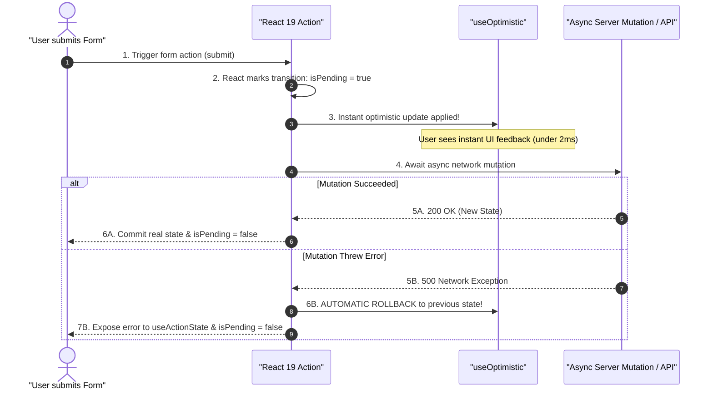
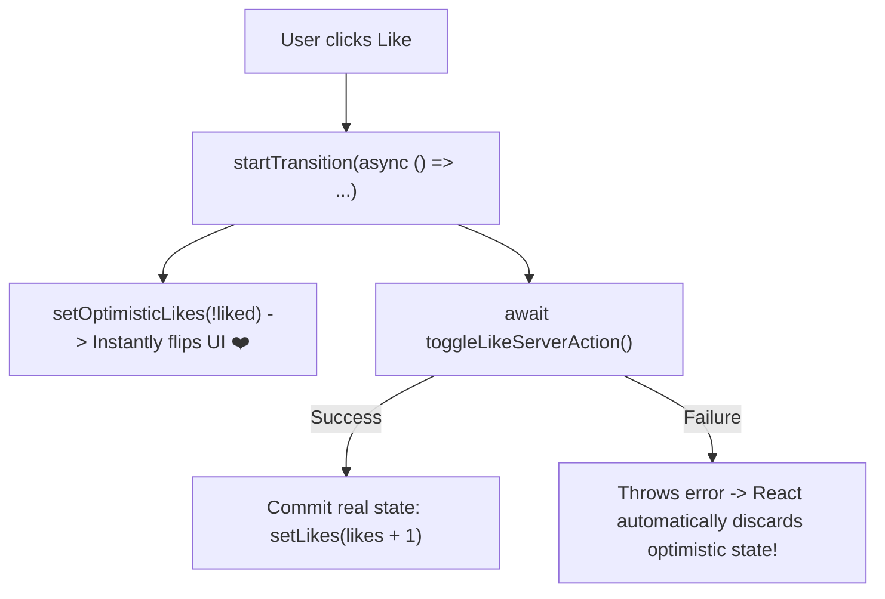
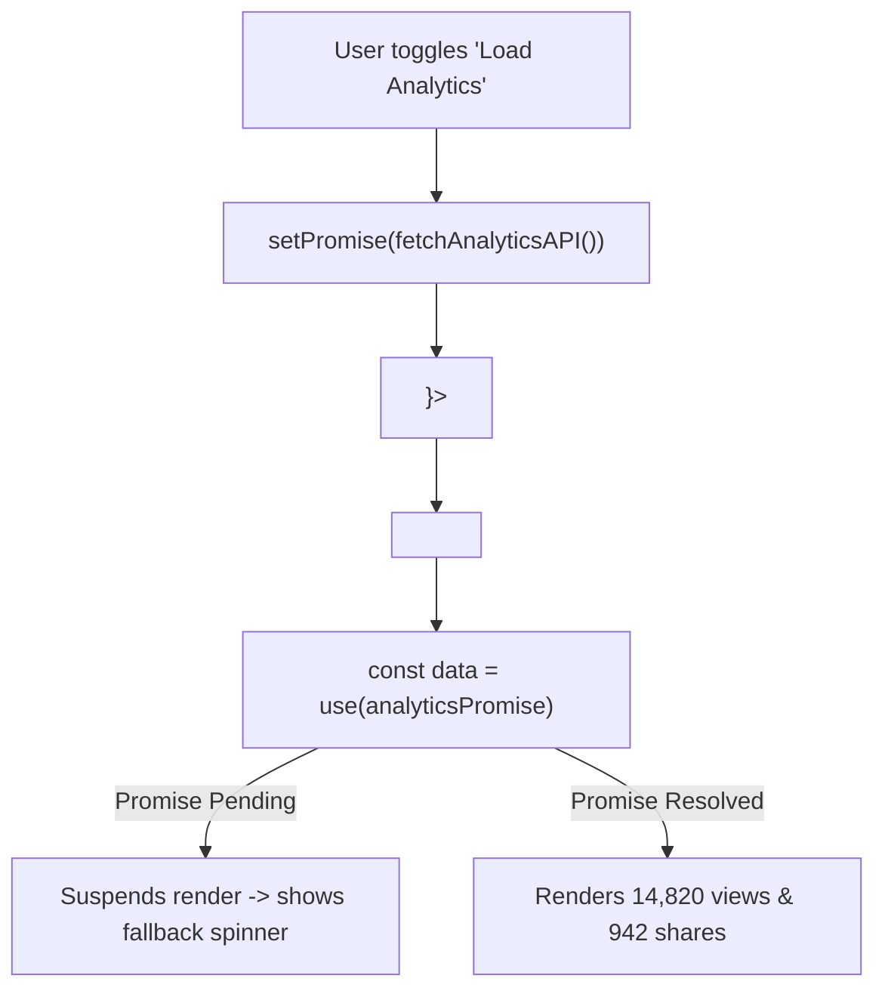
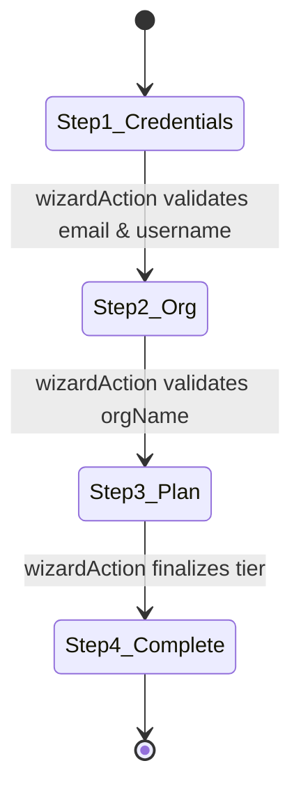
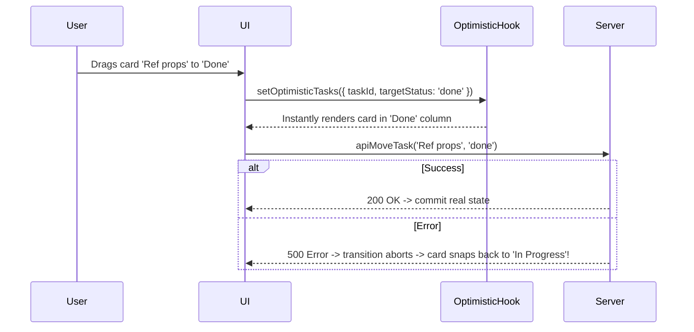

```mermaid
sequenceDiagram
    participant User
    participant Form
    participant ActionState
    participant ServerAction

    User->>Form: Submits form with email
    Form->>ActionState: Native <form action={formAction}>
    ActionState->>ActionState: Sets isPending = true
    ActionState->>ServerAction: subscribeNewsletterAction(prevState, formData)
    ServerAction-->>ActionState: Returns { success: true, message: "Subscribed!" }
    ActionState->>Form: Sets isPending = false, displays success banner
```

```mermaid
sequenceDiagram
    participant User
    participant Component
    participant InputDOM
    participant WindowListener

    User->>Component: Clicks "Open Search Bar"
    Component->>InputDOM: Mounts <input ref={handleInputRef} />
    InputDOM->>WindowListener: Adds 'keydown' (Escape) listener
    InputDOM->>InputDOM: Calls node.focus()
    User->>Component: Clicks "Close Input"
    Component->>InputDOM: Unmounts node
    InputDOM->>WindowListener: Ref Cleanup Function runs -> removes 'keydown' listener!
```

# React 19: The Complete Handbook & Architectural Guide

> **A Comprehensive, Production-Grade Deep Dive into Everything Introduced, Enhanced, and Deprecated in React 19**
>
> *(Actions, `useActionState`, `useFormStatus`, `useOptimistic`, `use()`, React Server Components, `ref` as a Prop, Ref Cleanups, `<Context>` as Provider, Asset Preloading, Document Metadata, React Compiler, and Breaking Changes)*

---

## Table of Contents

- [The React 19 Paradigm Shift](#the-react-19-paradigm-shift)
  - [1. Why React 19 is a Generational Leap](#1-why-react-19-is-a-generational-leap)
  - [2. React 18 vs React 19 Architectural Comparison Matrix](#2-react-18-vs-react-19-architectural-comparison-matrix)
  - [3. The Modern React Mental Model](#3-the-modern-react-mental-model)
  - [Quiz 00: The React 19 Evolution](#quiz-00-the-react-19-evolution)
- [Actions & Asynchronous Transitions](#actions-asynchronous-transitions)
  - [1. What are Actions in React 19?](#1-what-are-actions-in-react-19)
  - [2. Asynchronous Functions in `startTransition`](#2-asynchronous-functions-in-starttransition)
  - [3. Native Form Actions: `<form action={...}>`](#3-native-form-actions-form-action)
  - [4. Button and Input FormActions: `<button formAction={...}>`](#4-button-and-input-formactions-button-formaction)
  - [5. When to Use vs When Not to Use Actions](#5-when-to-use-vs-when-not-to-use-actions)
  - [Quiz 01: Actions & Form Integration](#quiz-01-actions--form-integration)
- [The `useActionState` Hook](#the-useactionstate-hook)
  - [1. Architecture & Purpose (Replacing `useFormState`)](#1-architecture--purpose-replacing-useformstate)
  - [2. Syntax, Parameters & Return Signature](#2-syntax-parameters--return-signature)
  - [3. Complete Production Example: User Registration Form with Validation](#3-complete-production-example-user-registration-form-with-validation)
  - [4. Comparison: `useActionState` vs `useState` + `useTransition`](#4-comparison-useactionstate-vs-usestate--usetransition)
  - [Quiz 02: `useActionState` Mechanics](#quiz-02-useactionstate-mechanics)
- [The `useFormStatus` Hook](#the-useformstatus-hook)
  - [1. Eliminating Prop Drilling for Form Pending States](#1-eliminating-prop-drilling-for-form-pending-states)
  - [2. Return Properties: `pending`, `data`, `method`, `action`](#2-return-properties-pending-data-method-action)
  - [3. The Golden Architectural Rule: Why It Must Be Inside a Child Component](#3-the-golden-architectural-rule-why-it-must-be-inside-a-child-component)
  - [4. Production Example: Dynamic Submit Button & Progress Indicator](#4-production-example-dynamic-submit-button--progress-indicator)
  - [Quiz 03: `useFormStatus` Rules & Gotchas](#quiz-03-useformstatus-rules--gotchas)
- [The `useOptimistic` Hook](#the-useoptimistic-hook)
  - [1. What is Optimistic UI?](#1-what-is-optimistic-ui)
  - [2. Mechanics of `useOptimistic`: Instant Updates with Automatic Rollback](#2-mechanics-of-useoptimistic-instant-updates-with-automatic-rollback)
  - [3. Production Example: Real-Time Chat Message Feed](#3-production-example-real-time-chat-message-feed)
  - [4. Pros, Cons & Edge Cases](#4-pros-cons--edge-cases)
  - [Quiz 04: Optimistic UI & Error Recovery](#quiz-04-optimistic-ui--error-recovery)
- [The `use()` Hook & Resource Resolution](#the-use-hook-resource-resolution)
  - [1. What is the `use()` API?](#1-what-is-the-use-api)
  - [2. Reading Promises in Render with Suspense](#2-reading-promises-in-render-with-suspense)
  - [3. Reading Context Conditionally & Inside Loops](#3-reading-context-conditionally--inside-loops)
  - [4. `use()` vs `useEffect` Data Fetching: Architectural Showdown](#4-use-vs-useeffect-data-fetching-architectural-showdown)
  - [Quiz 05: The `use()` API & Conditional Context](#quiz-05-the-use-api--conditional-context)
- [React Server Components (RSC) & Server Functions](#react-server-components-rsc-server-functions)
  - [1. Official Stabilization in React 19](#1-official-stabilization-in-react-19)
  - [2. The Directives: `'use client'` vs `'use server'`](#2-the-directives-use-client-vs-use-server)
  - [3. The Serialization Boundary: Passing Props & Actions](#3-the-serialization-boundary-passing-props--actions)
  - [4. Security Boundaries & Preventing Server Poisoning](#4-security-boundaries--preventing-server-poisoning)
  - [Quiz 06: Server Components & Directives](#quiz-06-server-components--directives)
- [Ref Modernization: `ref` as a Prop & Ref Cleanups](#ref-modernization-ref-as-a-prop-ref-cleanups)
  - [1. Deprecation of `forwardRef`: Passing `ref` as a Standard Prop](#1-deprecation-of-forwardref-passing-ref-as-a-standard-prop)
  - [2. Ref Cleanup Return Functions (The New Teardown Pattern)](#2-ref-cleanup-return-functions-the-new-teardown-pattern)
  - [3. Practical Example: Auto-resizing Textarea with Ref Cleanup](#3-practical-example-auto-resizing-textarea-with-ref-cleanup)
  - [Quiz 07: Ref Ergonomics & Lifecycles](#quiz-07-ref-ergonomics--lifecycles)
- [Context API Modernization: `<Context>` as Provider](#context-api-modernization-<context>-as-provider)
  - [1. Rendering `<MyContext value={...}>` Directly](#1-rendering-mycontext-value-directly)
  - [2. Deprecation of `<MyContext.Provider>`](#2-deprecation-of-mycontextprovider)
  - [3. Performance & Ergonomic Wins](#3-performance--ergonomic-wins)
  - [Quiz 08: Context Provider Simplification](#quiz-08-context-provider-simplification)
- [Native Document Metadata: Hoisting `<title>`, `<meta>`, and `<link>`](#native-document-metadata-hoisting-<title>-<meta>-and-<link>)
  - [1. Eliminating `react-helmet`: Native React 19 Metadata](#1-eliminating-react-helmet-native-react-19-metadata)
  - [2. How Metadata Hoisting Works Under the Hood](#2-how-metadata-hoisting-works-under-the-hood)
  - [3. Deep-Tree Metadata Definitions & Precedence Rules](#3-deep-tree-metadata-definitions--precedence-rules)
  - [Quiz 09: Document Head Management](#quiz-09-document-head-management)
- [Asset Preloading & Stylesheet Orchestration](#asset-preloading-stylesheet-orchestration)
  - [1. Resource Loading APIs from `react-dom`](#1-resource-loading-apis-from-react-dom)
  - [2. Stylesheets with Precedence (`precedence="default"`)](#2-stylesheets-with-precedence-precedencedefault)
  - [3. Async Script Deduplication](#3-async-script-deduplication)
  - [Quiz 10: Asset Preloading & Precedence](#quiz-10-asset-preloading--precedence)
- [Web Components & Custom Elements Support](#web-components-custom-elements-support)
  - [1. The Historical Pain of Web Components in React](#1-the-historical-pain-of-web-components-in-react)
  - [2. Native Properties vs Attributes in React 19](#2-native-properties-vs-attributes-in-react-19)
  - [3. Custom Event Listener Binding](#3-custom-event-listener-binding)
  - [Quiz 11: Web Components Interoperability](#quiz-11-web-components-interoperability)
- [Modern Error Reporting & Enhanced Hydration Diffs](#modern-error-reporting-enhanced-hydration-diffs)
  - [1. Root Error Callbacks: `onCaughtError`, `onUncaughtError`, `onRecoverableError`](#1-root-error-callbacks-oncaughterror-onuncaughterror-onrecoverableerror)
  - [2. Visual Hydration Mismatch Diffs](#2-visual-hydration-mismatch-diffs)
  - [Quiz 12: Error Handling Architecture](#quiz-12-error-handling-architecture)
- [The React Compiler: The End of Manual Memoization](#the-react-compiler-the-end-of-manual-memoization)
  - [1. What is the React Compiler (React Forget)?](#1-what-is-the-react-compiler-react-forget)
  - [2. How Auto-Memoization Works at the AST Level](#2-how-auto-memoization-works-at-the-ast-level)
  - [3. Are `useMemo`, `useCallback`, and `React.memo` Obsolete?](#3-are-usememo-usecallback-and-reactmemo-obsolete)
  - [Quiz 13: The Compiler Mental Model](#quiz-13-the-compiler-mental-model)
- [Deprecations, Removals & Migration Strategy](#deprecations-removals-migration-strategy)
  - [1. What Was Removed in React 19](#1-what-was-removed-in-react-19)
  - [2. Automated Codemods & Step-by-Step Upgrade Guide](#2-automated-codemods--step-by-step-upgrade-guide)
  - [Quiz 14: Breaking Changes & Migration](#quiz-14-breaking-changes--migration)
- [Top 20 Architectural Interview Questions on React 19](#top-20-architectural-interview-questions-on-react-19)
- [Hands-On Coding Challenges & Production Solutions](#hands-on-coding-challenges-production-solutions)
  - [Async Form Action with useActionState & Accessible Validation](#async-form-action-with-useactionstate--accessible-validation)
  - [Optimistic Social Feed with useOptimistic](#optimistic-social-feed-with-useoptimistic)
  - [Conditional Resource Resolution with use()](#conditional-resource-resolution-with-use)
  - [Custom Auto-Focus Controller with Ref Cleanup](#custom-auto-focus-controller-with-ref-cleanup)
  - [Full-Stack Multi-Step Registration Wizard with useActionState](#full-stack-multi-step-registration-wizard-with-useactionstate)
  - [Drag-and-Drop Kanban Board with useOptimistic & Server Rollback](#drag-and-drop-kanban-board-with-useoptimistic--server-rollback)

---

# The React 19 Paradigm Shift

## 1. Why React 19 is a Generational Leap

For years, React was criticized for three major pain points:
1. **Boilerplate Form Handling:** Handling an asynchronous form submission required dozens of lines of repetitive code: `onSubmit={e => { e.preventDefault(); ... }}`, `useState` for loading, `useState` for error, and manual optimistic state management.
2. **Mental Overhead of Memoization:** Developers spent hours debugging unnecessary re-renders, manually sprinkling `useMemo`, `useCallback`, and `React.memo` throughout their apps, often introducing subtle dependency-array stale closure bugs.
3. **Awkward Component APIs:** Awkward boilerplate like `forwardRef`, `<MyContext.Provider>`, third-party libraries for `<head>` tags (`react-helmet`), and cumbersome data-fetching lifecycles in `useEffect`.

**React 19 addresses all three head-on.** It redefines React from a pure client view library into an integrated, full-stack reactive framework with native form actions, optimistic state, compiler-driven auto-memoization, and seamless document metadata hoisting.

```text
+-------------------------------------------------------------------------------+
|                         THE REACT 19 ARCHITECTURAL SHIFT                      |
|                                                                               |
|   REACT 18 (Manual Boilerplate)               REACT 19 (Built-In Primitives)  |
|   -----------------------------               ------------------------------  |
|   - forwardRef((props, ref) => ...)    ───>   - ref is a regular prop!        |
|   - <MyContext.Provider value={...}>   ───>   - <MyContext value={...}>       |
|   - useMemo & useCallback everywhere   ───>   - React Compiler auto-memoizes! |
|   - Manual isPending, error state      ───>   - useActionState & useFormStatus|
|   - Complex optimistic rollback logic  ───>   - useOptimistic                 |
|   - useEffect for data fetching        ───>   - use(Promise) with Suspense    |
|   - Third-party react-helmet for SEO   ───>   - Native <title> & <meta> tags  |
|   - Sync-only transitions              ───>   - Async transitions in Actions  |
+-------------------------------------------------------------------------------+
```

## 2. React 18 vs React 19 Architectural Comparison Matrix

| Feature Dimension | React 18 | React 19 |
| :--- | :--- | :--- |
| **`startTransition`** | Synchronous callbacks only. Async functions threw warnings. | **Asynchronous callbacks fully supported** (Actions). Automatic pending states. |
| **Form Handling** | Manual `onSubmit`, `e.preventDefault()`, manual `fetch()`. | **Native `<form action={fn}>`** with progressive enhancement. |
| **Form Submission State** | Manual `const [loading, setLoading] = useState(false)`. | **`useActionState`** and **`useFormStatus`** hooks. |
| **Optimistic UI** | Custom state caches or complex Redux/TanStack recipes. | Native **`useOptimistic`** with automatic error rollbacks. |
| **Resource Reading** | Not possible in render; required `useEffect` or React Query. | **`use(Promise)`** and conditional **`use(Context)`**. |
| **Passing Refs** | Required `forwardRef((props, ref) => <Component />)`. | **`ref` is passed directly as a standard prop!** |
| **Ref Teardowns** | Only possible via `useEffect` cleanup. | **Callback refs can return a cleanup function directly!** |
| **Context Providers** | Required `<ThemeContext.Provider value="dark">`. | Directly render **`<ThemeContext value="dark">`**. |
| **Document Metadata** | Required external libraries like `react-helmet-async`. | Native **`<title>`**, **`<meta>`**, and **`<link>`** hoisted to `<head>`. |
| **Asset Preloading** | Manual `<link rel="preload">` tags in static HTML. | Native APIs: `preload`, `preinit`, `preloadModule`, `preinitModule`. |
| **Performance Memoization**| Manual `useMemo`, `useCallback`, `React.memo`. | **React Compiler** optimizes AST automatically at build time. |
| **Web Components** | Poor; attributes only, awkward custom event listeners. | **Full native support** for properties and custom events. |

## 3. The Modern React Mental Model

In React 19, the mental model shifts from **"imperatively coordinating asynchronous state"** to **"declaring intent via Actions and letting React coordinate the lifecycle"**.

When a user submits a form or clicks an interactive control:
1. You pass an `async` function directly to `action={submitAction}` or `startTransition(async () => { ... })`.
2. React automatically wraps the asynchronous promise in a **Transition**.
3. React automatically sets `isPending = true`.
4. Any `useOptimistic` updates render instantly on the screen.
5. If the async action succeeds: React commits the fresh server state and resets optimistic state.
6. If the async action throws: React catches the error, automatically rolls back optimistic state to the previous snapshot, and provides the error object to `useActionState`!



---

## Quiz: The React 19 Evolution

### Question 1
*In React 18, why did passing an `async` function to `startTransition` cause unexpected behavior, and how does React 19 fix this?*

<details>
<summary>Click to reveal answer & explanation</summary>

**Answer:**
In React 18, `startTransition` only accepted **synchronous** callbacks. When an `async` function was passed, the callback immediately returned a `Promise` on the first tick of the event loop. React considered the transition "complete" as soon as the synchronous function returned, causing `isPending` to flip back to `false` *before* the asynchronous network request even finished!

In **React 19**, `startTransition` was rebuilt to accept `async` functions natively. When an `async` callback is passed, React keeps `isPending` set to `true` across the entire lifetime of the `Promise`. If the Promise rejects, React automatically coordinates error recovery and rolls back optimistic updates.
</details>

---

# Actions & Asynchronous Transitions

## 1. What are Actions in React 19?

By convention, an **Action** in React 19 is any asynchronous transition function that handles user input and updates state.

### Actions provide three automated guarantees:
1. **Pending State:** Automatically manages loading indicators via `isPending` or `useFormStatus`.
2. **Optimistic Updates:** Seamlessly synchronizes with `useOptimistic` for instant feedback.
3. **Error Boundaries & Rollback:** Automatically handles rejected promises and rolls back UI state.

## 2. Asynchronous Functions in `startTransition`

Let's look at how easy handling an asynchronous action is with `useTransition`:

```tsx
// src/components/UpdateProfile.tsx
'use client';

import { useState, useTransition } from 'react';
import { updateUsernameOnServer } from '@/lib/api';

export default function UpdateProfile({ initialName }: { initialName: string }) {
  const [name, setName] = useState(initialName);
  const [error, setError] = useState<string | null>(null);
  
  // React 19: useTransition natively handles async functions!
  const [isPending, startTransition] = useTransition();

  const handleUpdate = () => {
    setError(null);

    // Pass async function directly into startTransition!
    startTransition(async () => {
      try {
        const updatedName = await updateUsernameOnServer(name);
        setName(updatedName);
      } catch (err: any) {
        setError(err.message || 'Failed to update username');
      }
    });
  };

  return (
    <div style={{ display: 'flex', flexDirection: 'column', gap: '12px', maxWidth: '360px' }}>
      <input
        type="text"
        value={name}
        disabled={isPending}
        onChange={(e) => setName(e.target.value)}
        style={{ padding: '8px 12px', border: '1px solid #ccc', borderRadius: '4px' }}
      />

      <button
        onClick={handleUpdate}
        disabled={isPending}
        style={{ padding: '8px 16px', background: isPending ? '#94a3b8' : '#2563eb', color: '#fff', border: 'none', borderRadius: '4px', cursor: isPending ? 'wait' : 'pointer' }}
      >
        {isPending ? (
          <>
            <span>Saving...</span>
          </>
        ) : (
          <span>Save Changes</span>
        )}
      </button>

      {error && <p style={{ color: '#dc2626', margin: 0, fontSize: '14px' }}>{error}</p>}
    </div>
  );
}
```

## 3. Native Form Actions: `<form action={...}>`

In HTML, `<form action="/submit" method="POST">` natively submits form data to a URL.
In React 19, the `action` prop is elevated into a first-class React property that accepts a JavaScript **Action function**:

```tsx
// src/components/SimpleForm.tsx
export default function SimpleForm() {
  // Action function automatically receives raw FormData!
  async function handleSubmit(formData: FormData) {
    'use server'; // Or client-side action function!
    const query = formData.get('searchQuery');
    await performSearch(query);
  }

  return (
    // React automatically handles e.preventDefault(), serializes inputs into FormData,
    // and wraps the invocation in an async transition!
    <form action={handleSubmit}>
      <input name="searchQuery" placeholder="Search products..." />
      <button type="submit">Search</button>
    </form>
  );
}
```

> [!NOTE]
> When you pass a function to `<form action={fn}>`, React automatically calls `e.preventDefault()` behind the scenes, resets controlled form states where appropriate, and invokes `fn(formData)`.

## 4. Button and Input FormActions: `<button formAction={...}>`

A single form often has multiple possible submission outcomes (e.g., "Save Draft" vs "Publish Now" vs "Delete Record").
React 19 supports the native HTML `formAction` attribute on `<button>` and `<input type="submit">`:

```tsx
// src/components/ArticleEditor.tsx
export default function ArticleEditor() {
  async function saveDraftAction(formData: FormData) {
    const title = formData.get('title');
    await saveDraftToDatabase({ title, published: false });
  }

  async function publishAction(formData: FormData) {
    const title = formData.get('title');
    await publishToDatabase({ title, published: true });
  }

  return (
    <form style={{ display: 'flex', flexDirection: 'column', gap: '12px', maxWidth: '450px' }}>
      <input name="title" placeholder="Article Title" style={{ padding: '8px', border: '1px solid #ccc', borderRadius: '4px' }} />
      <textarea name="content" placeholder="Write your post..." style={{ padding: '8px', border: '1px solid #ccc', borderRadius: '4px' }} />

      <div style={{ display: 'flex', gap: '12px' }}>
        {/* Button 1: Triggers saveDraftAction */}
        <button type="submit" formAction={saveDraftAction} style={{ padding: '8px 16px' }}>
          Save Draft
        </button>

        {/* Button 2: Triggers publishAction */}
        <button type="submit" formAction={publishAction} style={{ padding: '8px 16px', background: '#16a34a', color: '#fff', border: 'none', borderRadius: '4px' }}>
          Publish Immediately
        </button>
      </div>
    </form>
  );
}
```

## 5. When to Use vs When Not to Use Actions

> [!TIP]
> **When to Use Actions:**
> - Form submissions (logins, registrations, settings, checkouts).
> - Interactive UI state mutations triggered by user events (liking a post, toggling a setting, deleting a row).
> - Asynchronous workflows that need automatic pending indicators and rollback protection.

> [!WARNING]
> **When NOT to Use Actions:**
> - Passive read-only data fetching on component mount (use `use(Promise)` with Suspense or a data loader instead).
> - High-frequency continuous user inputs like keyboard typing or slider drags (use controlled state with debouncing).

## 6. Under the Hood: How React 19 Tracks Async Actions & Transitions

In React 18, `startTransition` only handled synchronous code because JavaScript execution is single-threaded; once an asynchronous function yields at an `await` statement, the original call stack unwinds into the microtask queue.

React 19 solved this by integrating with **Async Transition Tracking**:
1. When `startTransition(async () => { ... })` begins, React creates an internal `BatchConfig.transition` object.
2. In Node.js / Server environments, React uses `AsyncLocalStorage` to track the active transition across asynchronous execution boundaries.
3. In browser environments, React wraps the returned Promise in an internal transition listener:
   ```javascript
   // Simplified conceptual representation of React 19 async transition tracking
   function startTransition(scope) {
     const prevTransition = ReactCurrentBatchConfig.transition;
     const transition = { _callbacks: new Set() };
     ReactCurrentBatchConfig.transition = transition;

     try {
       const returnValue = scope();
       if (returnValue !== null && typeof returnValue === 'object' && typeof returnValue.then === 'function') {
         // Async Action returned a Promise!
         setPending(true);
         returnValue.then(
           () => {
             // Commit transition state once network settles
             setPending(false);
           },
           (error) => {
             // Catch error, trigger rollback, and notify error boundaries
             setPending(false);
             reportError(error);
           }
         );
       }
     } finally {
       ReactCurrentBatchConfig.transition = prevTransition;
     }
   }
   ```
4. While the promise is in-flight, any state updates dispatched inside the async action are tagged with `TransitionLane`, preventing them from blocking urgent UI events (like clicks and keypresses).

## 7. Architectural Comparison: React 19 Actions vs TanStack Query (React Query) Mutations

A frequent question in modern React is: *"Do React 19 Actions replace TanStack Query `useMutation`?"*

```text
+-----------------------------------------------------------------------------------------+
|                  REACT 19 ACTIONS vs TANSTACK QUERY MUTATIONS                           |
+-------------------------------+--------------------------------+------------------------+
| Dimension                     | React 19 Actions               | TanStack Query Mutation|
+-------------------------------+--------------------------------+------------------------+
| Core Primitive                | Language-level React feature   | Third-party library    |
| Bundle Size                   | 0 KB (Built into React 19)     | ~13 KB gzipped         |
| HTML Form Integration         | Native (<form action={...}>)   | Requires onSubmit wired|
| Progressive Enhancement (No JS)| Supported natively             | Impossible (needs JS)  |
| Optimistic UI                 | Native useOptimistic hook      | onMutate manual cache  |
| Automatic Pending Indicator   | Native useFormStatus hook      | isPending / isLoading  |
| Automatic Retries             | Not built-in (manual loop)     | Built-in (retry: 3)    |
| Global Cache Invalidation     | Framework-dependent (revalidate| queryClient.invalidate |
| Offline Mutation Queues       | Requires custom service worker | Built-in offline queue |
+-------------------------------+--------------------------------+------------------------+
```

### Recommendation:
- **Use React 19 Actions:** For forms, UI mutations, page interactions, and applications using full-stack frameworks (like Next.js Server Actions or Remix).
- **Use TanStack Query:** When you need client-side retry logic, offline mutation queuing, polling, or synchronization with complex external REST/GraphQL backends without a server component layer.

---

## Quiz: Actions & Form Integration

### Question 1
*What happens if a user submits a `<form action={myAction}>` in React 19, and the async `myAction` throws an uncaught JavaScript error?*

<details>
<summary>Click to reveal answer & explanation</summary>

**Answer:**
Because React 19 executes the form action inside an internal **Transition**, an unhandled error inside the action does not silently crash the page.

Instead:
1. React catches the thrown error.
2. If any optimistic updates were applied via `useOptimistic`, React **automatically rolls them back** to the pre-submission state.
3. The error is routed to the nearest **React Error Boundary** (`<ErrorBoundary>` or Next.js `error.tsx`).
4. If the form is wired to `useActionState`, the error object is returned directly in the state tuple without triggering an error boundary!
</details>

---

# The `useActionState` Hook

## 1. Architecture & Purpose (Replacing `useFormState`)

In React Canary and early Next.js 14, developers used an experimental hook called `useFormState`.
In **React 19**, this hook was finalized and renamed to **`useActionState`** to reflect that it works with **any Action**, not just forms!

`useActionState` eliminates the awkward dance of:
- Creating separate `useState` for validation errors.
- Creating separate `useState` for return values.
- Creating separate `useTransition` for loading state.

It unifies action execution, return value state, and pending status into a single declarative tuple!

## 2. Syntax, Parameters & Return Signature

```typescript
const [state, formAction, isPending] = useActionState(
  actionFn,
  initialState,
  permalink?
);
```

### Parameters:
1. **`actionFn`**: The function invoked when the action triggers. It receives two arguments:
   `async function actionFn(previousState, formDataOrPayload)`
2. **`initialState`**: The initial value of `state` before the action is ever invoked.
3. **`permalink`** *(Optional)*: A URL string used for progressive enhancement in Server Component frameworks.

### Return Values:
1. **`state`**: The current state returned by the latest execution of `actionFn` (or `initialState`).
2. **`formAction`**: The wrapped function you pass to `<form action={formAction}>` or invoke imperatively.
3. **`isPending`**: A boolean indicating whether the asynchronous transition is currently executing.

## 3. Complete Production Example: User Registration Form with Validation

Let's build a real-world registration form with server validation:

```tsx
// src/components/RegisterForm.tsx
'use client';

import { useActionState } from 'react';

// 1. Define Form State Type
interface RegisterState {
  errors?: {
    email?: string[];
    password?: string[];
  };
  message?: string | null;
  success?: boolean;
}

// 2. Define Action Function
async function registerUserAction(
  prevState: RegisterState,
  formData: FormData
): Promise<RegisterState> {
  const email = formData.get('email') as string;
  const password = formData.get('password') as string;

  // Simulate network validation delay
  await new Promise((res) => setTimeout(res, 800));

  const errors: RegisterState['errors'] = {};

  if (!email || !email.includes('@')) {
    errors.email = ['Please provide a valid corporate email address.'];
  }
  if (!password || password.length < 8) {
    errors.password = ['Password must contain at least 8 characters.'];
  }

  if (Object.keys(errors).length > 0) {
    return { errors, message: 'Validation failed. Please correct errors below.', success: false };
  }

  // Success path
  return { errors: {}, message: 'Registration successful! Welcome aboard.', success: true };
}

// 3. Form Component
export default function RegisterForm() {
  const initialState: RegisterState = { message: null, errors: {}, success: false };
  
  // React 19 useActionState hook!
  const [state, formAction, isPending] = useActionState(registerUserAction, initialState);

  return (
    <form action={formAction} style={{ maxWidth: "400px", padding: "16px", border: "1px solid #ccc", borderRadius: "8px" }}>
      <h2 style={{ margin: '0 0 16px 0' }}>Create Account</h2>

      {/* Global Status Message */}
      {state.message && (
        <div
          style={{ padding: '10px', borderRadius: '6px', marginBottom: '12px', background: state.success ? '#dcfce7' : '#fee2e2', color: state.success ? '#15803d' : '#b91c1c' }}}
          role="status"
          aria-live="polite"
        >
          {state.message}
        </div>
      )}

      {/* Email Input */}
      <div>
        <label htmlFor="email" style={{ display: 'block', marginBottom: '4px', fontWeight: 500 }}>
          Email Address
        </label>
        <input
          id="email"
          name="email"
          type="email"
          disabled={isPending}
          style={{ width: "100%", padding: "8px", border: "1px solid #ccc", borderRadius: "4px", boxSizing: "border-box" }}
        />
        {state.errors?.email && (
          <p style={{ color: '#dc2626', fontSize: '12px', margin: '4px 0 0 0' }}>{state.errors.email[0]}</p>
        )}
      </div>

      {/* Password Input */}
      <div>
        <label htmlFor="password" style={{ display: 'block', marginBottom: '4px', fontWeight: 500 }}>
          Password
        </label>
        <input
          id="password"
          name="password"
          type="password"
          disabled={isPending}
          style={{ width: "100%", padding: "8px", border: "1px solid #ccc", borderRadius: "4px", boxSizing: "border-box" }}
        />
        {state.errors?.password && (
          <p style={{ color: '#dc2626', fontSize: '12px', margin: '4px 0 0 0' }}>{state.errors.password[0]}</p>
        )}
      </div>

      {/* Submit Button */}
      <button
        type="submit"
        disabled={isPending}
        style={{ width: "100%", padding: "8px 16px", background: "#2563eb", color: "#fff", border: "none", borderRadius: "4px" }}
      >
        {isPending ? (
          <>
            
            <span>Validating...</span>
          </>
        ) : (
          <span>Register Now</span>
        )}
      </button>
    </form>
  );
}
```

## 4. Comparison: `useActionState` vs `useState` + `useTransition`

```text
+-------------------------------------------------------------------------------+
|                       STATE MANAGEMENT PATTERNS COMPARISON                    |
+------------------------------------+------------------------------------------+
| Pattern A: Legacy React 18         | Pattern B: Modern React 19 (useActionState)|
+------------------------------------+------------------------------------------+
| const [data, setData] = useState() | const [data, formAction, isPending] =    |
| const [err, setErr] = useState()   |     useActionState(actionFn, initial);   |
| const [pending, startTransition] = |                                          |
|     useTransition();               | Everything unified into ONE hook call!   |
|                                    | Action receives (prevState, formData).   |
| Requires 3 separate hooks and      | Native automatic transition wrapping.    |
| manual try/catch synchronization!  | Native progressive enhancement support.  |
+------------------------------------+------------------------------------------+
```

## 5. The `useActionState` Lifecycle State Machine

```text
================================================================================
                    useActionState INTERNAL STATE MACHINE
================================================================================

  [ STATE 1: INITIAL IDLE ]
  - state = initialState
  - isPending = false
  - formAction is ready for invocation
                  │
                  ▼ User clicks Submit (<form action={formAction}>)
  [ STATE 2: TRANSITION PENDING ]
  - state = initialState (preserved)
  - isPending = true (Triggers loading spinners, disables buttons)
  - React executes actionFn(prevState, formData)
                  │
        ┌─────────┴─────────┐
        ▼ (Promise Resolves) ▼ (Promise Rejects)
  [ STATE 3A: SETTLED SUCCESS ]          [ STATE 3B: ERROR RECOVERY ]
  - state = actionFn return value        - state = previous state or error object
  - isPending = false                    - isPending = false
  - UI re-renders with fresh data!       - UI displays validation errors!
================================================================================
```

## 6. Multi-Step Form Wizard with `useActionState`

Because `useActionState` provides `prevState`, building multi-step wizards becomes effortless:

```tsx
// src/components/WizardForm.tsx
'use client';

import { useActionState } from 'react';

interface WizardState {
  step: number;
  data: {
    fullName?: string;
    accountPlan?: string;
  };
}

async function wizardAction(prevState: WizardState, formData: FormData): Promise<WizardState> {
  if (prevState.step === 1) {
    const fullName = formData.get('fullName') as string;
    return {
      step: 2,
      data: { ...prevState.data, fullName },
    };
  }

  if (prevState.step === 2) {
    const accountPlan = formData.get('accountPlan') as string;
    // Simulate final server save
    await new Promise((r) => setTimeout(r, 600));
    return {
      step: 3,
      data: { ...prevState.data, accountPlan },
    };
  }

  return prevState;
}

export default function WizardForm() {
  const [state, formAction, isPending] = useActionState(wizardAction, { step: 1, data: {} });

  return (
    <form action={formAction} style={{ maxWidth: "400px", padding: "16px", border: "1px solid #ccc", borderRadius: "8px" }}>
      <div style={{ display: "flex", justifyContent: "space-between", fontSize: "12px", color: "#666" }}>
        <span>Step {state.step} of 3</span>
        <span>{state.step === 1 ? 'Personal Info' : state.step === 2 ? 'Select Plan' : 'Confirmation'}</span>
      </div>

      {state.step === 1 && (
        <div style={{ display: "flex", flexDirection: "column", gap: "8px" }}>
          <label style={{ fontSize: "14px", fontWeight: 500 }}>Full Name</label>
          <input name="fullName" required defaultValue={state.data.fullName || ''} style={{ width: "100%", padding: "8px", border: "1px solid #ccc", borderRadius: "4px", boxSizing: "border-box" }} />
          <button type="submit" disabled={isPending} style={{ width: "100%", padding: "8px 16px", background: "#2563eb", color: "#fff", border: "none", borderRadius: "4px" }}>Next Step</button>
        </div>
      )}

      {state.step === 2 && (
        <div style={{ display: "flex", flexDirection: "column", gap: "8px" }}>
          <label style={{ fontSize: "14px", fontWeight: 500 }}>Choose Plan</label>
          <select name="accountPlan" defaultValue={state.data.accountPlan || 'pro'} style={{ width: "100%", padding: "8px", border: "1px solid #ccc", borderRadius: "4px", boxSizing: "border-box" }}>
            <option value="starter">Starter Plan ($9/mo)</option>
            <option value="pro">Pro Enterprise ($49/mo)</option>
          </select>
          <button type="submit" disabled={isPending} style={{ width: "100%", padding: "8px 16px", background: "#2563eb", color: "#fff", border: "none", borderRadius: "4px" }}>Complete Checkout</button>
        </div>
      )}

      {state.step === 3 && (
        <div style={{ padding: "16px", background: "#dcfce7", border: "1px solid #86efac", borderRadius: "6px", textAlign: "center" }}>
          <p style={{ fontWeight: "bold", color: "#15803d" }}>Welcome, {state.data.fullName}!</p>
          <p style={{ fontSize: "12px", color: "#666" }}>Your {state.data.accountPlan} subscription is active.</p>
        </div>
      )}
    </form>
  );
}
```

---

## Quiz: `useActionState` Mechanics

### Question 1
*Notice that the first parameter of the action passed to `useActionState` is `prevState`, NOT `formData`. Why is `prevState` passed as the first argument?*

<details>
<summary>Click to reveal answer & explanation</summary>

**Answer:**
`useActionState` functions identically to a **Reducer** (`(state, action) => newState`).

By passing `prevState` as the first argument:
1. The action has access to the previous result (such as previous validation attempts, accumulated wizard steps, or previous retry counters).
2. It enforces a pure mathematical reducer signature: `(previousState, payload) => nextState`.
3. When used with HTML forms, React automatically supplies `formData` as the second argument: `action(prevState, formData)`.
</details>

---

# The `useFormStatus` Hook

## 1. Eliminating Prop Drilling for Form Pending States

In complex forms, the submit button or loading spinner is often nested deep inside child components:
```text
<Form>
  <FormSection>
    <Card>
      <SubmitButton />  <── Needs to know if <Form> is submitting!
    </Card>
  </FormSection>
</Form>
```

In React 18, you had to pass `isPending` down through every layer:
`<FormSection isPending={isPending}><Card isPending={isPending}>...`

In **React 19**, `useFormStatus` acts like an automatic Context hook that reads the status of the **parent `<form>`** directly from the DOM tree, with **zero prop drilling**!

## 2. Return Properties: `pending`, `data`, `method`, `action`

When you call `const status = useFormStatus();`, it returns an object with four properties:

```typescript
interface FormStatus {
  pending: boolean;       // Is the parent <form> actively submitting?
  data: FormData | null;  // The raw FormData being submitted (or null if idle)
  method: string | null;  // HTTP method ('get' | 'post' | null)
  action: ((formData: FormData) => void | Promise<void>) | string | null; // Reference to the action prop
}
```

## 3. The Golden Architectural Rule: Why It Must Be Inside a Child Component

> [!CAUTION]
> **THE #1 MISTAKE WITH `useFormStatus`:**
> `useFormStatus` **WILL NOT WORK** if called inside the same component that renders the `<form>` tag!

```tsx
// ❌ WRONG: useFormStatus called in SAME component as <form>
export default function BrokenForm() {
  const { pending } = useFormStatus(); // Always returns pending === false!

  return (
    <form action={myAction}>
      <button disabled={pending}>Submit</button>
    </form>
  );
}

// ✅ CORRECT: Extract button into a CHILD component
function SubmitButton() {
  const { pending } = useFormStatus(); // Reads parent <form> correctly!
  return <button disabled={pending}>{pending ? 'Saving...' : 'Submit'}</button>;
}

export default function WorkingForm() {
  return (
    <form action={myAction}>
      <SubmitButton />
    </form>
  );
}
```

### Why?
`useFormStatus` is powered by an internal React Context provider that is created **by the `<form>` DOM element itself**. A component cannot read context provided by its own JSX return value; it can only read context provided by an ancestor higher in the component tree.

## 4. Production Example: Dynamic Submit Button & Progress Indicator

```tsx
// src/components/DynamicSubmitButton.tsx
'use client';

import { useFormStatus } from 'react-dom';

export function DynamicSubmitButton({ label = 'Submit' }: { label?: string }) {
  const { pending, data } = useFormStatus();

  // We can even inspect what is being submitted in real time!
  const targetEmail = data?.get('email') as string;

  return (
    <div style={{ display: "flex", flexDirection: "column", gap: "8px" }}>
      <button
        type="submit"
        disabled={pending}
        style={{ width: "100%", padding: "8px 16px", background: "#2563eb", color: "#fff", border: "none", borderRadius: "4px" }}
      >
        {pending ? (
          <>
              <span>Sending to {targetEmail || 'server'}...</span>
          </>
        ) : (
          <span>{label}</span>
        )}
      </button>
      
      {pending && (
        <p style={{ fontSize: "12px", color: "#666", textAlign: "center" }}>
          Processing request across server network...
        </p>
      )}
    </div>
  );
}
```

---

## Quiz: `useFormStatus` Rules & Gotchas

### Question 1
*You need to build a cancel button inside a form: `<button type="button" onClick={cancel}>Cancel</button>`. Should the Cancel button be disabled while the form is submitting? How can you read `pending` without passing props?*

<details>
<summary>Click to reveal answer & explanation</summary>

**Answer:**
Yes, to prevent race conditions (e.g. canceling while an action is already committing on the server), the Cancel button should be disabled while submitting.

You can create a `<CancelButton />` component that calls `const { pending } = useFormStatus();` and sets `disabled={pending}`. Because `useFormStatus` works for any component rendered inside `<form>`, not just submit buttons, any sibling component inside the form can subscribe to the form's pending state without prop drilling.
</details>

---

# The `useOptimistic` Hook

## 1. What is Optimistic UI?

On mobile connections, a server mutation can take 500ms to 2000ms. If a user clicks "Like" on a post and waits 2 seconds to see the heart turn pink, the app feels sluggish and unresponsive.

**Optimistic UI** is a UX pattern where the interface updates **instantly** (0ms) under the assumption that the server request will succeed. If the server request fails, React seamlessly rolls the UI back to the previous state and informs the user.

## 2. Mechanics of `useOptimistic`: Instant Updates with Automatic Rollback

In React 19, `useOptimistic` provides native, declarative optimistic state management:

```typescript
const [optimisticState, setOptimisticState] = useOptimistic(
  currentState,
  // Update function: calculates optimistic state
  (currentState, optimisticValue) => {
    return mergeOptimistically(currentState, optimisticValue);
  }
);
```

### The Invariant Guarantee:
- While an async transition is pending, `optimisticState` reflects your optimistic value.
- As soon as the async action finishes, React drops the optimistic value and renders the real server `currentState`.
- If the action **throws an error**, React catches the error and **instantly reverts** `optimisticState` to `currentState`.

## 3. Production Example: Real-Time Chat Message Feed

```tsx
// src/components/ChatFeed.tsx
'use client';

import { useOptimistic, useRef, useTransition } from 'react';
import { sendMessageAction } from '@/lib/actions';

interface Message {
  id: string;
  text: string;
  sending?: boolean; // Flag to indicate optimistic pending status!
}

export default function ChatFeed({ initialMessages }: { initialMessages: Message[] }) {
  const formRef = useRef<HTMLFormElement>(null);
  const [isPending, startTransition] = useTransition();

  // useOptimistic hook:
  const [optimisticMessages, setOptimisticMessages] = useOptimistic(
    initialMessages,
    (state, newText: string) => [
      ...state,
      {
        id: 'temp-' + Date.now(),
        text: newText,
        sending: true, // Mark optimistic message with subtle opacity
      },
    ]
  );

  const handleSubmit = (formData: FormData) => {
    const text = formData.get('message') as string;
    if (!text.trim()) return;

    // Reset form input immediately
    formRef.current?.reset();

    // Trigger Action inside transition:
    startTransition(async () => {
      // 1. Immediately apply optimistic message to UI (0ms latency!)
      setOptimisticMessages(text);

      // 2. Perform real network request to server
      await sendMessageAction(text);
    });
  };

  return (
    <div style={{ maxWidth: "420px", margin: "0 auto", padding: "16px", border: "1px solid #ccc", borderRadius: "8px", display: "flex", flexDirection: "column", height: "480px" }}>
      <h2 style={{ margin: "0 0 12px 0", paddingBottom: "8px", borderBottom: "1px solid #eee" }}>
        Team Chat
      </h2>

      {/* Message List */}
      <div style={{ flex: 1, overflowY: "auto", display: "flex", flexDirection: "column", gap: "10px" }}>
        {optimisticMessages.map((msg) => (
          <div
            key={msg.id}
            className={`p-3 rounded-xl max-w-[80%] ml-auto text-sm ${
              msg.sending
                ? 'bg-blue-600/60 text-blue-100 border border-blue-400/40 animate-pulse'
                : 'bg-blue-600 text-white'
            }`}
          >
            <p>{msg.text}</p>
            {msg.sending && (
              <span style={{ display: "block", fontSize: "10px", marginTop: "4px", color: "#bfdbfe" }}>Sending...</span>
            )}
          </div>
        ))}
      </div>

      {/* Input Form */}
      <form ref={formRef} action={handleSubmit} style={{ display: "flex", gap: "8px", paddingTop: "12px", borderTop: "1px solid #eee" }}>
        <input
          name="message"
          type="text"
          placeholder="Type a message..."
          style={{ flex: 1, padding: "8px", border: "1px solid #ccc", borderRadius: "4px" }}
        />
        <button
          type="submit"
          style={{ padding: "8px 16px", background: "#2563eb", color: "#fff", border: "none", borderRadius: "6px", cursor: "pointer" }}
        >
          Send
        </button>
      </form>
    </div>
  );
}
```

## 4. Pros, Cons & Edge Cases

| Pros | Cons / Watch-outs |
| :--- | :--- |
| **Instant Perceived Speed:** Zero wait time for user interactions. | **Temporary Stale IDs:** Optimistic items lack real database IDs until server responds. |
| **Automatic Rollback:** Zero manual cleanup if network fails. | **Must Run in Transitions:** `setOptimistic` must be called inside `startTransition` or an Action. |
| **Composable:** Pairs natively with React Server Actions. | **Complexity on Conflicts:** Complex collaborative editing requires conflict resolution logic. |

## 5. Advanced Pattern: Optimistic Task Status Board with Sequential Queue Merging

What happens when a user clicks rapidly, triggering multiple optimistic actions before the first server response returns?
React 19 maintains an internal linked queue of pending optimistic updates. Each update function runs sequentially over the cumulative optimistic state:

```tsx
// src/components/KanbanBoard.tsx
'use client';

import { useOptimistic, useTransition, useState } from 'react';

interface Task {
  id: string;
  title: string;
  status: 'TODO' | 'DOING' | 'DONE';
}

export default function KanbanBoard({ initialTasks }: { initialTasks: Task[] }) {
  const [tasks, setTasks] = useState(initialTasks);
  const [isPending, startTransition] = useTransition();

  // useOptimistic handles multiple rapid moves smoothly
  const [optimisticTasks, setOptimisticTaskStatus] = useOptimistic(
    tasks,
    (currentTasks, update: { taskId: string; newStatus: Task['status'] }) =>
      currentTasks.map((t) =>
        t.id === update.taskId ? { ...t, status: update.newStatus } : t
      )
  );

  const moveTask = (taskId: string, newStatus: Task['status']) => {
    startTransition(async () => {
      // 1. Immediately apply optimistic position in UI
      setOptimisticTaskStatus({ taskId, newStatus });

      // 2. Perform backend persistence
      try {
        await updateTaskOnServer(taskId, newStatus);
        // Commit to real state on success
        setTasks((prev) =>
          prev.map((t) => (t.id === taskId ? { ...t, status: newStatus } : t))
        );
      } catch (error) {
        console.error('Failed to move task. Reverting automatically.');
      }
    });
  };

  return (
    <div style={{ display: "grid", gridTemplateColumns: "repeat(3, 1fr)", gap: "16px", padding: "16px" }}>
      {(['TODO', 'DOING', 'DONE'] as const).map((column) => (
        <div key={column} style={{ background: "#f8fafc", border: "1px solid #e2e8f0", padding: "12px", borderRadius: "8px", display: "flex", flexDirection: "column", gap: "10px" }}>
          <h3 style={{ fontSize: "12px", fontWeight: "bold", margin: 0, color: "#475569" }}>{column}</h3>
          <div style={{ display: "flex", flexDirection: "column", gap: "8px" }}>
            {optimisticTasks
              .filter((t) => t.status === column)
              .map((t) => (
                <div key={t.id} style={{ padding: "10px", background: "#fff", border: "1px solid #cbd5e1", borderRadius: "6px", display: "flex", justifyContent: "space-between", alignItems: "center", fontSize: "14px" }}>
                  <span>{t.title}</span>
                  {column !== 'DONE' && (
                    <button
                      onClick={() => moveTask(t.id, column === 'TODO' ? 'DOING' : 'DONE')}
                      style={{ padding: "2px 8px", fontSize: "12px", background: "#2563eb", color: "#fff", border: "none", borderRadius: "4px", cursor: "pointer" }}
                    >
                      Advance →
                    </button>
                  )}
                </div>
              ))}
          </div>
        </div>
      ))}
    </div>
  );
}
```

---

## Quiz: Optimistic UI & Error Recovery

### Question 1
*What happens if you call `setOptimisticState()` outside of a Transition or Form Action?*

<details>
<summary>Click to reveal answer & explanation</summary>

**Answer:**
React will throw an error or warning in development:
`An optimistic state update occurred outside a transition or action.`

`useOptimistic` relies on React's Concurrent Transition lifecycle. Because optimistic states are designed to exist exclusively *during* an in-flight asynchronous transition, React must know which transition lifecycle controls the optimistic value. Without an active transition, React cannot know when to discard the optimistic value or how to coordinate rollback on error.
</details>

---

# The `use()` Hook & Resource Resolution

## 1. What is the `use()` API?

`use()` is a revolutionary new React API that can read the value of a resource (a **Promise** or a **Context**) directly inside the render phase.

Unlike all other React hooks (`useState`, `useEffect`, `useMemo`):
> [!IMPORTANT]
> **`use()` CAN be called conditionally inside `if` statements and loops!**

```tsx
function Profile({ userPromise, shouldLoadDetails }) {
  if (shouldLoadDetails) {
    // Perfectly valid in React 19!
    const details = use(userPromise);
    return <UserDetails details={details} />;
  }
  return <div>Click to expand details</div>;
}
```

## 2. Reading Promises in Render with Suspense

When you pass a Promise to `use(promise)`:
1. **If the Promise is pending:** React **suspends** the component! The nearest `<Suspense fallback={<Skeleton />}>` boundary catches it and displays the fallback.
2. **If the Promise resolves:** React continues rendering and `use()` returns the resolved data value.
3. **If the Promise rejects:** React unwinds and renders the nearest `<ErrorBoundary>`.

```tsx
// src/components/Comments.tsx
'use client';

import { use, Suspense } from 'react';

// Reader Component
function CommentsList({ commentsPromise }: { commentsPromise: Promise<string[]> }) {
  // Directly unwraps the Promise! Suspends automatically while loading!
  const comments = use(commentsPromise);

  return (
    <ul style={{ listStyle: "none", padding: 0, margin: 0, display: "flex", flexDirection: "column", gap: "8px" }}>
      {comments.map((comment, i) => (
        <li key={i} style={{ padding: "8px 12px", background: "#f1f5f9", borderRadius: "4px", fontSize: "14px" }}>
          {comment}
        </li>
      ))}
    </ul>
  );
}

// Parent Container
export default function CommentsSection({ commentsPromise }: { commentsPromise: Promise<string[]> }) {
  return (
    <div style={{ display: "flex", flexDirection: "column", gap: "10px" }}>
      <h3 style={{ margin: "0 0 8px 0" }}>User Discussion</h3>
      <Suspense fallback={<div style={{ color: "#888" }}>Loading comments stream...</div>}>
        <CommentsList commentsPromise={commentsPromise} />
      </Suspense>
    </div>
  );
}
```

> [!WARNING]
> Do NOT create a new Promise inside the render function and pass it to `use()`!
> ```tsx
> // ❌ WRONG: Creates a new Promise on every single render loop! Infinite loop!
> function BadComponent() {
>   const data = use(fetch('/api/data')); 
> }
> ```
> Promises passed to `use()` must be created outside of render (e.g. passed from a Server Component, cached in a store, or created in an event handler).

## 3. Reading Context Conditionally & Inside Loops

Before React 19, if a component only needed a Context under specific conditions, you were forced to call `useContext(MyContext)` unconditionally at the top of the component:

```tsx
// React 18: Unconditionally subscribes even if not needed!
function Header({ showThemeToggle }) {
  const theme = useContext(ThemeContext); // Always executes!
  if (!showThemeToggle) return null;
  return <div>{theme}</div>;
}

// React 19: Conditionally subscribes using use()!
function ModernHeader({ showThemeToggle }) {
  if (!showThemeToggle) return null;

  // Subscribes to ThemeContext ONLY when condition is true!
  const theme = use(ThemeContext);
  return <div>{theme}</div>;
}
```

## 4. `use()` vs `useEffect` Data Fetching: Architectural Showdown

```text
+-------------------------------------------------------------------------------+
|                      DATA FETCHING ARCHITECTURAL COMPARISON                   |
+------------------------------------+------------------------------------------+
| Legacy Pattern: useEffect + state  | Modern React 19: use(Promise) + Suspense |
+------------------------------------+------------------------------------------+
| - Triggers client-side waterfalls  | - Streams directly from server to client |
| - Blank screen or flickering spin  | - Coordinated Suspense fallback skeleton |
| - Race conditions on unmount       | - Native cancellation & resolution       |
| - 20+ lines of loading/error code  | - 1 clean line: const data = use(promise)|
| - Component mounts twice in dev    | - Clean concurrent integration           |
+------------------------------------+------------------------------------------+
```

## 5. The Promise Caching Pattern: Preventing Infinite Render Loops with `React.cache`

A critical rule when using `use(promise)`:
> [!CAUTION]
> If you create a new Promise inside a component's render body and pass it to `use()`, your application will enter an **Infinite Suspension Loop**!

```tsx
// ❌ CRITICAL BUG: Creates a brand new Promise on EVERY render pass!
function BrokenComponent({ id }: { id: string }) {
  // Every time React suspends and re-renders, fetch() returns a NEW Promise reference!
  // React detects a new pending Promise and suspends AGAIN forever!
  const user = use(fetch(`/api/users/${id}`).then(r => r.json()));
  return <h1>{user.name}</h1>;
}
```

### The Solution: Cache the Promise Reference
In React 19, wrap your fetcher in `React.cache()` (in server environments) or use a stable Promise cache keyed by ID:

```tsx
// ✅ PRODUCTION PATTERN: Cached Promise
import { cache } from 'react';

// React.cache dedupes requests by argument during a render pass!
export const getUserPromise = cache((id: string) => {
  return fetch(`https://api.internal/users/${id}`).then((r) => r.json());
});

export default function SafeComponent({ id }: { id: string }) {
  // Calling getUserPromise(id) returns the EXACT SAME cached Promise instance!
  const user = use(getUserPromise(id));
  return <h1>{user.name}</h1>;
}
```

---

## Quiz: The `use()` API & Conditional Context

### Question 1
*Why is the `use()` API allowed to be called inside `if` statements and loops, whereas traditional hooks like `useState` and `useEffect` strictly forbid it?*

<details>
<summary>Click to reveal answer & explanation</summary>

**Answer:**
Traditional hooks like `useState` and `useEffect` rely on a **strict, sequential singly-linked list** on `fiber.memoizedState`. Their identity depends purely on the order of invocation across renders (`hook = hook.next`). If an `if` statement skips a hook, the linked list pointers shift and desynchronize.

`use()`, by contrast, **does not store state in the component's hook linked list**.
- When resolving a **Promise**, `use()` interacts directly with the **Suspense reconciler loop** (catching or awaiting the promise).
- When resolving a **Context**, `use()` looks up the Context's current value directly from the Context cursor stack (`context._currentValue`).
Because `use()` is an expression evaluator rather than an index-dependent state slot, it can safely execute conditionally.
</details>

---

# React Server Components (RSC) & Server Functions

## 1. Official Stabilization in React 19

In React 18, React Server Components (RSC) were available only in experimental Canary channels and adopted by frameworks like Next.js App Router.
In **React 19, React Server Components and Server Functions are officially part of the stable React specification!**

### What are React Server Components?
Components that execute **exclusively on the server** (or during build time).
- Their code is **never shipped to the client**.
- Heavy dependencies (e.g. 500KB markdown parsers, syntax highlighters) add **zero bytes** to the browser bundle.
- They have direct, secure access to databases, filesystems, and backend internal microservices.

## 2. The Directives: `'use client'` vs `'use server'`

The modern React ecosystem uses two file-level directives:

```text
+-------------------------------------------------------------------------------+
|                       THE TWO DIRECTIVES EXPLAINED                            |
|                                                                               |
|   'use client'                                'use server'                    |
|   ----------------------------------------    --------------------------------|
|   - Marks the BOUNDARY to the client.         - Marks an EXPOSED RPC ENDPOINT.|
|   - Code inside ships to the browser and      - Functions inside execute      |
|     is hydrated with event listeners.           EXCLUSIVELY on the server.    |
|   - Can use useState, useEffect, onClick.     - Can be called directly from   |
|   - Default in traditional SPAs.                client forms and buttons!     |
+-------------------------------------------------------------------------------+
```

> [!WARNING]
> `'use server'` does **NOT** mean "this is a React Server Component". Server Components are the **default** environment in modern React frameworks.
> `'use server'` designates a **Server Function (Server Action)**—an asynchronous function that can be called remotely from the client via HTTP POST RPC!

## 3. The Serialization Boundary: Passing Props & Actions

When a Server Component renders a Client Component:
`<ClientWidget data={serverData} onSave={serverAction} />`

All props crossing from Server to Client must cross the **Serialization Boundary**:
- **Allowed:** Strings, numbers, booleans, plain objects, arrays, Dates, BigInts, Promises (consumed via `use()`), and Server Actions (`'use server'`).
- **Forbidden:** Custom class instances, native DOM elements, and arbitrary client callbacks.

## 4. Security Boundaries & Preventing Server Poisoning

Because Server Functions are public HTTP endpoints under the hood, you must treat them with the same security rigor as a REST API:
- Always authenticate user sessions inside the Server Function.
- Always validate incoming arguments using a schema validator like **Zod**.
- Use the `server-only` package in database modules to prevent accidental imports into Client Components.

## 5. The RSC Wire Format (Flight Protocol) Demystified

How do Server Components stream to the browser without sending HTML strings?
React uses an internal text streaming format called the **Flight Protocol**.

```text
================================================================================
                    THE REACT FLIGHT PROTOCOL WIRE FORMAT
================================================================================
Suppose an RSC renders:
<div style={{ border: "1px solid #ccc", padding: "12px", borderRadius: "6px" }}>
  <h1>Welcome Back</h1>
  <ClientCounter initial={10} />
</div>

React serializes this on the server as line-delimited JSON chunks:

1:I["./src/ClientCounter.tsx",["default"],"ClientCounter"]
2:{"name":"Welcome Back"}
0:["$","div",null,{"className":"card","children":[["$","h1",null,{"children":"Welcome Back"}],["$","$L1",null,{"initial":10}]]}]

Dissection of the symbols:
- '$': React element marker (symbol for Symbol.for('react.transitional.element'))
- '$L1': Lazy reference to Client Component defined in chunk 1 (ClientCounter)
- Props and text values are preserved as JSON primitives!
================================================================================
```

When the browser receives this stream, it reconstructs the Virtual DOM nodes and lazily downloads only the JavaScript chunk for `ClientCounter.tsx`. The JavaScript for `div` and `h1` is never sent!

---

## Quiz: Server Components & Directives

### Question 1
*An engineer adds `'use client'` at the top of a file containing a React component. Does this mean the component NEVER runs on the server?*

<details>
<summary>Click to reveal answer & explanation</summary>

**Answer:**
**NO!**
This is the single most common misconception in modern React.

A component with `'use client'` **still runs on the server during the initial page request** to generate the initial HTML string (Server-Side Rendering / SSR). The `'use client'` directive simply signals to the bundler that this component should have its JavaScript sent to the browser for hydration, enabling interactive features like `useState`, `useEffect`, and `onClick`.
</details>

---

# Ref Modernization: `ref` as a Prop & Ref Cleanups

## 1. Deprecation of `forwardRef`: Passing `ref` as a Standard Prop

In React 18, if you wanted a custom component to accept a `ref`, you had to wrap it in the cumbersome `forwardRef` Higher-Order Component:

```tsx
// ❌ Legacy React 18: Required forwardRef wrapper
import { forwardRef } from 'react';

const MyInput = forwardRef<HTMLInputElement, InputProps>((props, ref) => {
  return <input ref={ref} {...props} style={{ border: "1px solid #ccc", padding: "6px 10px", borderRadius: "4px" }} />;
});
```

In **React 19**, `forwardRef` is completely deprecated!
Function components now accept `ref` directly as a **regular prop**, alongside `props`:

```tsx
// ✅ Modern React 19: ref is just a regular prop!
interface InputProps extends React.InputHTMLAttributes<HTMLInputElement> {
  label: string;
  ref?: React.Ref<HTMLInputElement>; // Standard prop!
}

export function MyInput({ label, ref, ...props }: InputProps) {
  return (
    <div>
      <label style={{ display: "block", fontSize: "14px", fontWeight: "bold", marginBottom: "4px" }}>{label}</label>
      <input ref={ref} {...props} style={{ border: "1px solid #ccc", padding: "6px 10px", borderRadius: "4px" }} />
    </div>
  );
}
```

## 2. Ref Cleanup Return Functions (The New Teardown Pattern)

In previous versions of React, if you passed a callback function to `ref`, React called it with the DOM node when mounting, and with `null` when unmounting:
`ref={node => { if (node) init(node); else destroy(); }}`

In **React 19**, callback refs support **Cleanup Functions**, exactly like `useEffect`:

```tsx
// React 19: Return a cleanup function directly from the ref callback!
<input
  ref={(element) => {
    // 1. Setup phase: element is mounted
    const observer = new ResizeObserver((entries) => {
      console.log('Resized:', entries[0].contentRect);
    });
    observer.observe(element);

    // 2. Teardown phase: React calls this cleanup function when element unmounts!
    return () => {
      observer.disconnect();
    };
  }}
/>
```

## 3. Practical Example: Auto-resizing Textarea with Ref Cleanup

```tsx
// src/components/AutoResizingTextarea.tsx
'use client';

export default function AutoResizingTextarea({ placeholder }: { placeholder: string }) {
  return (
    <textarea
      placeholder={placeholder}
      style={{ width: "100%", padding: "8px", border: "1px solid #ccc", borderRadius: "4px", resize: "none" }}
      ref={(textarea) => {
        if (!textarea) return;

        const resize = () => {
          textarea.style.height = 'auto';
          textarea.style.height = `${textarea.scrollHeight}px`;
        };

        // Attach listener
        textarea.addEventListener('input', resize);
        resize(); // Initial calculation

        // React 19 Ref Cleanup: Automatically invoked when textarea is unmounted!
        return () => {
          textarea.removeEventListener('input', resize);
        };
      }}
    />
  );
}
```

## 4. Integrating Third-Party Libraries with Ref Cleanups (D3 / Chart.js)

Before React 19, binding imperative DOM libraries (like Chart.js, D3, Leaflet, or Monaco Editor) required a synchronization dance:
1. Create a `ref = useRef(null)`.
2. Add a `useEffect` that checks `if (ref.current)`.
3. Track cleanup in the `useEffect` return function.

In React 19, **the ref callback handles both initialization AND teardown in a single contiguous block**:

```tsx
// src/components/ChartCanvas.tsx
'use client';

import Chart from 'chart.js/auto';

export default function ChartCanvas({ data }: { data: number[] }) {
  return (
    <canvas
      style={{ width: "100%", maxWidth: "500px", aspectRatio: "16/9", border: "1px solid #ddd", borderRadius: "8px" }}
      ref={(canvasElement) => {
        if (!canvasElement) return;

        // 1. Initialization: Create Chart.js instance on DOM mount
        const chart = new Chart(canvasElement, {
          type: 'line',
          data: {
            labels: ['Jan', 'Feb', 'Mar', 'Apr', 'May'],
            datasets: [{ label: 'Sales', data, borderColor: '#3b82f6' }],
          },
        });

        // 2. React 19 Teardown: Destroy chart instance on DOM unmount!
        return () => {
          chart.destroy();
          console.log('Chart instance destroyed cleanly.');
        };
      }}
    />
  );
}
```

---

## Quiz: Ref Ergonomics & Lifecycles

### Question 1
*In TypeScript, if your ref callback returns a value that is NOT a function (for example: `ref={node => observer.observe(node)}` where `observe()` returns a boolean or number), why will React 19 throw a compile error?*

<details>
<summary>Click to reveal answer & explanation</summary>

**Answer:**
In React 19, React checks the return value of a ref callback. If anything is returned, React expects it to be a **cleanup function** (`() => void`).

If an arrow function has an implicit return statement returning a non-function value (e.g. `ref={node => map.set('el', node)}`), TypeScript and React will warn that the returned value is not a callable cleanup function.
**Fix:** Wrap the body in curly braces to ensure nothing is implicitly returned:
`ref={node => { map.set('el', node); }}`
</details>


---

# Context API Modernization: `<Context>` as Provider

## 1. Rendering `<MyContext value={...}>` Directly

For nearly a decade, creating and consuming a React Context required writing `<ThemeContext.Provider value="dark">`. The `.Provider` suffix was redundant boilerplate.

In **React 19**, you can render the Context object itself directly as a JSX component:

```tsx
// src/components/ThemeContainer.tsx
import { createContext } from 'react';

export const ThemeContext = createContext('light');

export function ThemeContainer({ children }: { children: React.ReactNode }) {
  // ✅ Modern React 19: Render <ThemeContext> directly!
  return (
    <ThemeContext value="dark">
      {children}
    </ThemeContext>
  );
}
```

## 2. Deprecation of `<MyContext.Provider>`

Existing code using `<ThemeContext.Provider>` will continue to work for backward compatibility, but it is now deprecated. Future versions of React will phase out the `.Provider` property entirely.

```text
React 16 to 18:  <ThemeContext.Provider value="dark"> ... </ThemeContext.Provider>
                                      │
                                      ▼
React 19+:       <ThemeContext value="dark"> ... </ThemeContext>
```

## 3. Performance & Ergonomic Wins

- **Cleaner Component Trees:** Simplifies JSX hierarchies in deeply nested state providers (e.g., Theme, Auth, Query, Locale).
- **First-Class Component Representation:** The Context object is now treated identically to any other React component, making prop typing more straightforward.

---

## Quiz: Context Provider Simplification

### Question 1
*Does rendering `<MyContext value="dark">` change the way child components consume the context via `useContext(MyContext)` or `use(MyContext)`?*

<details>
<summary>Click to reveal answer & explanation</summary>

**Answer:**
**No.**
The consumer API remains 100% backward-compatible. Child components can continue to read the context using `const value = useContext(MyContext)` or the new React 19 `const value = use(MyContext)` API. The change is strictly ergonomic at the Provider JSX level.
</details>

---

# Native Document Metadata: Hoisting `<title>`, `<meta>`, and `<link>`

## 1. Eliminating `react-helmet`: Native React 19 Metadata

Historically, React had no native mechanism to manage the document `<head>` from deep within the component tree. Developers had to install third-party libraries like `react-helmet` or `react-helmet-async`, which used DOM side effects to inject tags after rendering.

**React 19 introduces native document metadata support.**
You can place `<title>`, `<meta>`, and `<link>` tags **anywhere** inside your component tree, and React will automatically hoist them into the `<head>` of the HTML document!

```tsx
// src/components/BlogPost.tsx
export default function BlogPost({ post }: { post: { title: string; summary: string; author: string } }) {
  return (
    <article style={{ maxWidth: "680px", margin: "0 auto", padding: "24px 16px" }}>
      {/* 
        React 19 automatically hoists these tags into document <head>!
        Works seamlessly in both Server-Side Rendering (SSR) and Client-Side SPAs!
      */}
      <title>{post.title} | Tech Engineering Journal</title>
      <meta name="description" content={post.summary} />
      <meta name="author" content={post.author} />
      <meta property="og:title" content={post.title} />

      <h1 style={{ fontSize: "28px", fontWeight: "bold", margin: "0 0 16px 0" }}>{post.title}</h1>
      <p style={{ fontSize: "16px", lineHeight: "1.6", color: "#444" }}>{post.summary}</p>
    </article>
  );
}
```

## 2. How Metadata Hoisting Works Under the Hood

When React encounters a `<title>`, `<meta>`, or `<link rel="...">` element during rendering:
1. It intercepts the element in `completeWork`.
2. It strips the element from the component's direct DOM output.
3. It hoists the element directly into the document `<head>`.
4. In SSR, React includes these tags directly in the initial HTML `<head>` payload, ensuring search engine bots and social scrapers (Twitter, LinkedIn) receive accurate OpenGraph previews immediately!

## 3. Deep-Tree Metadata Definitions & Precedence Rules

If multiple components define conflicting metadata:
- **For `<title>`:** The innermost / deepest component rendered in the tree wins and overrides parent titles.
- **For `<meta name="...">` and `<meta property="...">`:** React dedupes tags based on their `name` or `property` attributes.

---

## Quiz: Document Head Management

### Question 1
*If Component A defines `<title>Dashboard</title>` and its child Component B defines `<title>User Settings</title>`, what will the browser tab title display, and what happens when Component B unmounts?*

<details>
<summary>Click to reveal answer & explanation</summary>

**Answer:**
1. While Component B is mounted, the browser tab displays **"User Settings"** because deeper child components override parent titles.
2. When Component B unmounts, React automatically removes Component B's title tag and restores the parent's title: **"Dashboard"**.
React manages metadata lifecycles natively without leaking stale head tags.
</details>

---

# Asset Preloading & Stylesheet Orchestration

## 1. Resource Loading APIs from `react-dom`

Slow web applications often suffer from late-discovered resources (fonts, stylesheets, hero images) discovered only after CSS is downloaded and parsed.

React 19 introduces four native resource preloading functions in `react-dom`:

```typescript
import { preload, preinit, preloadModule, preinitModule } from 'react-dom';
```

| Function | What it Does | Browser Equivalent |
| :--- | :--- | :--- |
| **`preload(href, options)`** | Instructs the browser to start fetching an asset in the background. | `<link rel="preload" as="...">` |
| **`preinit(href, options)`** | Fetches AND immediately evaluates/applies the resource (e.g. stylesheet or script). | `<link rel="stylesheet">` or `<script>` |
| **`preloadModule(href, options)`** | Preloads an ES module script. | `<link rel="modulepreload">` |
| **`preinitModule(href, options)`**| Fetches and executes an ES module script. | `<script type="module">` |

### Practical Usage Example:
```tsx
import { preload, preinit } from 'react-dom';

export default function ArticlePage({ fontUrl, analyticsScriptUrl }) {
  // Start preloading high-priority font
  preload(fontUrl, { as: 'font', type: 'font/woff2', crossOrigin: 'anonymous' });

  // Pre-initialize and execute script
  preinit(analyticsScriptUrl, { as: 'script' });

  return <div>Article Content...</div>;
}
```

## 2. Stylesheets with Precedence (`precedence="default"`)

When rendering components conditionally or dynamically importing them, stylesheets often load out of order, causing unexpected CSS rule cascading bugs.

In React 19, you can declare stylesheets with a **`precedence`** attribute:

```tsx
function Button() {
  return (
    <>
      <link rel="stylesheet" href="/components/button.css" precedence="high" />
      <button style={{ padding: "8px 16px", borderRadius: "4px" }}>Click</button>
    </>
  );
}
```

### Precedence Guarantees:
1. **Deduplication:** Even if 100 `<Button />` components are rendered, React injects `/components/button.css` into `<head>` **only once**.
2. **Order Management:** React groups stylesheets in `<head>` by their precedence tier (`reset` -> `default` -> `high`), ensuring that higher-precedence styles always override lower-precedence rules regardless of when components mount!
3. **Suspense Coordination:** While a stylesheet marked with `precedence` is downloading, React **suspends the component** until the CSS is loaded, completely eliminating Flash of Unstyled Content (FOUC)!

## 3. Async Script Deduplication

Loading third-party scripts (Google Maps, Stripe, reCAPTCHA) dynamically across multiple components frequently caused duplicate `<script>` tags:

```tsx
function Checkout() {
  return (
    <div>
      {/* React 19 deduplicates async scripts with identical src URLs automatically! */}
      <script async src="https://js.stripe.com/v3/" />
      <PaymentForm />
    </div>
  );
}
```

---

## Quiz: Asset Preloading & Precedence

### Question 1
*How does setting `precedence="default"` on a `<link rel="stylesheet">` tag prevent Flash of Unstyled Content (FOUC) when a component is lazily loaded via `React.lazy`?*

<details>
<summary>Click to reveal answer & explanation</summary>

**Answer:**
When a stylesheet has a `precedence` attribute, React treats the stylesheet as a **blocking resource for that component's Suspense boundary**.

React pauses (suspends) rendering the component until the browser signals that the stylesheet has finished downloading and has been inserted into the CSSOM. Only then does React reveal the component to the user. This guarantees that the component is never displayed in an unstyled state.
</details>

---

# Web Components & Custom Elements Support

## 1. The Historical Pain of Web Components in React

Historically, React treated all HTML tags as standard DOM elements. When developers used **Web Components (Custom Elements)**, React had two major flaws:
1. **Attributes vs Properties:** React passed all props as string HTML *attributes* (via `setAttribute`) rather than JavaScript *properties* (`element.prop = value`). If you passed an object, array, or function to a custom element, it was serialized into `[object Object]`!
2. **Event Listeners:** React's SyntheticEvent system only recognized native DOM events (click, change). Custom events dispatched by Web Components (`element.dispatchEvent(new CustomEvent('user-select'))`) could not be listened to via JSX `onUserSelect={...}`.

## 2. Native Properties vs Attributes in React 19

**React 19 provides 100% first-class support for Custom Elements.**

React now checks:
- If a property key exists on the custom element's JavaScript prototype: React assigns it as a **property** (`element[prop] = value`). Complex arrays, objects, and functions are preserved natively!
- If the property does not exist on the prototype: React sets it as an **attribute** (`element.setAttribute(...)`).

```tsx
// src/components/CustomChartWrapper.tsx
export default function CustomChartWrapper({ chartData }: { chartData: object }) {
  return (
    // <custom-chart> is a registered Web Component.
    // In React 19, chartData is passed directly as an object property, NOT serialized to string!
    <custom-chart
      theme="dark"
      chart-config={chartData}
      onChartClick={(e: CustomEvent) => console.log('Point clicked:', e.detail)}
    />
  );
}
```

## 3. Custom Event Listener Binding

In React 19, any JSX prop starting with `on[Event]` on a custom element attaches a real event listener via `addEventListener(event.toLowerCase(), handler)`. Custom event details (`event.detail`) are received directly in the handler!

---

## Quiz: Web Components Interoperability

### Question 1
*Before React 19, how did developers have to pass complex arrays or objects to Web Components, and how does React 19 eliminate that workaround?*

<details>
<summary>Click to reveal answer & explanation</summary>

**Answer:**
Before React 19, developers had to create a `ref`, wait for the component to mount in a `useEffect`, and imperatively assign the property:
```tsx
const ref = useRef();
useEffect(() => {
  ref.current.data = complexData;
}, [complexData]);
return <custom-grid ref={ref} />;
```
React 19 eliminates this entire workaround. You can now pass complex data directly in JSX:
`<custom-grid data={complexData} />`. React inspects the custom element instance and sets `element.data = complexData` directly.
</details>

---

# Modern Error Reporting & Enhanced Hydration Diffs

## 1. Root Error Callbacks: `onCaughtError`, `onUncaughtError`, `onRecoverableError`

In React 18, configuring logging for runtime errors in `createRoot` was scattered across `window.onerror`, Error Boundaries, and console intercepts.

React 19 introduces unified error hooks directly in `createRoot` and `hydrateRoot`:

```tsx
// src/index.tsx
import { createRoot } from 'react-dom/client';
import App from './App';

const container = document.getElementById('root')!;

const root = createRoot(container, {
  // 1. Errors caught by an <ErrorBoundary>:
  onCaughtError(error, errorInfo) {
    console.warn('Caught by boundary:', error);
    sendToDatadog({ error, componentStack: errorInfo.componentStack });
  },

  // 2. Uncaught errors that crash the root:
  onUncaughtError(error, errorInfo) {
    console.error('Fatal crash:', error);
    sendToSentry({ error, componentStack: errorInfo.componentStack });
  },

  // 3. Recoverable errors (e.g. hydration mismatches):
  onRecoverableError(error, errorInfo) {
    console.info('Recoverable warning:', error);
  },
});

root.render(<App />);
```

## 2. Visual Hydration Mismatch Diffs

In React 18, when server HTML differed from client render, the console output was notorious:
`Warning: Text content did not match. Server: "A" Client: "B"`
In a 500-line DOM tree, finding *which* element mismatched was painful.

React 19 replaces this with **colorized, side-by-side visual diffs** in development:

```text
================================================================================
                      REACT 19 HYDRATION MISMATCH DIFF
================================================================================

Uncaught Error: Hydration failed because the initial UI does not match the server.

  <main>
    <div>
      <span>
-       "Server: Logged in as Administrator"
+       "Client: Logged in as Guest"
      </span>
    </div>
  </main>

The above error occurred in the <span> component.
================================================================================
```

---

## Quiz: Error Handling Architecture

### Question 1
*What is the difference between `onCaughtError` and `onRecoverableError` in `createRoot`?*

<details>
<summary>Click to reveal answer & explanation</summary>

**Answer:**
- **`onCaughtError`**: Fires when a JavaScript runtime exception is thrown during rendering and successfully intercepted by a React Error Boundary (`componentDidCatch` or `getDerivedStateFromError`).
- **`onRecoverableError`**: Fires when an issue occurs that React can automatically recover from without crashing the UI—most notably a **hydration mismatch**. React logs the error, discards the mismatched server HTML, and re-renders the subtree on the client.
</details>

---

# The React Compiler: The End of Manual Memoization

## 1. What is the React Compiler (React Forget)?

The **React Compiler** is an optimizing build-time Babel/SWC plugin created by the React core team.

For years, React required developers to manually maintain referential equality using:
- `useMemo(() => compute(a, b), [a, b])`
- `useCallback(() => doSomething(), [])`
- `React.memo(Component)`

Manual memoization is notoriously error-prone: forgetting a dependency creates stale closures, while over-memoizing bloats memory and clutters code.

**The React Compiler analyzes your standard JavaScript code at build time and automatically inserts fine-grained memoization instructions.**

## 2. How Auto-Memoization Works at the AST Level

Consider this standard, un-memoized component:

```tsx
// Source code written by developer
function ProductCard({ product, onSelect }) {
  const formattedPrice = '$' + (product.price / 100).toFixed(2);
  return (
    <div onClick={() => onSelect(product.id)}>
      <h3>{product.name}</h3>
      <p>{formattedPrice}</p>
    </div>
  );
}
```

The React Compiler converts this into an optimized intermediate representation with a **Memoization Cache ($) array**:

```javascript
// Conceptual output generated by React Compiler at build time
function ProductCard(props) {
  const $ = useMemoCache(4); // Fixed memoization slots
  const { product, onSelect } = props;

  // Cache formattedPrice calculation
  let formattedPrice;
  if ($[0] !== product.price) {
    formattedPrice = '$' + (product.price / 100).toFixed(2);
    $[0] = product.price;
    $[1] = formattedPrice;
  } else {
    formattedPrice = $[1];
  }

  // Cache onClick function
  let onClick;
  if ($[2] !== product.id || $[3] !== onSelect) {
    onClick = () => onSelect(product.id);
    $[2] = product.id;
    $[3] = onSelect;
  } else {
    onClick = $[3];
  }

  return (
    <div onClick={onClick}>
      <h3>{product.name}</h3>
      <p>{formattedPrice}</p>
    </div>
  );
}
```

Every value, JSX element, and inline callback is memoized at the granular variable level!

## 3. Are `useMemo`, `useCallback`, and `React.memo` Obsolete?

> [!TIP]
> **With the React Compiler enabled:**
> - You **no longer need** `useCallback` to prevent child re-renders.
> - You **no longer need** `React.memo` to skip child renders when props haven't changed.
> - You **no longer need** `useMemo` for general calculations.

You only need `useMemo` in rare cases where you are intentionally memoizing an exceptionally expensive calculation (e.g. processing 100,000 array items) and want explicit control.

---

## Quiz: The Compiler Mental Model

### Question 1
*Does the React Compiler require you to rewrite your components or adopt a new syntax like signals?*

<details>
<summary>Click to reveal answer & explanation</summary>

**Answer:**
**NO.**
The React Compiler adheres 100% to idiomatic JavaScript and standard React syntax. You write plain React components and hooks without any special decorators or signal wrappers. As long as your code obeys the fundamental **Rules of React** (pure rendering without mutating props or state in render), the compiler optimizes your code automatically at build time.
</details>

---

# Deprecations, Removals & Migration Strategy

## 1. What Was Removed in React 19

React 19 removes legacy APIs that have been deprecated for several major versions:

```text
+-------------------------------------------------------------------------------+
|                       REACT 19 REMOVALS & DEPRECATIONS                        |
+------------------------------------+------------------------------------------+
| Removed Feature                    | Modern React 19 Replacement              |
+------------------------------------+------------------------------------------+
| forwardRef                         | Pass 'ref' directly as a standard prop!  |
| <Context.Provider>                 | Render <Context value={...}> directly!   |
| defaultProps (on functions)        | Use JavaScript default values: ({ a = 1 })|
| propTypes                          | Use TypeScript interfaces and types.     |
| String Refs: ref="myInput"         | Use callback refs or useRef().           |
| findDOMNode                        | Use DOM refs directly (ref={domRef}).     |
| Legacy Context (childContextTypes) | Use createContext() or use().            |
| React.createFactory                | Use JSX syntax directly.                 |
+------------------------------------+------------------------------------------+
```

## 2. Automated Codemods & Step-by-Step Upgrade Guide

React provides official codemods to automate 95% of your codebase upgrade:

```bash
# 1. Update dependencies
npm install react@latest react-dom@latest

# 2. Run React 19 migration codemod
npx codemod@latest react/19/migration-recipe
```

The codemod automatically:
- Unwraps `forwardRef` into direct `ref` props.
- Replaces `<Context.Provider>` with `<Context>`.
- Converts `defaultProps` to ES6 default parameter values.

---

## Quiz: Breaking Changes & Migration

### Question 1
*A component defines `defaultProps = { color: 'blue' }`. In React 19, what happens, and how do you fix it?*

<details>
<summary>Click to reveal answer & explanation</summary>

**Answer:**
In React 19, `defaultProps` on function components is completely ignored and will trigger a console warning.

**Fix:** Use standard ES6 destructuring defaults in the function signature:
```tsx
// Modern React 19
function Button({ color = 'blue', label }: { color?: string; label: string }) {
  return <button style={{ background: color }}>{label}</button>;
}
```
</details>

---

# Top 20 Architectural Interview Questions on React 19

### Q1: What is an Action in React 19 and how does it change form handling?
**Answer:**
An Action is an asynchronous transition function that handles user input and state mutations. In React 19, passing an action to `<form action={myAction}>` automatically intercepts form submission, prevents default browser reload, serializes inputs into `FormData`, and executes the action inside a React transition. React automatically manages the pending lifecycle, coordinates optimistic rollbacks on rejection, and exposes submission status via `useActionState` and `useFormStatus`.

### Q2: Compare `useActionState` vs `useFormStatus`.
**Answer:**
- `useActionState` manages the **state and return value** of a specific action. It returns `[state, formAction, isPending]` and is declared at the form definition level to handle validation errors and return values.
- `useFormStatus` reads the **status of the parent `<form>`** without prop drilling. It returns `{ pending, data, method, action }` and must be called inside a child component rendered *within* the `<form>` element.

### Q3: How does `useOptimistic` handle network failures?
**Answer:**
`useOptimistic` maintains a temporary optimistic state linked to an active transition. If the asynchronous action throws an error or rejects its Promise, React's transition runner intercepts the failure, discards the optimistic value, and automatically reverts `optimisticState` back to the pre-transition `currentState` without requiring manual rollback code.

### Q4: How is the `use()` API different from all other React hooks?
**Answer:**
Unlike all other hooks (`useState`, `useEffect`), `use()` is an expression evaluator that **can be called conditionally inside `if` statements and loops**. When passed a Promise, `use()` integrates directly with the Suspense reconciler, pausing component execution until the Promise resolves. When passed a Context, it reads the current value directly from the Context stack.

### Q5: Why is `forwardRef` deprecated in React 19?
**Answer:**
In React 19, React's JSX compiler and element factory were updated to treat `ref` as a standard prop. Function components can now accept `ref` directly in their props object (`function MyInput({ ref, ...props })`), eliminating the need for the Higher-Order Component `forwardRef`.

### Q6: How do callback refs work with cleanup functions in React 19?
**Answer:**
In React 19, a callback ref can return a cleanup function:
`ref={(element) => { setup(element); return () => cleanup(element); }}`.
When the DOM node unmounts or changes, React executes the returned cleanup function, mimicking the teardown lifecycle of `useEffect`.

### Q7: What happened to `<MyContext.Provider>` in React 19?
**Answer:**
React 19 enables rendering `<MyContext value={...}>` directly as a provider. `<MyContext.Provider>` is deprecated but remains supported for backward compatibility.

### Q8: How does React 19 handle document metadata (`<title>`, `<meta>`)?
**Answer:**
React 19 natively supports `<title>`, `<meta>`, and `<link>` tags placed anywhere in the component tree. React automatically hoists these tags into document `<head>`, dedupes them, applies precedence rules, and removes them when the declaring component unmounts, eliminating the need for libraries like `react-helmet`.

### Q9: What are the resource preloading APIs in `react-dom`?
**Answer:**
React 19 introduces `preload`, `preinit`, `preloadModule`, and `preinitModule`. They allow components to imperatively instruct the browser to start fetching or evaluating fonts, stylesheets, and scripts early in the lifecycle to eliminate waterfalls.

### Q10: How does stylesheet `precedence` prevent FOUC in React 19?
**Answer:**
Declaring `<link rel="stylesheet" href="..." precedence="default" />` signals to React that the stylesheet is required for the rendering of that component's Suspense boundary. React suspends rendering until the browser finishes loading the CSS, preventing Flash of Unstyled Content.

### Q11: How did Web Components support improve in React 19?
**Answer:**
React 19 checks whether a property exists on a custom element's prototype. If it exists, React sets it as a JavaScript property (`element.prop = value`), preserving complex objects and arrays. It also binds custom events natively via `addEventListener` using standard JSX `on[Event]` props.

### Q12: What is the React Compiler and what does it eliminate?
**Answer:**
The React Compiler is a build-time tool that analyzes JavaScript AST to automatically insert memoization instructions. It eliminates the need for manual `useMemo`, `useCallback`, and `React.memo` by tracking fine-grained value dependencies automatically.

### Q13: What are `onCaughtError`, `onUncaughtError`, and `onRecoverableError` in `createRoot`?
**Answer:**
They are centralized root-level error callbacks:
- `onCaughtError`: Invoked when an error is caught by an Error Boundary.
- `onUncaughtError`: Invoked when an error bubbles unhandled and crashes the root.
- `onRecoverableError`: Invoked when a non-fatal error occurs (e.g. hydration mismatch), allowing clean integration with monitoring services like Sentry or Datadog.

### Q14: What is the difference between `'use client'` and `'use server'`?
**Answer:**
- `'use client'` marks an entry point to the client bundle; the component hydrates on the browser and can use client-side hooks and event listeners.
- `'use server'` marks a **Server Function (Server Action)**; it exposes a secure RPC endpoint that executes exclusively on the server and can be invoked from the client.

### Q15: Why were `propTypes` and `defaultProps` removed from function components in React 19?
**Answer:**
TypeScript has become the industry standard for compile-time prop type checking, making runtime `propTypes` redundant. `defaultProps` on function components was redundant with native ES6 default parameter syntax (`function Comp({ color = 'blue' })`). Removing them streamlined React's internal element creation engine.

### Q16: How do Async Transitions behave during Server-Side Rendering (SSR) and Streaming?
**Answer:**
During SSR with `renderToPipeableStream` or `renderToReadableStream`, asynchronous transitions triggered before hydration (progressive enhancement `<form>` posts) execute natively via HTTP POST with URL-encoded form data. Once hydrated on the client, async transitions run asynchronously in the client Fiber tree: React keeps the current view responsive, defers pending updates to lower priority lanes (`TransitionLane`), and streams incoming flight or data chunks without blocking the main event thread or triggering fallback UI unless wrapped in an explicit `Suspense` boundary.

### Q17: What are the security boundaries and attack vectors when passing closures to Server Functions (`'use server'`)?
**Answer:**
When a Client Component passes arguments or closed-over variables to a Server Function:
1. **Encrypted Action Bound Arguments:** React encrypts closed-over arguments bound using `.bind(null, id)` so client-side tampering is prevented.
2. **Untrusted Client Payloads:** Any arguments passed from the client must be validated on the server (e.g., with Zod) because network requests can be spoofed.
3. **Information Leaks:** Never return raw database entities containing sensitive fields (hashed passwords, internal IDs) across the `'use server'` boundary, as the return value is serialized over the Flight protocol.

### Q18: How does the React Compiler handle bailouts and unsupported code patterns?
**Answer:**
The React Compiler adopts a strict safety-first approach:
- If a function violates the **Rules of React** (e.g., mutating props, writing to global state during render, calling hooks conditionally without `use()`), the compiler issues a warning and **bails out** of optimizing that specific function or component.
- The rest of the codebase continues to be compiled normally.
- Developers can also use the `'use no memo'` directive to explicitly opt out individual components or files from compiler memoization.

### Q19: How does React 19 reconcile Custom Element properties vs HTML attributes under the hood?
**Answer:**
React 19 queries the target custom element prototype using `prop in element`:
- If the property name exists on the custom element instance or prototype, React assigns it directly as a DOM property (`element[prop] = value`). This allows passing complex data structures (arrays, objects, functions).
- If the property does not exist on the prototype, or if the value is a primitive string/number/boolean that matches standard HTML attribute reflection, React sets it via `element.setAttribute(prop, value)`.
- For booleans, standard HTML boolean attribute semantics apply (`setAttribute(prop, '')` for true, `removeAttribute(prop)` for false).

### Q20: What is the microtask execution order between Ref cleanups, Layout Effects, and Passive Effects in React 19?
**Answer:**
During the commit phase of a Fiber reconciliation cycle:
1. **Mutation Phase:** DOM mutations are performed (elements removed, inserted, or updated).
2. **Ref Teardown & Setup:** Old ref cleanups execute synchronously when nodes are unmounted or ref callbacks change. New ref callbacks receive the updated DOM node.
3. **Layout Phase (`useLayoutEffect`):** Teardown cleanups of previous layout effects run synchronously, followed immediately by new layout effect callbacks (before browser paint).
4. **Browser Paint:** The browser paints the updated DOM tree to the screen.
5. **Passive Phase (`useEffect`):** In a macrotask/microtask scheduled after paint, React flushes passive effect cleanups followed by passive effect setup functions. Ref cleanups therefore run strictly before layout effects and before paint.

---

# Hands-On Coding Challenges & Production Solutions

---

## Async Form Action with useActionState & Accessible Validation

### Scenario & Requirements
You are tasked with building a modern newsletter subscription component in React 19. The marketing team requires a smooth, accessible experience that doesn't trigger full-page reloads, provides instantaneous pending feedback, and handles validation errors gracefully.

**Key Requirements:**
1. Leverage React 19's native `<form action={...}>` integration with `useActionState`.
2. Asynchronous validation: simulate network delay and enforce email format constraints (e.g. must be a valid `.com` domain).
3. Accessibility: provide an inline error message linked via `aria-describedby`, an `aria-invalid` flag on the input, and an `aria-live="polite"` region for status updates.
4. Clean submit state: disable input and button during `isPending`, with clear loading copy.

---

### Visual UI Wireframe & Component Hierarchy

```
+-------------------------------------------------------------+
| Stay in the Loop                                            |
| Get weekly in-depth engineering guides on modern React 19.  |
|                                                             |
| Email Address:                                              |
| [ user@company.com                                        ] |
|                                                             |
| [ Subscribing... ]  (Disabled + aria-busy during action)    |
+-------------------------------------------------------------+
```



---

### Intuition & Mental Model: Actions as State Transitions

In React 18, handling an asynchronous form submission required manual state choreography:
```
const [email, setEmail] = useState('');
const [isSubmitting, setIsSubmitting] = useState(false);
const [error, setError] = useState(null);
const [success, setSuccess] = useState(false);

const handleSubmit = async (e) => {
  e.preventDefault();
  setIsSubmitting(true);
  try { ... } catch (err) { ... } finally { setIsSubmitting(false); }
};
```

In React 19, the entire process is modeled as an **Action**: a pure transition from `previousState` to `nextState` driven by browser-native `FormData`:

```
User types "alice@example.com" and submits
                    |
                    v
          <form action={formAction}>
                    |
                    v
    subscribeNewsletterAction(prevState, formData)
                    |
                    +---> Extracts: formData.get('email')
                    +---> Awaits server validation
                    +---> Returns: { success: true, message: "Subscribed!" }
                    |
                    v
       [useActionState updates automatically]
       - isPending resets to false
       - state holds the returned outcome
```

---

### Component Skeleton (Drafting the Blueprint)

Before implementing the details, draft the component blueprint with type interfaces, the action signature, and the JSX skeleton:

```tsx
// 1. STATE CONTRACT
interface NewsletterState {
  error?: string | null;
  message?: string | null;
  success?: boolean;
}

// 2. SERVER ACTION BLUEPRINT
// An Action function in useActionState always takes (prevState, formData) and returns Promise<nextState>
async function subscribeActionSkeleton(
  prevState: NewsletterState,
  formData: FormData
): Promise<NewsletterState> {
  // TODO: Extract email using formData.get('email')
  // TODO: Validate format
  // TODO: Return new state
  return { success: false };
}

// 3. COMPONENT BLUEPRINT
export function NewsletterSignupSkeleton() {
  // TODO: Connect useActionState(subscribeActionSkeleton, initialState)
  // const [state, formAction, isPending] = useActionState(subscribeActionSkeleton, initialState);

  return (
    <div>
      {/* Success banner if state.success */}
      {/* <form action={formAction}> */}
      {/*   <input name="email" aria-invalid={!!state.error} /> */}
      {/*   <button disabled={isPending}>{isPending ? 'Subscribing...' : 'Subscribe'}</button> */}
      {/*   {state.error && <p role="alert">{state.error}</p>} */}
      {/* </form> */}
    </div>
  );
}
```

---

### Step-by-Step Implementation Guide

1. **Defining the Action Function:** Ensure your action is defined outside the component or with stable reference identity. Notice that React passes `FormData` directly — you do not need controlled `value` or `onChange` listeners on the `<input>`.
2. **Accessing Form Values:** Use `formData.get('email') as string`. Always trim and check for non-empty strings.
3. **Connecting `useActionState`:** Call `const [state, formAction, isPending] = useActionState(actionFn, initialState)`. React automatically passes `isPending = true` during the asynchronous transition.

---

### Complete Working Solution

```tsx
// src/components/challenges/NewsletterSignup.tsx
'use client';

import React, { useActionState } from 'react';

interface NewsletterState {
  error?: string | null;
  message?: string | null;
  success?: boolean;
}

async function subscribeNewsletterAction(
  prevState: NewsletterState,
  formData: FormData
): Promise<NewsletterState> {
  const email = (formData.get('email') as string) || '';

  // Simulate network latency (1000ms)
  await new Promise((res) => setTimeout(res, 1000));

  if (!email || !email.includes('@') || !email.endsWith('.com')) {
    return {
      error: 'Please enter a valid .com email address.',
      success: false
    };
  }

  return {
    message: 'Thank you for subscribing to our React 19 newsletter!',
    success: true
  };
}

export default function NewsletterSignup() {
  const initialState: NewsletterState = { error: null, message: null, success: false };
  const [state, formAction, isPending] = useActionState(subscribeNewsletterAction, initialState);

  return (
    <div
      style={{
        maxWidth: '400px',
        margin: '20px auto',
        padding: '24px',
        border: '1px solid #d1d5db',
        borderRadius: '8px',
        fontFamily: 'sans-serif'
      }}
    >
      <h3 style={{ margin: '0 0 6px 0', fontSize: '18px' }}>Stay in the Loop</h3>
      <p style={{ fontSize: '14px', color: '#6b7280', margin: '0 0 16px 0' }}>
        Get weekly in-depth engineering guides on modern React internals.
      </p>

      {state.success ? (
        <div
          role="status"
          style={{
            padding: '12px 16px',
            backgroundColor: '#dcfce7',
            border: '1px solid #86efac',
            color: '#15803d',
            borderRadius: '6px',
            fontSize: '14px',
            fontWeight: 500
          }}
        >
          ✓ {state.message}
        </div>
      ) : (
        <form action={formAction} style={{ display: 'flex', flexDirection: 'column', gap: '12px' }}>
          <div>
            <label
              htmlFor="newsletter-email"
              style={{ display: 'block', fontSize: '13px', fontWeight: 600, marginBottom: '4px' }}
            >
              Email Address:
            </label>
            <input
              id="newsletter-email"
              name="email"
              type="email"
              required
              disabled={isPending}
              aria-invalid={!!state.error}
              aria-describedby={state.error ? 'newsletter-error' : undefined}
              placeholder="you@domain.com"
              style={{
                width: '100%',
                padding: '8px 12px',
                border: state.error ? '1px solid #dc2626' : '1px solid #ccc',
                borderRadius: '4px',
                boxSizing: 'border-box',
                fontSize: '14px'
              }}
            />
            {state.error && (
              <p
                id="newsletter-error"
                role="alert"
                style={{ color: '#dc2626', fontSize: '12px', margin: '4px 0 0 0' }}
              >
                {state.error}
              </p>
            )}
          </div>

          <button
            type="submit"
            disabled={isPending}
            style={{
              padding: '10px 16px',
              backgroundColor: isPending ? '#94a3b8' : '#2563eb',
              color: '#ffffff',
              border: 'none',
              borderRadius: '4px',
              fontSize: '14px',
              fontWeight: 600,
              cursor: isPending ? 'wait' : 'pointer'
            }}
          >
            {isPending ? 'Subscribing...' : 'Subscribe'}
          </button>
        </form>
      )}
    </div>
  );
}
```

---

## Optimistic Social Feed with useOptimistic

### Scenario & Requirements
Build a social feed item containing a Like counter. Clicking the Like button must immediately reflect the incremented count and toggled heart icon without waiting for the server response. If the network call fails, the UI must automatically revert to the original value and inform the user.

**Key Requirements:**
1. Implement optimistic UI using React 19's `useOptimistic`.
2. Wrap the background API mutation in `startTransition`.
3. Simulate transient network failures (e.g. 25% failure rate) to demonstrate automatic rollback.
4. Prevent button mash spamming while a mutation is in flight.

---

### Visual UI Wireframe & Component Hierarchy

```
+-------------------------------------------------------------+
| Engineering Post                                            |
| React 19 Concurrent Actions in Production                   |
|                                                             |
| +---------------------------------------------------------+ |
| | ❤️ 16 Likes (syncing...)                                 | |
| +---------------------------------------------------------+ |
|                                                             |
| [ ⚠️ Network timeout: Could not record like.             ]  |
+-------------------------------------------------------------+
```



---

### Intuition & Mental Model: Declarative Optimism

In React 18, optimistic UI required manually saving snapshots in temporary variables and writing rollback logic in `catch` blocks.

In React 19, `useOptimistic` is a **pure projection** of your committed server state:

```
Committed State: { likes: 10, isLiked: false }
                      |
                      v (User clicks "Like")
startTransition(async () => {
   setOptimisticLikes(!optimistic.isLiked); // Instantly projects { likes: 11, isLiked: true }
   await serverMutation();                  // Dispatches to backend
})
                      |
                      +---> If server succeeds: update committed state.
                      +---> If server throws  : React automatically discards optimistic projection!
```

---

### Component Skeleton (Drafting the Blueprint)

```tsx
export function OptimisticSocialFeedSkeleton({ postId, initialLikes }) {
  // 1. COMMITTED SERVER STATE
  // const [likes, setLikes] = useState(initialLikes);
  // const [isLiked, setIsLiked] = useState(false);

  // 2. TRANSITION & OPTIMISTIC HOOKS
  // const [isPending, startTransition] = useTransition();
  // const [optimisticState, setOptimisticState] = useOptimistic(
  //   { likes, isLiked },
  //   (currentState, nextIsLiked: boolean) => ({
  //     likes: nextIsLiked ? currentState.likes + 1 : currentState.likes - 1,
  //     isLiked: nextIsLiked
  //   })
  // );

  // 3. ACTION HANDLER
  // const handleToggleLike = () => {
  //   startTransition(async () => {
  //     setOptimisticState(!optimisticState.isLiked);
  //     await apiToggleLike(postId);
  //   });
  // };

  // 4. RENDER SKELETON
  // return <button onClick={handleToggleLike}>{optimisticState.likes}</button>;
}
```

---

### Complete Working Solution

```tsx
// src/components/challenges/OptimisticLike.tsx
'use client';

import React, { useOptimistic, useTransition, useState } from 'react';

async function toggleLikeServerAction(postId: string, shouldFail = false) {
  await new Promise((res) => setTimeout(res, 800));
  if (shouldFail) {
    throw new Error('Network timeout: Could not record like.');
  }
  return { success: true };
}

export default function OptimisticLike({
  postId = 'post-99',
  initialLikes = 15
}: {
  postId?: string;
  initialLikes?: number;
}) {
  const [likes, setLikes] = useState(initialLikes);
  const [isLiked, setIsLiked] = useState(false);
  const [errorMessage, setErrorMessage] = useState<string | null>(null);
  const [isPending, startTransition] = useTransition();

  // Optimistic state projection
  const [optimisticLikes, setOptimisticLikes] = useOptimistic(
    { count: likes, isLiked },
    (state, nextLiked: boolean) => ({
      count: nextLiked ? state.count + 1 : state.count - 1,
      isLiked: nextLiked
    })
  );

  const handleToggleLike = () => {
    setErrorMessage(null);

    startTransition(async () => {
      const nextLiked = !optimisticLikes.isLiked;
      // 1. Instantly project optimistic state
      setOptimisticLikes(nextLiked);

      try {
        // 2. Simulate 25% random network drop
        const simulateFailure = Math.random() < 0.25;
        await toggleLikeServerAction(postId, simulateFailure);

        // 3. On success, commit to real state
        setIsLiked(nextLiked);
        setLikes((prev) => (nextLiked ? prev + 1 : prev - 1));
      } catch (err: any) {
        // 4. Automatic rollback occurs because transition fails; alert user
        setErrorMessage(err.message || 'Failed to update like status.');
      }
    });
  };

  return (
    <div
      style={{
        maxWidth: '320px',
        margin: '20px auto',
        padding: '20px',
        border: '1px solid #d1d5db',
        borderRadius: '8px',
        fontFamily: 'sans-serif',
        textAlign: 'center'
      }}
    >
      <h4 style={{ margin: '0 0 6px 0', fontSize: '16px' }}>Engineering Post</h4>
      <p style={{ fontSize: '13px', color: '#6b7280', margin: '0 0 16px 0' }}>
        React 19 Concurrent Actions in Production
      </p>

      <button
        onClick={handleToggleLike}
        disabled={isPending}
        style={{
          width: '100%',
          display: 'flex',
          alignItems: 'center',
          justifyContent: 'center',
          gap: '8px',
          padding: '10px 16px',
          borderRadius: '24px',
          border: optimisticLikes.isLiked ? '1px solid #e11d48' : '1px solid #ccc',
          backgroundColor: optimisticLikes.isLiked ? '#ffe4e6' : '#ffffff',
          color: optimisticLikes.isLiked ? '#e11d48' : '#374151',
          fontWeight: 600,
          cursor: isPending ? 'wait' : 'pointer'
        }}
      >
        <span>{optimisticLikes.isLiked ? '❤️' : '🤍'}</span>
        <span>{optimisticLikes.count} {optimisticLikes.count === 1 ? 'Like' : 'Likes'}</span>
        {isPending && <span style={{ fontSize: '11px', color: '#9ca3af' }}>(syncing...)</span>}
      </button>

      {errorMessage && (
        <div
          role="alert"
          style={{
            marginTop: '12px',
            padding: '8px 12px',
            backgroundColor: '#fef2f2',
            border: '1px solid #fca5a5',
            color: '#b91c1c',
            borderRadius: '4px',
            fontSize: '12px'
          }}
        >
          ⚠️ {errorMessage}
        </div>
      )}
    </div>
  );
}
```

---

## Conditional Resource Resolution with use()

### Scenario & Requirements
Build a dashboard panel where supplementary data (e.g. detailed analytics metrics) is only loaded if the user checks an "Enable Analytics" toggle. The data reading must happen using the React 19 `use()` hook directly inside rendering, without `useEffect` or loading state flags.

**Key Requirements:**
1. Use React 19's `use(Promise)` API to unwrap data inside an inner component.
2. Demonstrate calling `use()` conditionally — an architectural capability strictly prohibited with traditional React hooks!
3. Wrap the reader in a `<Suspense>` boundary with a clean fallback.

---

### Visual UI Wireframe & Component Hierarchy

```
+-------------------------------------------------------------+
| Post Metrics                               [ Hide Analytics]|
+-------------------------------------------------------------+
| PAGE VIEWS                          TOTAL SHARES            |
| 14,820                              942                     |
+-------------------------------------------------------------+
  (use() unwraps Promise inside <Suspense>; conditional execution)
```



---

### Intuition & Mental Model: Why use() is Not a Traditional Hook

Traditional React hooks (`useState`, `useEffect`) rely on a fixed call order tracked via internal linked-list pointers. If you call `useState` inside an `if` block, the pointer offsets break and React throws an error.

The `use()` API is different: **it is an expression evaluator**. React allows calling `use(promise)` or `use(context)` conditionally inside loops and `if` statements:

```
function AnalyticsReader({ isExpanded, analyticsPromise }) {
  if (!isExpanded) {
    return <p>Analytics are disabled.</p>; // use() is skipped completely!
  }

  // VALID IN REACT 19:
  const data = use(analyticsPromise); // Suspends until promise resolves!
  return <div>Views: {data.views}</div>;
}
```

---

### Component Skeleton (Drafting the Blueprint)

```tsx
// 1. DATA FETCHER HELPER
function fetchAnalyticsData(): Promise<{ views: number; shares: number }> {
  // Returns a Promise that resolves after delay
  return new Promise(...);
}

// 2. READER COMPONENT SKELETON
function AnalyticsPanelSkeleton({ promise }: { promise: Promise<any> }) {
  // const data = use(promise); // Suspends if pending!
  // return <div>{data.views}</div>;
}

// 3. MAIN DASHBOARD SKELETON WITH SUSPENSE
export function DashboardSkeleton() {
  // const [showMetrics, setShowMetrics] = useState(false);
  // const [promise, setPromise] = useState(null);

  // return (
  //   <div>
  //     <button onClick={() => { setShowMetrics(true); setPromise(fetchAnalyticsData()); }}>
  //     <Suspense fallback={<div>Loading metrics...</div>}>
  //       {showMetrics && <AnalyticsPanelSkeleton promise={promise} />}
  //     </Suspense>
  //   </div>
  // );
}
```

---

### Complete Working Solution

```tsx
// src/components/challenges/ConditionalResourceReader.tsx
'use client';

import React, { useState, use, Suspense } from 'react';

interface AnalyticsData {
  views: number;
  shares: number;
}

function fetchAnalyticsAPI(): Promise<AnalyticsData> {
  return new Promise((resolve) => {
    setTimeout(() => {
      resolve({ views: 14820, shares: 942 });
    }, 900);
  });
}

function AnalyticsPanel({ analyticsPromise }: { analyticsPromise: Promise<AnalyticsData> }) {
  // Directly unwraps the Promise; suspends parent Suspense boundary while in-flight!
  const data = use(analyticsPromise);

  return (
    <div
      style={{
        display: 'grid',
        gridTemplateColumns: '1fr 1fr',
        gap: '12px',
        padding: '16px',
        backgroundColor: '#f8fafc',
        border: '1px solid #e2e8f0',
        borderRadius: '6px'
      }}
    >
      <div style={{ textAlign: 'center' }}>
        <span style={{ fontSize: '11px', color: '#64748b', textTransform: 'uppercase', fontWeight: 600 }}>
          Page Views
        </span>
        <div style={{ fontSize: '24px', fontWeight: 'bold', color: '#2563eb', marginTop: '4px' }}>
          {data.views.toLocaleString()}
        </div>
      </div>

      <div style={{ textAlign: 'center' }}>
        <span style={{ fontSize: '11px', color: '#64748b', textTransform: 'uppercase', fontWeight: 600 }}>
          Total Shares
        </span>
        <div style={{ fontSize: '24px', fontWeight: 'bold', color: '#16a34a', marginTop: '4px' }}>
          {data.shares.toLocaleString()}
        </div>
      </div>
    </div>
  );
}

export default function ConditionalResourceReader() {
  const [showAnalytics, setShowAnalytics] = useState(false);
  const [promise, setPromise] = useState<Promise<AnalyticsData> | null>(null);

  const handleToggle = () => {
    if (!showAnalytics) {
      // Create promise when enabling
      setPromise(fetchAnalyticsAPI());
      setShowAnalytics(true);
    } else {
      setShowAnalytics(false);
      setPromise(null);
    }
  };

  return (
    <div
      style={{
        maxWidth: '420px',
        margin: '20px auto',
        padding: '24px',
        border: '1px solid #d1d5db',
        borderRadius: '8px',
        fontFamily: 'sans-serif'
      }}
    >
      <div style={{ display: 'flex', justifyContent: 'space-between', alignItems: 'center', marginBottom: '16px' }}>
        <h3 style={{ margin: 0, fontSize: '17px' }}>Post Metrics</h3>
        <button
          onClick={handleToggle}
          style={{
            padding: '6px 14px',
            backgroundColor: showAnalytics ? '#fee2e2' : '#eff6ff',
            color: showAnalytics ? '#dc2626' : '#2563eb',
            border: showAnalytics ? '1px solid #fca5a5' : '1px solid #bfdbfe',
            borderRadius: '4px',
            fontSize: '13px',
            fontWeight: 500,
            cursor: 'pointer'
          }}
        >
          {showAnalytics ? 'Hide Analytics' : 'Load Analytics'}
        </button>
      </div>

      {showAnalytics && promise && (
        <Suspense
          fallback={
            <div
              style={{
                padding: '24px',
                textAlign: 'center',
                color: '#6b7280',
                backgroundColor: '#f9fafb',
                borderRadius: '6px',
                fontSize: '14px'
              }}
            >
              Fetching live analytics from metrics server...
            </div>
          }
        >
          <AnalyticsPanel analyticsPromise={promise} />
        </Suspense>
      )}
    </div>
  );
}
```

---

## Custom Auto-Focus Controller with Ref Cleanup

### Scenario & Requirements
Build an interactive search bar controller that mounts an input when a button is clicked, attaches a keyboard shortcut listener (e.g. `Ctrl+K` / `Cmd+K`) to focus the input, and utilizes React 19's **Ref Cleanup Function** to detach window listeners and cancel intervals cleanly.

**Key Requirements:**
1. Leverage React 19's native Ref Cleanup signature: `ref={(node) => { ... return () => { cleanup(); } }}`.
2. Auto-focus the input on mount.
3. Remove global shortcut listeners automatically when the DOM node is removed.

---

### Visual UI Wireframe & Component Hierarchy

```
+-------------------------------------------------------------+
| Ref Cleanup Demonstration                                   |
| [ Open Search Bar ]                                         |
|                                                             |
| Quick Search (Press Escape to dismiss):                     |
| [ Type your query...|                                     ] |
+-------------------------------------------------------------+
  (Ref callback auto-focuses input & registers Escape listener)
  (Unmounting automatically triggers ref return cleanup function)
```



---

### Intuition & Mental Model: Why Ref Cleanup Functions Matter

In React 18, ref callbacks were called with the DOM element on mount, and called with `null` on unmount:
```javascript
// React 18:
<input ref={(node) => {
  if (node) {
    // Mount logic
    window.addEventListener('keydown', handler);
  } else {
    // Unmount logic: easy to forget or mess up scope!
    window.removeEventListener('keydown', handler);
  }
}} />
```

In React 19, ref callbacks can return a cleanup function, mirroring the familiar `useEffect` return pattern:
```javascript
// React 19:
<input ref={(node) => {
  window.addEventListener('keydown', handler);
  return () => {
    // Automatically invoked by React when node unmounts!
    window.removeEventListener('keydown', handler);
  };
}} />
```

---

### Component Skeleton (Drafting the Blueprint)

```tsx
export function RefCleanupSkeleton() {
  // 1. VISIBILITY STATE SKELETON
  // const [isOpen, setIsOpen] = useState(false);

  // 2. REF CALLBACK WITH CLEANUP SKELETON
  // const inputRefCallback = (node: HTMLInputElement | null) => {
  //   if (!node) return;
  //   node.focus();
  //   const listener = (e) => { ... };
  //   window.addEventListener('keydown', listener);
  //   // Return cleanup function:
  //   return () => window.removeEventListener('keydown', listener);
  // };

  // 3. RENDER SKELETON
  // return <div><button onClick={toggle}>Toggle</button>{isOpen && <input ref={inputRefCallback} />}</div>;
}
```

---

### Complete Working Solution

```tsx
// src/components/challenges/RefCleanupController.tsx
'use client';

import React, { useState } from 'react';

export default function RefCleanupController() {
  const [showInput, setShowInput] = useState(false);

  // React 19 Ref Callback returning a cleanup function
  const handleInputRef = (node: HTMLInputElement | null) => {
    if (!node) return;

    // 1. Focus element immediately on mount
    node.focus();

    // 2. Add hotkey listener (Escape to close)
    const handleKeyDown = (e: KeyboardEvent) => {
      if (e.key === 'Escape') {
        setShowInput(false);
      }
    };

    window.addEventListener('keydown', handleKeyDown);

    // 3. React 19 Ref Cleanup Function: automatically executed on node unmount
    return () => {
      window.removeEventListener('keydown', handleKeyDown);
    };
  };

  return (
    <div
      style={{
        maxWidth: '400px',
        margin: '20px auto',
        padding: '24px',
        border: '1px solid #d1d5db',
        borderRadius: '8px',
        fontFamily: 'sans-serif'
      }}
    >
      <h3 style={{ margin: '0 0 12px 0', fontSize: '18px' }}>Ref Cleanup Demonstration</h3>
      <p style={{ fontSize: '13px', color: '#6b7280', margin: '0 0 16px 0' }}>
        Pressing the button mounts the search box. The ref callback sets focus and registers an Escape listener, which is cleaned up automatically via React 19's ref cleanup return.
      </p>

      <button
        onClick={() => setShowInput((prev) => !prev)}
        style={{
          padding: '8px 16px',
          backgroundColor: '#2563eb',
          color: '#ffffff',
          border: 'none',
          borderRadius: '4px',
          fontSize: '14px',
          fontWeight: 500,
          cursor: 'pointer',
          marginBottom: '16px'
        }}
      >
        {showInput ? 'Close Input' : 'Open Search Bar'}
      </button>

      {showInput && (
        <div>
          <label htmlFor="search-field" style={{ display: 'block', fontSize: '12px', fontWeight: 600, marginBottom: '4px' }}>
            Quick Search (Press Escape to dismiss):
          </label>
          <input
            id="search-field"
            ref={handleInputRef}
            type="text"
            placeholder="Type your query..."
            style={{
              width: '100%',
              padding: '8px 12px',
              border: '1px solid #2563eb',
              borderRadius: '4px',
              fontSize: '14px',
              boxSizing: 'border-box',
              outline: 'none'
            }}
          />
        </div>
      )}
    </div>
  );
}
```

---

## Full-Stack Multi-Step Registration Wizard with useActionState

### Scenario & Requirements
Build a 3-step organization registration wizard (Step 1: Account, Step 2: Org Details, Step 3: Plan Selection) that validates each step sequentially using `useActionState` and Server Actions, without relying on external form management libraries.

**Key Requirements:**
1. Progress tracking: Step 1 $	o$ Step 2 $	o$ Step 3 $	o$ Confirmation.
2. Step isolation: validate required inputs for the active step before allowing progress.
3. Hidden inputs: preserve previous step data across transitions using standard `<input type="hidden">`.
4. Single `useActionState` managing the entire wizard flow.

---

### Visual UI Wireframe & Component Hierarchy

```
+-------------------------------------------------------------+
|   (✓) Account  ======  (2) Organization  ======  (3) Plan   |
+-------------------------------------------------------------+
| Step 2: Organization Profile                                |
|                                                             |
| Organization Name:                                          |
| [ Acme Software, Inc.                                     ] |
|                                                             |
| [ Next Step → ]                                             |
+-------------------------------------------------------------+
```



---

### Intuition & Mental Model: Progressive Form Accumulation

Instead of keeping giant client-side objects in memory, each step's form renders hidden inputs carrying forward previously validated data:

```
Step 1 Form ---> [email, username]
                   | (Action validates & returns Step 2)
                   v
Step 2 Form ---> <input type="hidden" name="email" value="..." />
                 <input type="hidden" name="username" value="..." />
                 [orgName, orgSize]
                   | (Action validates & returns Step 3)
                   v
Step 3 Form ---> <input type="hidden" ... /> (carries Step 1 & Step 2)
                 [planSelection]
                   | (Action finalizes account)
                   v
Confirmation
```

---

### Component Skeleton (Drafting the Blueprint)

```tsx
// 1. WIZARD STATE CONTRACT
interface WizardState {
  currentStep: number;
  data: { email: string; username: string; orgName: string; tier: string };
  errors: Record<string, string>;
  isComplete: boolean;
}

// 2. SERVER ACTION SKELETON
async function wizardActionSkeleton(prevState: WizardState, formData: FormData): Promise<WizardState> {
  // Step 1: Validate email & username -> if valid, return currentStep: 2
  // Step 2: Validate orgName -> if valid, return currentStep: 3
  // Step 3: Validate tier -> if valid, return isComplete: true
  return prevState;
}

// 3. WIZARD COMPONENT SKELETON
export function WizardSkeleton() {
  // const [state, formAction, isPending] = useActionState(wizardActionSkeleton, initialState);

  // return (
  //   <form action={formAction}>
  //     {/* Progress Header */}
  //     {/* Step 1 Fields if currentStep === 1 */}
  //     {/* Step 2 Fields if currentStep === 2 */}
  //     {/* Step 3 Fields if currentStep === 3 */}
  //     {/* Submit / Next Button */}
  //   </form>
  // );
}
```

---

### Complete Working Solution

```tsx
// src/components/challenges/MultiStepWizard.tsx
'use client';

import React, { useActionState } from 'react';

interface WizardState {
  currentStep: number;
  data: {
    email: string;
    username: string;
    orgName: string;
    tier: string;
  };
  errors: Record<string, string>;
  isComplete: boolean;
}

const INITIAL_STATE: WizardState = {
  currentStep: 1,
  data: {
    email: '',
    username: '',
    orgName: '',
    tier: 'pro'
  },
  errors: {},
  isComplete: false
};

async function wizardAction(prevState: WizardState, formData: FormData): Promise<WizardState> {
  await new Promise((r) => setTimeout(r, 600));

  const step = prevState.currentStep;
  const errors: Record<string, string> = {};

  if (step === 1) {
    const email = (formData.get('email') as string) || '';
    const username = (formData.get('username') as string) || '';

    if (!email.includes('@')) errors.email = 'Valid email is required.';
    if (username.length < 3) errors.username = 'Username must be at least 3 characters.';

    if (Object.keys(errors).length > 0) {
      return { ...prevState, errors };
    }

    return {
      ...prevState,
      currentStep: 2,
      data: { ...prevState.data, email, username },
      errors: {}
    };
  }

  if (step === 2) {
    const orgName = (formData.get('orgName') as string) || '';
    if (orgName.trim().length < 2) errors.orgName = 'Organization name is required.';

    if (Object.keys(errors).length > 0) {
      return { ...prevState, errors };
    }

    return {
      ...prevState,
      currentStep: 3,
      data: { ...prevState.data, orgName },
      errors: {}
    };
  }

  if (step === 3) {
    const tier = (formData.get('tier') as string) || 'pro';
    return {
      ...prevState,
      data: { ...prevState.data, tier },
      isComplete: true,
      errors: {}
    };
  }

  return prevState;
}

export default function MultiStepWizard() {
  const [state, formAction, isPending] = useActionState(wizardAction, INITIAL_STATE);

  if (state.isComplete) {
    return (
      <div
        style={{
          maxWidth: '460px',
          margin: '20px auto',
          padding: '24px',
          border: '1px solid #10b981',
          borderRadius: '8px',
          backgroundColor: '#f0fdf4',
          textAlign: 'center',
          fontFamily: 'sans-serif'
        }}
      >
        <h3 style={{ color: '#047857', margin: '0 0 8px 0' }}>Registration Complete!</h3>
        <p style={{ color: '#374151', fontSize: '14px', lineHeight: 1.6 }}>
          Account created for <strong>{state.data.email}</strong> under organization{' '}
          <strong>{state.data.orgName}</strong> ({state.data.tier.toUpperCase()} tier).
        </p>
      </div>
    );
  }

  return (
    <div
      style={{
        maxWidth: '460px',
        margin: '20px auto',
        padding: '24px',
        border: '1px solid #d1d5db',
        borderRadius: '8px',
        fontFamily: 'sans-serif'
      }}
    >
      {/* Progress Indicator */}
      <div style={{ display: 'flex', justifyContent: 'space-between', marginBottom: '20px' }}>
        {['Account', 'Organization', 'Plan'].map((name, i) => (
          <div key={name} style={{ textAlign: 'center', flex: 1 }}>
            <div
              style={{
                width: '26px',
                height: '26px',
                borderRadius: '50%',
                backgroundColor: state.currentStep > i + 1 ? '#10b981' : state.currentStep === i + 1 ? '#2563eb' : '#e5e7eb',
                color: state.currentStep >= i + 1 ? '#fff' : '#6b7280',
                display: 'flex',
                alignItems: 'center',
                justifyContent: 'center',
                margin: '0 auto 4px auto',
                fontSize: '12px',
                fontWeight: 'bold'
              }}
            >
              {state.currentStep > i + 1 ? '✓' : i + 1}
            </div>
            <span style={{ fontSize: '11px', color: '#6b7280' }}>{name}</span>
          </div>
        ))}
      </div>

      <form action={formAction} style={{ display: 'flex', flexDirection: 'column', gap: '14px' }}>
        {/* Step 1 Fields */}
        {state.currentStep === 1 && (
          <div>
            <h4 style={{ margin: '0 0 12px 0' }}>Step 1: Account Credentials</h4>
            <div style={{ marginBottom: '10px' }}>
              <label style={{ display: 'block', fontSize: '13px', marginBottom: '4px' }}>Email Address:</label>
              <input
                name="email"
                type="email"
                defaultValue={state.data.email}
                required
                style={{ width: '100%', padding: '8px', border: '1px solid #ccc', borderRadius: '4px', boxSizing: 'border-box' }}
              />
              {state.errors.email && <p style={{ color: '#dc2626', fontSize: '12px', margin: '2px 0 0 0' }}>{state.errors.email}</p>}
            </div>
            <div>
              <label style={{ display: 'block', fontSize: '13px', marginBottom: '4px' }}>Username:</label>
              <input
                name="username"
                type="text"
                defaultValue={state.data.username}
                required
                style={{ width: '100%', padding: '8px', border: '1px solid #ccc', borderRadius: '4px', boxSizing: 'border-box' }}
              />
              {state.errors.username && <p style={{ color: '#dc2626', fontSize: '12px', margin: '2px 0 0 0' }}>{state.errors.username}</p>}
            </div>
          </div>
        )}

        {/* Step 2 Fields */}
        {state.currentStep === 2 && (
          <div>
            <h4 style={{ margin: '0 0 12px 0' }}>Step 2: Organization Profile</h4>
            <div>
              <label style={{ display: 'block', fontSize: '13px', marginBottom: '4px' }}>Organization Name:</label>
              <input
                name="orgName"
                type="text"
                defaultValue={state.data.orgName}
                required
                style={{ width: '100%', padding: '8px', border: '1px solid #ccc', borderRadius: '4px', boxSizing: 'border-box' }}
              />
              {state.errors.orgName && <p style={{ color: '#dc2626', fontSize: '12px', margin: '2px 0 0 0' }}>{state.errors.orgName}</p>}
            </div>
          </div>
        )}

        {/* Step 3 Fields */}
        {state.currentStep === 3 && (
          <div>
            <h4 style={{ margin: '0 0 12px 0' }}>Step 3: Select Plan</h4>
            <div style={{ display: 'flex', gap: '8px' }}>
              {['starter', 'pro', 'enterprise'].map((tier) => (
                <label
                  key={tier}
                  style={{
                    flex: 1,
                    padding: '12px 8px',
                    border: '1px solid #ccc',
                    borderRadius: '6px',
                    textAlign: 'center',
                    cursor: 'pointer',
                    fontSize: '13px',
                    textTransform: 'capitalize'
                  }}
                >
                  <input
                    type="radio"
                    name="tier"
                    value={tier}
                    defaultChecked={state.data.tier === tier}
                    style={{ marginRight: '4px' }}
                  />
                  {tier}
                </label>
              ))}
            </div>
          </div>
        )}

        <button
          type="submit"
          disabled={isPending}
          style={{
            marginTop: '8px',
            padding: '10px 16px',
            backgroundColor: isPending ? '#94a3b8' : '#2563eb',
            color: '#fff',
            border: 'none',
            borderRadius: '4px',
            fontWeight: 600,
            cursor: isPending ? 'wait' : 'pointer'
          }}
        >
          {isPending ? 'Processing...' : state.currentStep === 3 ? 'Complete Registration' : 'Next Step →'}
        </button>
      </form>
    </div>
  );
}
```

---

## Drag-and-Drop Kanban Board with useOptimistic & Server Rollback

### Scenario & Requirements
Build an agile sprint board containing three columns (*Todo*, *In Progress*, *Done*). Moving a task from one column to another must immediately update the UI via `useOptimistic`. Simultaneously, an asynchronous server action persists the card position. If the server rejects the move, the task must automatically bounce back to its original column.

**Key Requirements:**
1. Combine HTML5 drag and drop with React 19's `useOptimistic`.
2. Wrap card move dispatch inside `startTransition`.
3. Support server mutation failure simulation with automatic state rollback.
4. Clean visual state during drag operations.

---

### Visual UI Wireframe & Component Hierarchy

```
+-------------------------------------------------------------+
| Sprint Board (React 19 useOptimistic)    [Syncing with server]|
+--------------------+-------------------+--------------------+
| To Do (1)          | In Progress (1)   | Done (1)           |
+--------------------+-------------------+--------------------+
| [ Flight Protocol] | [ Ref props     ] | [ React Compiler ] |
|                    | [ Drop target ]   |                    |
+--------------------+-------------------+--------------------+
```



---

### Intuition & Mental Model: Optimistic Column Reassignment

```
Committed Tasks: [ { id: 't-1', title: 'Task 1', status: 'todo' } ]
                         |
                         v (User drags 't-1' to 'in_progress')
startTransition(async () => {
  setOptimisticTasks({ taskId: 't-1', nextStatus: 'in_progress' });
  // Instant visual update! Card renders in "In Progress" column.

  await moveTaskOnServer('t-1', 'in_progress');
  // If rejected: transition throws, React rolls back card to "Todo"!
})
```

---

### Component Skeleton (Drafting the Blueprint)

```tsx
export function OptimisticKanbanSkeleton({ initialTasks }) {
  // 1. COMMITTED BOARD STATE
  // const [tasks, setTasks] = useState(initialTasks);
  // const [isPending, startTransition] = useTransition();

  // 2. OPTIMISTIC PROJECTION
  // const [optimisticTasks, setOptimisticTasks] = useOptimistic(
  //   tasks,
  //   (currentTasks, { taskId, targetStatus }) =>
  //     currentTasks.map(t => t.id === taskId ? { ...t, status: targetStatus } : t)
  // );

  // 3. DND EVENT HANDLERS
  // const handleDragStart = (e, taskId) => ...;
  // const handleDrop = (targetColId) => {
  //   startTransition(async () => {
  //     setOptimisticTasks({ taskId, targetStatus });
  //     await apiMoveCard(...);
  //   });
  // };

  // 4. RENDER SKELETON
  // return <div board><div columns>{optimisticTasks.map(...)}</div></div>;
}
```

---

### Complete Working Solution

```tsx
// src/components/challenges/OptimisticKanbanBoard.tsx
'use client';

import React, { useOptimistic, useTransition, useState } from 'react';

type TaskStatus = 'todo' | 'in_progress' | 'done';

interface Task {
  id: string;
  title: string;
  status: TaskStatus;
}

const INITIAL_TASKS: Task[] = [
  { id: 't-1', title: 'Implement Flight Protocol parser', status: 'todo' },
  { id: 't-2', title: 'Migrate forwardRef to ref props', status: 'in_progress' },
  { id: 't-3', title: 'Configure React Compiler in Next.js', status: 'done' }
];

async function apiMoveTask(taskId: string, targetStatus: TaskStatus, shouldFail = false) {
  await new Promise((r) => setTimeout(r, 700));
  if (shouldFail) {
    throw new Error('Server lock error: could not update task status.');
  }
  return { success: true };
}

export default function OptimisticKanbanBoard() {
  const [tasks, setTasks] = useState<Task[]>(INITIAL_TASKS);
  const [errorMessage, setErrorMessage] = useState<string | null>(null);
  const [draggedTaskId, setDraggedTaskId] = useState<string | null>(null);
  const [isPending, startTransition] = useTransition();

  // Optimistic projection of board tasks
  const [optimisticTasks, setOptimisticTasks] = useOptimistic(
    tasks,
    (currentTasks, update: { taskId: string; nextStatus: TaskStatus }) =>
      currentTasks.map((t) => (t.id === update.taskId ? { ...t, status: update.nextStatus } : t))
  );

  const moveTask = (taskId: string, nextStatus: TaskStatus) => {
    setErrorMessage(null);

    startTransition(async () => {
      // 1. Instantly project task into target column
      setOptimisticTasks({ taskId, nextStatus });

      try {
        // 2. Simulate 20% server drop
        const simulateFailure = Math.random() < 0.2;
        await apiMoveTask(taskId, nextStatus, simulateFailure);

        // 3. Commit state on success
        setTasks((prev) =>
          prev.map((t) => (t.id === taskId ? { ...t, status: nextStatus } : t))
        );
      } catch (err: any) {
        // 4. Automatic rollback to previous column on error
        setErrorMessage(err.message || 'Failed to move task. Reverting position.');
      }
    });
  };

  const columns: { id: TaskStatus; label: string }[] = [
    { id: 'todo', label: 'To Do' },
    { id: 'in_progress', label: 'In Progress' },
    { id: 'done', label: 'Done' }
  ];

  return (
    <div
      style={{
        maxWidth: '750px',
        margin: '20px auto',
        padding: '20px',
        border: '1px solid #d1d5db',
        borderRadius: '8px',
        fontFamily: 'sans-serif'
      }}
    >
      <div style={{ display: 'flex', justifyContent: 'space-between', alignItems: 'center', marginBottom: '16px' }}>
        <h3 style={{ margin: 0, fontSize: '18px' }}>Sprint Board (React 19 useOptimistic)</h3>
        {isPending && <span style={{ fontSize: '12px', color: '#2563eb' }}>Syncing with server...</span>}
      </div>

      {errorMessage && (
        <div
          role="alert"
          style={{
            marginBottom: '16px',
            padding: '8px 12px',
            backgroundColor: '#fef2f2',
            border: '1px solid #fca5a5',
            color: '#b91c1c',
            borderRadius: '4px',
            fontSize: '13px'
          }}
        >
          ⚠️ {errorMessage}
        </div>
      )}

      <div style={{ display: 'grid', gridTemplateColumns: 'repeat(3, 1fr)', gap: '16px' }}>
        {columns.map((col) => {
          const colTasks = optimisticTasks.filter((t) => t.status === col.id);

          return (
            <div
              key={col.id}
              onDragOver={(e) => e.preventDefault()}
              onDrop={() => {
                if (draggedTaskId) {
                  moveTask(draggedTaskId, col.id);
                  setDraggedTaskId(null);
                }
              }}
              style={{
                backgroundColor: '#f8fafc',
                border: '1px solid #e2e8f0',
                borderRadius: '6px',
                padding: '12px',
                minHeight: '260px'
              }}
            >
              <h4 style={{ margin: '0 0 10px 0', fontSize: '14px', color: '#334155' }}>
                {col.label} ({colTasks.length})
              </h4>

              <div style={{ display: 'flex', flexDirection: 'column', gap: '8px' }}>
                {colTasks.map((task) => (
                  <div
                    key={task.id}
                    draggable
                    onDragStart={() => setDraggedTaskId(task.id)}
                    style={{
                      padding: '10px',
                      backgroundColor: '#ffffff',
                      border: '1px solid #cbd5e1',
                      borderRadius: '4px',
                      fontSize: '13px',
                      cursor: 'grab',
                      boxShadow: '0 1px 2px rgba(0,0,0,0.05)'
                    }}
                  >
                    {task.title}
                  </div>
                ))}
                {colTasks.length === 0 && (
                  <div style={{ textAlign: 'center', padding: '24px 0', color: '#94a3b8', fontSize: '12px' }}>
                    Drop cards here
                  </div>
                )}
              </div>
            </div>
          );
        })}
      </div>
    </div>
  );
}
