# React Interview Coding Cookbook: Real-World Problems, Recipes & Solutions

Welcome to the definitive hands-on coding handbook for frontend engineering interviews.

Many candidates understand React theory in isolation — they can explain virtual DOM diffing or reconciliation — yet stumble during practical live coding interviews when asked to implement an accessible modal with a focus trap, build a debounced search with `AbortController`, or construct an optimistic rollback mechanism.

This cookbook is engineered to prepare you for senior machine coding interviews. Every problem follows a structured, interview-tested pedagogy:
1. **The Interview Problem & Requirements:** What the interviewer is evaluating and constraints.
2. **Intuition & Mental Model:** Clear conceptual analogies, ASCII state diagrams, and architectural decision rationales.
3. **Component Skeleton (Drafting the Blueprint):** The scaffolding you should type out in the first 3 minutes of an interview to frame your thoughts, outline props, define state placeholders, and establish handler signatures before writing deep logic.
4. **Step-by-Step Logic Breakdown:** Building out each mechanism sequentially with multiple intermediate code snippets.
5. **Complete, Self-Contained Implementation:** Clean JSX, standard semantic HTML, accessible ARIA attributes, and zero utility framework clutter.
6. **Edge Cases, Pitfalls & Follow-Up Questions:** What senior interviewers ask the moment your code compiles.

---

## Table of Contents

- [The Senior Machine Coding Framework](#the-senior-machine-coding-framework)
  - [The 5-Pillar Evaluation Matrix](#the-5-pillar-evaluation-matrix)
  - [The 45-Minute Interview Battle Plan](#the-45-minute-interview-battle-plan)
  - [Core Terminology Every Candidate Must Know](#core-terminology-every-candidate-must-know)
  - [Red Flags vs Green Flags in Code Execution](#red-flags-vs-green-flags-in-code-execution)
- [React 18 Fundamental & Beginner Recipes](#react-18-fundamental--beginner-recipes)
  - [Counter with Undo/Redo History](#counter-with-undoredo-history)
  - [Accessible Accordion / Collapsible FAQ](#accessible-accordion--collapsible-faq)
  - [Dynamic Tag / Pill Input with Backspace Removal](#dynamic-tag--pill-input-with-backspace-removal)
  - [Theme Switcher with Context & LocalStorage](#theme-switcher-with-context--localstorage)
  - [Paginated Data Table with Column Sorting & Instant Filtering](#paginated-data-table-with-column-sorting--instant-filtering)
- [React 18 Intermediate Recipes](#react-18-intermediate-recipes)
  - [Debounced Auto-Complete Search with AbortController](#debounced-auto-complete-search-with-abortcontroller)
  - [Multi-Step Form Wizard with useReducer & Draft Recovery](#multi-step-form-wizard-with-usereducer--draft-recovery)
  - [Star Rating Widget with Precision Half-Stars & Keyboard Slider](#star-rating-widget-with-precision-half-stars--keyboard-slider)
  - [Accessible Modal Dialog with Focus Trap & Portal](#accessible-modal-dialog-with-focus-trap--portal)
  - [Compound Component Tabs with Sliding Indicator](#compound-component-tabs-with-sliding-indicator)
  - [Toast Notification System (Context + Portal)](#toast-notification-system-context--portal)
  - [Recursive File and Folder Tree Explorer](#recursive-file-and-folder-tree-explorer)
  - [Infinite Feed with Intersection Observer](#infinite-feed-with-intersection-observer)
  - [Drag-and-Drop Kanban Board (Native HTML5 API)](#drag-and-drop-kanban-board-native-html5-api)
  - [React 18 Optimistic Mutation with Manual Rollback](#react-18-optimistic-mutation-with-manual-rollback)
- [React 18 Advanced Recipes](#react-18-advanced-recipes)
  - [Virtualized List Windowing from Scratch](#virtualized-list-windowing-from-scratch)
  - [React 18 Concurrent Rendering: useTransition vs useDeferredValue](#react-18-concurrent-rendering-usetransition-vs-usedeferredvalue)
  - [Custom Hooks Suite (The Core 4)](#custom-hooks-suite-the-core-4)
- [React 19 Modernizations](#react-19-modernizations)
  - [Modernizing Optimistic Updates: useOptimistic](#modernizing-optimistic-updates-useoptimistic)
  - [Modernizing Form Handling: useActionState and useFormStatus](#modernizing-form-handling-useactionstate-and-useformstatus)
  - [Modernizing Refs: Eliminating forwardRef](#modernizing-refs-eliminating-forwardref)
  - [Modernizing Async Data: The use() Hook with Suspense](#modernizing-async-data-the-use-hook-with-suspense)
- [Common Interview Follow-Up Questions](#common-interview-follow-up-questions)
- [The Candidate's Final Pre-Interview Checklist](#the-candidates-final-pre-interview-checklist)

---

# The Senior Machine Coding Framework

## The 5-Pillar Evaluation Matrix

When interviewing at top tech companies, interviewers evaluate five specific dimensions:

```
+--------------------------------------------------------------------------+
|                        CANDIDATE EVALUATION MATRIX                       |
+--------------------------------------------------------------------------+
| 1. Problem Decomposition : Can you break requirements into subcomponents?|
| 2. State Modeling        : Is state minimal, normalized, and predictable?|
| 3. Lifecycle Hygiene     : Are all effects, timers, and listeners cleaned?|
| 4. Accessibility (a11y)  : Does it support keyboards and screen readers?|
| 5. Code Organization     : Is logic modular, readable, and typed?        |
+--------------------------------------------------------------------------+
```

---

## The 45-Minute Interview Battle Plan

Never start coding immediately. Allocate your 45 minutes strategically:

```
[00:00 - 05:00] Clarify Requirements & Scope
  |-- What are the edge cases? (e.g. empty lists, network errors, long text)
  |-- Is persistence required? (LocalStorage, server, or in-memory)
  |-- What accessibility features are mandatory?
  v
[05:00 - 10:00] Draft the Skeleton Blueprint
  |-- Write out props interface / TypeScript types
  |-- Declare state placeholders and custom hook signatures
  |-- Outline empty event handler stubs
  |-- Sketch basic JSX container layout
  v
[10:00 - 30:00] Implement Core Logic Step-by-Step
  |-- Step 1: Wire internal state and user inputs
  |-- Step 2: Implement core business logic and state calculations
  |-- Step 3: Implement side effects, timers, and cleanup routines
  v
[30:00 - 40:00] Edge Cases & Accessibility Hardening
  |-- Add keyboard listeners (Enter, Escape, Arrow keys, Tab traps)
  |-- Add ARIA labels, roles, and live regions
  |-- Handle rapid double-clicks and empty state screens
  v
[40:00 - 45:00] Review, Refactor & Discuss Future Improvements
  |-- Mention performance optimizations (memoization, windowing)
  |-- Explain how React 19 primitives (Actions, useOptimistic) could simplify it
```

---

## Core Terminology Every Candidate Must Know

| Term | Interview Definition |
| :--- | :--- |
| **Controlled Component** | A component whose input value is governed by React state (`value` + `onChange`). React is the single source of truth. |
| **Uncontrolled Component** | An input whose value is stored directly in the browser's DOM node. React inspects it on demand using a `useRef` or `FormData`. |
| **Stale Closure** | An asynchronous callback or `useEffect` referencing a state variable captured during an older render cycle. Solved using functional state updaters `prev => ...` or refs. |
| **Race Condition** | When two asynchronous operations are dispatched in sequence, but the earlier request completes *after* the later request, overwriting current data with stale data. Solved with `AbortController` or cleanup flags. |
| **Compound Component** | A component architecture where multiple components coordinate implicitly via Context or shared state (e.g. `<Tabs><TabList><Tab/></TabList><TabPanels><Panel/></TabPanels></Tabs>`). |
| **Optimistic UI** | Updating the visual interface immediately as if an asynchronous operation succeeded, while reverting to a saved state snapshot if the network request fails. |

---

# React 18 Fundamental & Beginner Recipes

---

## Counter with Undo/Redo History

### The Interview Problem
Build an interactive Counter component in React 18 with configurable step, upper and lower bounds, and full Undo/Redo historical navigation.

**Key Requirements:**
1. Increment and decrement buttons that respect configurable `min` and `max` constraints.
2. Step input: clicking $+/-$ changes the count by the step value.
3. Undo and Redo buttons: navigating through previous count states using historical stacks.
4. Boundaries: buttons disable when reaching bounds (e.g. disable `+` when count reaches `max`, disable `Undo` when history is empty).

---

### Visual UI Wireframe & Component Hierarchy

```
+-------------------------------------------------------------+
| Counter with History                                        |
|                                                             |
| Step Size: [  1  ]                                          |
|                                                             |
|                    +------------------+                     |
|                    |        42        |                     |
|                    +------------------+                     |
|                    Range: [-50 to 50]                       |
|                                                             |
|         [  - 1  ]                    [  + 1  ]              |
|                                                             |
| +---------------------------------------------------------+ |
| | [ Undo (3) ]       [ Redo (1) ]            [ Reset ]    | |
| +---------------------------------------------------------+ |
+-------------------------------------------------------------+
```

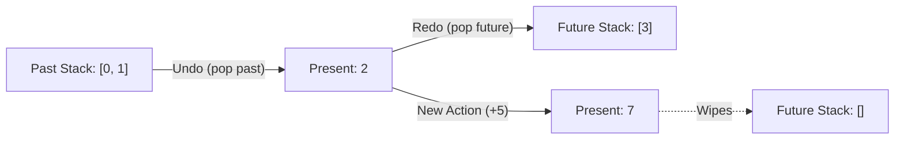

---

### Intuition & Mental Model: The Dual-Stack History Pattern

How should we think about "Undo" and "Redo"?
Imagine three containers on a desk:
- **Past Stack (`past`):** An array of previous counts in chronological order.
- **Current Value (`present`):** The number on the screen right now.
- **Future Stack (`future`):** Numbers you "undid" that can be brought back.

```
Initial state:
  Past: []                Present: 0             Future: []

User clicks "+1":
  Past: [0]               Present: 1             Future: []

User clicks "+1":
  Past: [0, 1]            Present: 2             Future: []

User clicks "Undo":
  Past: [0]               Present: 1             Future: [2]

User clicks "+5" (NEW ACTION):
  Past: [0, 1]            Present: 6             Future: []  <-- Future is wiped!
```

> [!IMPORTANT]
> Whenever the user performs a **brand new action**, the `future` stack must be wiped out. You cannot redo actions from an alternate timeline!

---

### Component Skeleton (Drafting the Blueprint)

When the interviewer presents this prompt, start by sketching the component skeleton in the first 2 minutes. This communicates clarity and architectural forethought:

```jsx
export function CounterSkeleton({
  initialCount = 0,
  min = -100,
  max = 100,
  defaultStep = 1
}) {
  // 1. STATE SKELETON
  // We need past history (array), present count (number), future history (array), and step (number)
  // const [history, setHistory] = useState({ past: [], present: initialCount, future: [] });
  // const [step, setStep] = useState(defaultStep);

  // 2. HANDLER STUBS
  // const handleIncrement = () => { /* Add step, push present to past, clear future */ };
  // const handleDecrement = () => { /* Subtract step, push present to past, clear future */ };
  // const handleUndo = () => { /* Pop last item from past, make present, push present to future */ };
  // const handleRedo = () => { /* Pop first item from future, make present, push present to past */ };
  // const handleReset = () => { /* Revert to initial count and empty stacks */ };

  // 3. RENDER SKELETON
  return (
    <div>
      {/* Step Input */}
      {/* Display Value & Bounds status */}
      {/* Main Buttons (+ and -) */}
      {/* History Controls (Undo, Redo, Reset) */}
    </div>
  );
}
```

---

### Step 1: Modeling State with useReducer

While you *could* manage `past`, `present`, and `future` across three independent `useState` calls, doing so risks out-of-sync state updates when an undo or redo action occurs.

A single `useReducer` or unified state object guarantees atomic updates:

```javascript
const initialState = {
  past: [],
  present: 0,
  future: []
};

function counterReducer(state, action) {
  const { past, present, future } = state;

  switch (action.type) {
    case 'SET': {
      const nextValue = action.payload;
      if (nextValue === present) return state;
      return {
        past: [...past, present], // Archive current value
        present: nextValue,        // Apply new value
        future: []                 // Wipe redo history on new action
      };
    }
    case 'UNDO': {
      if (past.length === 0) return state; // Nothing to undo
      const previous = past[past.length - 1];
      const newPast = past.slice(0, past.length - 1);
      return {
        past: newPast,
        present: previous,
        future: [present, ...future] // Push current to future
      };
    }
    case 'REDO': {
      if (future.length === 0) return state; // Nothing to redo
      const next = future[0];
      const newFuture = future.slice(1);
      return {
        past: [...past, present], // Current moves to past
        present: next,
        future: newFuture
      };
    }
    case 'RESET': {
      return {
        past: [],
        present: action.payload,
        future: []
      };
    }
    default:
      return state;
  }
}
```

---

### Step 2: Complete Implementation

Here is the clean, accessible implementation without any CSS utility frameworks:

```jsx
import React, { useReducer, useState } from 'react';

export function Counter({ initialCount = 0, min = -50, max = 50, defaultStep = 1 }) {
  const [state, dispatch] = useReducer(counterReducer, {
    past: [],
    present: initialCount,
    future: []
  });

  const [step, setStep] = useState(defaultStep);

  const { past, present, future } = state;

  // Derived disabled states
  const canIncrement = present + step <= max;
  const canDecrement = present - step >= min;
  const canUndo = past.length > 0;
  const canRedo = future.length > 0;

  const handleIncrement = () => {
    if (canIncrement) {
      dispatch({ type: 'SET', payload: present + step });
    }
  };

  const handleDecrement = () => {
    if (canDecrement) {
      dispatch({ type: 'SET', payload: present - step });
    }
  };

  const handleUndo = () => dispatch({ type: 'UNDO' });
  const handleRedo = () => dispatch({ type: 'REDO' });
  const handleReset = () => dispatch({ type: 'RESET', payload: initialCount });

  return (
    <div
      style={{
        maxWidth: '360px',
        padding: '24px',
        border: '1px solid #d1d5db',
        borderRadius: '8px',
        fontFamily: 'sans-serif'
      }}
    >
      <h3 style={{ margin: '0 0 16px 0', fontSize: '18px' }}>Counter with History</h3>

      {/* Step Configuration */}
      <div style={{ marginBottom: '16px', display: 'flex', alignItems: 'center', gap: '8px' }}>
        <label htmlFor="step-input" style={{ fontSize: '14px', fontWeight: 500 }}>
          Step Size:
        </label>
        <input
          id="step-input"
          type="number"
          min="1"
          max="20"
          value={step}
          onChange={(e) => setStep(Math.max(1, Number(e.target.value) || 1))}
          style={{ width: '60px', padding: '4px 8px', fontSize: '14px' }}
        />
      </div>

      {/* Main Counter Display */}
      <div style={{ textAlign: 'center', margin: '20px 0' }}>
        <span
          aria-live="polite"
          style={{
            fontSize: '48px',
            fontWeight: 'bold',
            color: present === max ? '#dc2626' : present === min ? '#2563eb' : '#111827'
          }}
        >
          {present}
        </span>
        <div style={{ fontSize: '12px', color: '#6b7280', marginTop: '4px' }}>
          Range: [{min} to {max}]
        </div>
      </div>

      {/* Primary Action Buttons */}
      <div style={{ display: 'flex', gap: '8px', marginBottom: '16px' }}>
        <button
          onClick={handleDecrement}
          disabled={!canDecrement}
          aria-label={`Decrease by ${step}`}
          style={{
            flex: 1,
            padding: '10px',
            fontSize: '18px',
            cursor: canDecrement ? 'pointer' : 'not-allowed',
            opacity: canDecrement ? 1 : 0.4
          }}
        >
          -{step}
        </button>
        <button
          onClick={handleIncrement}
          disabled={!canIncrement}
          aria-label={`Increase by ${step}`}
          style={{
            flex: 1,
            padding: '10px',
            fontSize: '18px',
            cursor: canIncrement ? 'pointer' : 'not-allowed',
            opacity: canIncrement ? 1 : 0.4
          }}
        >
          +{step}
        </button>
      </div>

      {/* Historical Navigation Controls */}
      <div style={{ display: 'flex', gap: '8px', borderTop: '1px solid #e5e7eb', paddingTop: '16px' }}>
        <button
          onClick={handleUndo}
          disabled={!canUndo}
          style={{
            flex: 1,
            padding: '8px',
            cursor: canUndo ? 'pointer' : 'not-allowed',
            opacity: canUndo ? 1 : 0.4
          }}
        >
          Undo ({past.length})
        </button>
        <button
          onClick={handleRedo}
          disabled={!canRedo}
          style={{
            flex: 1,
            padding: '8px',
            cursor: canRedo ? 'pointer' : 'not-allowed',
            opacity: canRedo ? 1 : 0.4
          }}
        >
          Redo ({future.length})
        </button>
        <button
          onClick={handleReset}
          style={{ padding: '8px 12px', cursor: 'pointer' }}
        >
          Reset
        </button>
      </div>
    </div>
  );
}
```

---

### Edge Cases & Follow-Up Questions

1. **"What happens if the user holds down the increment button?"**
   - In a production component, we would add `onMouseDown` and `onMouseUp` handlers to trigger an interval that increments repeatedly, clearing the interval timer on `onMouseLeave` or mouse release.
2. **"How would you prevent the past stack from consuming too much memory?"**
   - Cap the history length: `past: [...past, present].slice(-MAX_HISTORY_SIZE)`.
3. **"Why use `aria-live='polite'` on the count display?"**
   - Screen readers will announce the updated count to visually impaired users without interrupting ongoing speech synthesis.

---

## Accessible Accordion / Collapsible FAQ

### The Interview Problem
Build an accordion component that displays a list of expandable FAQ items.

**Key Requirements:**
1. Single-collapse mode vs Multi-expand mode (controlled via an `allowMultiple` boolean prop).
2. Keyboard navigation: `Enter` or `Space` toggles items; `Up` and `Down` arrow keys move focus between headers.
3. Proper WAI-ARIA compliance: `aria-expanded`, `aria-controls`, and `role="region"`.

---

### Visual UI Wireframe & Component Hierarchy

```
+-------------------------------------------------------------+
| Frequently Asked Questions                                  |
+-------------------------------------------------------------+
| [ > ] What is React Reconciliation?                     [+] |
+-------------------------------------------------------------+
| [ v ] How does the Virtual DOM work?                    [-] |
|   Reconciliation is the recursive diffing algorithm         |
|   React uses to compare the old Fiber tree with the         |
|   new Fiber tree, computing minimal DOM patches.            |
+-------------------------------------------------------------+
| [ > ] When should I use useMemo?                        [+] |
+-------------------------------------------------------------+
```

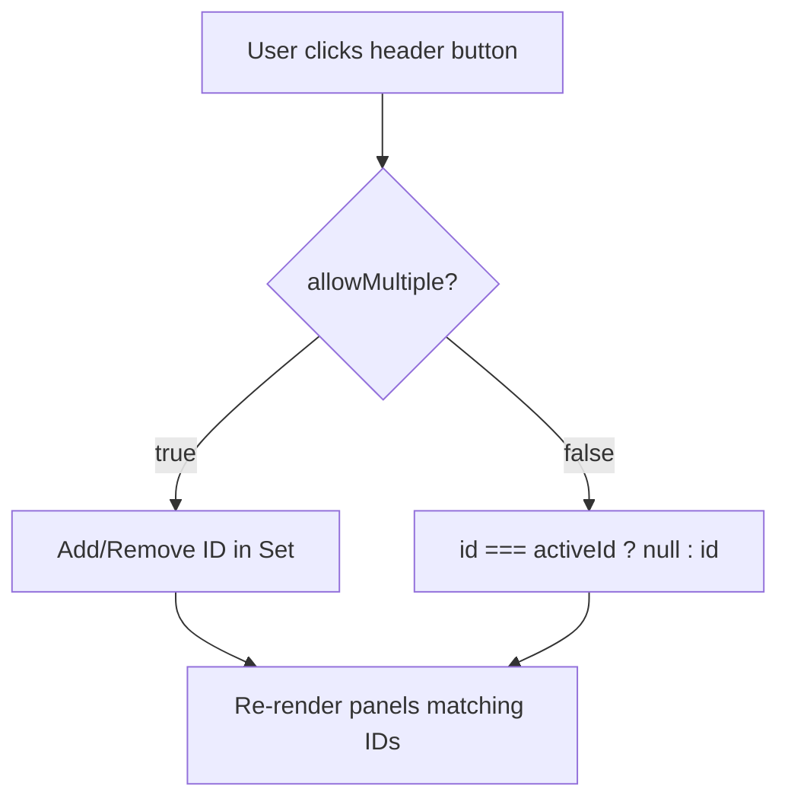

---

### Intuition & Mental Model: Single vs Multi State Representation

How should we represent which accordion items are open?
- Beginners often store a boolean flag on every item object, mutating raw data.
- **The Senior Approach:** Store only the IDs of open items in a set or array:
  - If `allowMultiple = false`: `openId` is either a string/number or `null`.
  - If `allowMultiple = true`: `openIds` is a `Set<string | number>`.

```
Single-open mode:
  Active item ID: "item-2" (only 1 item open at a time)
  Clicking "item-3" replaces "item-2" -> Active: "item-3"
  Clicking "item-3" again closes it    -> Active: null

Multi-open mode:
  Active items: Set { "item-1", "item-3" }
  Clicking "item-2" adds it -> Set { "item-1", "item-2", "item-3" }
```

---

### Component Skeleton (Drafting the Blueprint)

```jsx
export function AccordionSkeleton({ items, allowMultiple = false }) {
  // 1. STATE SKELETON
  // Single open: string | null
  // Multi open: Set<string>
  // const [openItems, setOpenItems] = useState(allowMultiple ? new Set() : null);

  // 2. REFS FOR KEYBOARD NAVIGATION
  // const headerRefs = useRef([]);

  // 3. HANDLER STUBS
  // const toggleItem = (id) => { /* Handle single vs multi toggle logic */ };
  // const handleKeyDown = (e, index) => { /* Handle ArrowUp, ArrowDown, Home, End */ };

  // 4. RENDER SKELETON
  return (
    <div>
      {items.map((item, index) => (
        <div key={item.id}>
          {/* Header button with aria-expanded and ref */}
          {/* Collapsible panel with role="region" */}
        </div>
      ))}
    </div>
  );
}
```

---

### Step 1: Keyboard Navigation Logic (W3C Accordion Pattern)

To achieve full accessibility, an accordion must allow users to traverse headers using arrow keys without pressing `Tab` repeatedly:

```javascript
const handleHeaderKeyDown = (e, index, totalItems) => {
  switch (e.key) {
    case 'ArrowDown':
      e.preventDefault();
      // Move focus to next header (wrapping around to 0)
      headerRefs.current[(index + 1) % totalItems]?.focus();
      break;
    case 'ArrowUp':
      e.preventDefault();
      // Move focus to previous header (wrapping around to end)
      headerRefs.current[(index - 1 + totalItems) % totalItems]?.focus();
      break;
    case 'Home':
      e.preventDefault();
      headerRefs.current[0]?.focus();
      break;
    case 'End':
      e.preventDefault();
      headerRefs.current[totalItems - 1]?.focus();
      break;
  }
};
```

---

### Step 2: Complete Implementation

```jsx
import React, { useState, useRef } from 'react';

export function Accordion({ items, allowMultiple = false }) {
  // Use a Set for multi-expand, or string/null for single-expand
  const [openIds, setOpenIds] = useState(() => (allowMultiple ? new Set() : null));
  const headerRefs = useRef([]);

  const isOpen = (id) => {
    return allowMultiple ? openIds.has(id) : openIds === id;
  };

  const handleToggle = (id) => {
    if (allowMultiple) {
      setOpenIds((prev) => {
        const next = new Set(prev);
        if (next.has(id)) {
          next.delete(id);
        } else {
          next.add(id);
        }
        return next;
      });
    } else {
      setOpenIds((prev) => (prev === id ? null : id));
    }
  };

  const handleKeyDown = (e, index) => {
    const total = items.length;
    if (e.key === 'ArrowDown') {
      e.preventDefault();
      headerRefs.current[(index + 1) % total]?.focus();
    } else if (e.key === 'ArrowUp') {
      e.preventDefault();
      headerRefs.current[(index - 1 + total) % total]?.focus();
    } else if (e.key === 'Home') {
      e.preventDefault();
      headerRefs.current[0]?.focus();
    } else if (e.key === 'End') {
      e.preventDefault();
      headerRefs.current[total - 1]?.focus();
    }
  };

  return (
    <div style={{ maxWidth: '500px', margin: '0 auto', border: '1px solid #e0e0e0', borderRadius: '8px' }}>
      {items.map((item, index) => {
        const expanded = isOpen(item.id);
        const headerId = `accordion-header-${item.id}`;
        const panelId = `accordion-panel-${item.id}`;

        return (
          <div
            key={item.id}
            style={{
              borderBottom: index < items.length - 1 ? '1px solid #e0e0e0' : 'none'
            }}
          >
            <h3>
              <button
                ref={(el) => (headerRefs.current[index] = el)}
                id={headerId}
                aria-expanded={expanded}
                aria-controls={panelId}
                onClick={() => handleToggle(item.id)}
                onKeyDown={(e) => handleKeyDown(e, index)}
                style={{
                  width: '100%',
                  display: 'flex',
                  justifyContent: 'space-between',
                  alignItems: 'center',
                  padding: '16px',
                  background: expanded ? '#f9fafb' : '#ffffff',
                  border: 'none',
                  textAlign: 'left',
                  cursor: 'pointer',
                  fontWeight: 600,
                  fontSize: '15px'
                }}
              >
                <span>{item.title}</span>
                <span
                  aria-hidden="true"
                  style={{
                    transform: expanded ? 'rotate(180deg)' : 'rotate(0deg)',
                    transition: 'transform 0.2s ease'
                  }}
                >
                  ▼
                </span>
              </button>
            </h3>

            <div
              id={panelId}
              role="region"
              aria-labelledby={headerId}
              hidden={!expanded}
              style={{
                padding: expanded ? '0 16px 16px 16px' : '0 16px',
                color: '#4b5563',
                fontSize: '14px',
                lineHeight: '1.5',
                display: expanded ? 'block' : 'none'
              }}
            >
              {item.content}
            </div>
          </div>
        );
      })}
    </div>
  );
}
```

---

## Dynamic Tag / Pill Input with Backspace Removal

### The Interview Problem
Build a multi-tag input component (similar to GitHub repository topic labels or Gmail recipient fields).

**Key Requirements:**
1. Type text and hit `Enter` or `,` (comma) to convert input into a tag pill.
2. Clicking the $	imes$ button on a tag removes it.
3. Hitting `Backspace` when the text input is empty highlights or deletes the last tag in the list.
4. Duplicate prevention and trimming whitespace.

---

### Visual UI Wireframe & Component Hierarchy

```
Skills / Technologies:
+-------------------------------------------------------------+
| [ React ✕ ]  [ TypeScript ✕ ]  [ Next.js ✕ ]  type here...|  |
+-------------------------------------------------------------+
  (Hitting 'Enter' or ',' adds pill | Backspace on empty deletes)
```

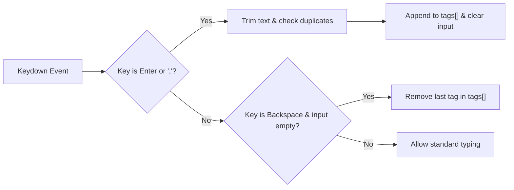

---

### Intuition & Mental Model: Keystroke Event Interception

```
User types "react" -> presses Enter:
  1. e.preventDefault() to avoid form submission.
  2. Trim input: "react".
  3. Validate: Is it non-empty? Is it already in tags[]?
  4. Append: tags = [...tags, "react"].
  5. Clear text input: setInputValue("").

User presses Backspace on an EMPTY input:
  1. e.target.value === "".
  2. Pop the last tag: tags.slice(0, -1).
```

---

### Component Skeleton (Drafting the Blueprint)

```jsx
export function TagInputSkeleton({ initialTags = [], onTagsChange }) {
  // 1. STATE SKELETON
  // const [tags, setTags] = useState(initialTags);
  // const [inputValue, setInputValue] = useState('');

  // 2. HANDLER STUBS
  // const handleKeyDown = (e) => {
  //   if (e.key === 'Enter' || e.key === ',') { /* add tag */ }
  //   if (e.key === 'Backspace' && !inputValue) { /* delete last tag */ }
  // };
  // const removeTag = (indexToRemove) => { /* filter out tag */ };

  // 3. RENDER SKELETON
  return (
    <div>
      {/* List of tag pills with remove buttons */}
      {/* Text input for new tag entry */}
    </div>
  );
}
```

---

### Step 1: Complete Implementation

```jsx
import React, { useState } from 'react';

export function TagInput({
  initialTags = ['React', 'JavaScript'],
  maxTags = 8,
  placeholder = 'Add a skill (press Enter)...'
}) {
  const [tags, setTags] = useState(initialTags);
  const [inputValue, setInputValue] = useState('');
  const [errorMessage, setErrorMessage] = useState('');

  const addTag = (rawText) => {
    const trimmed = rawText.trim().replace(/^,+|,+$/g, '');
    setErrorMessage('');

    if (!trimmed) return;

    if (tags.length >= maxTags) {
      setErrorMessage(`Maximum of ${maxTags} tags allowed.`);
      return;
    }

    if (tags.some((t) => t.toLowerCase() === trimmed.toLowerCase())) {
      setErrorMessage(`"${trimmed}" is already added.`);
      return;
    }

    setTags([...tags, trimmed]);
    setInputValue('');
  };

  const removeTag = (indexToRemove) => {
    setTags(tags.filter((_, idx) => idx !== indexToRemove));
    setErrorMessage('');
  };

  const handleKeyDown = (e) => {
    if (e.key === 'Enter' || e.key === ',') {
      e.preventDefault();
      addTag(inputValue);
    } else if (e.key === 'Backspace' && inputValue === '' && tags.length > 0) {
      // Remove last tag when backspacing on empty input
      removeTag(tags.length - 1);
    }
  };

  return (
    <div style={{ maxWidth: '480px', fontFamily: 'sans-serif' }}>
      <label
        htmlFor="tag-input-field"
        style={{ display: 'block', fontSize: '14px', fontWeight: 600, marginBottom: '6px' }}
      >
        Skills / Technologies:
      </label>

      {/* Outer container mimicking an input border */}
      <div
        style={{
          display: 'flex',
          flexWrap: 'wrap',
          alignItems: 'center',
          gap: '6px',
          padding: '6px 10px',
          border: errorMessage ? '1px solid #dc2626' : '1px solid #ccc',
          borderRadius: '6px',
          minHeight: '44px',
          backgroundColor: '#fff'
        }}
      >
        {tags.map((tag, index) => (
          <span
            key={index}
            style={{
              display: 'inline-flex',
              alignItems: 'center',
              gap: '4px',
              padding: '4px 8px',
              backgroundColor: '#e0e7ff',
              color: '#3730a3',
              borderRadius: '16px',
              fontSize: '13px',
              fontWeight: 500
            }}
          >
            {tag}
            <button
              type="button"
              onClick={() => removeTag(index)}
              aria-label={`Remove tag ${tag}`}
              style={{
                border: 'none',
                background: 'transparent',
                cursor: 'pointer',
                color: '#4338ca',
                fontWeight: 'bold',
                padding: '0 2px'
              }}
            >
              ×
            </button>
          </span>
        ))}

        <input
          id="tag-input-field"
          type="text"
          value={inputValue}
          onChange={(e) => setInputValue(e.target.value)}
          onKeyDown={handleKeyDown}
          onBlur={() => {
            if (inputValue.trim()) addTag(inputValue);
          }}
          placeholder={tags.length < maxTags ? placeholder : ''}
          disabled={tags.length >= maxTags}
          style={{
            flex: 1,
            minWidth: '120px',
            border: 'none',
            outline: 'none',
            fontSize: '14px',
            padding: '4px 0'
          }}
        />
      </div>

      {errorMessage && (
        <p style={{ color: '#dc2626', fontSize: '12px', margin: '4px 0 0 0' }}>
          {errorMessage}
        </p>
      )}
    </div>
  );
}
```

---

## Theme Switcher with Context & LocalStorage

### The Interview Problem
Build a theme toggle system (light vs dark mode) that persists across page refreshes and respects the user's OS system preferences.

**Key Requirements:**
1. A `ThemeProvider` and custom `useTheme()` hook.
2. Persisting preference in `localStorage`.
3. Reading `window.matchMedia('(prefers-color-scheme: dark)')` as initial fallback.
4. Synchronizing multiple tabs when storage changes in another window.

---

### Visual UI Wireframe & Component Hierarchy

```
+-------------------------------------------------------------+
| Navigation Bar                             [ 🌙 Dark Mode ] |
+-------------------------------------------------------------+
| Dashboard Overview                                          |
|                                                             |
| [ Card 1: Analytics ]              [ Card 2: Revenue ]      |
| Background: #111827                Background: #111827      |
| Text: #F9FAFB                      Text: #F9FAFB            |
+-------------------------------------------------------------+
```

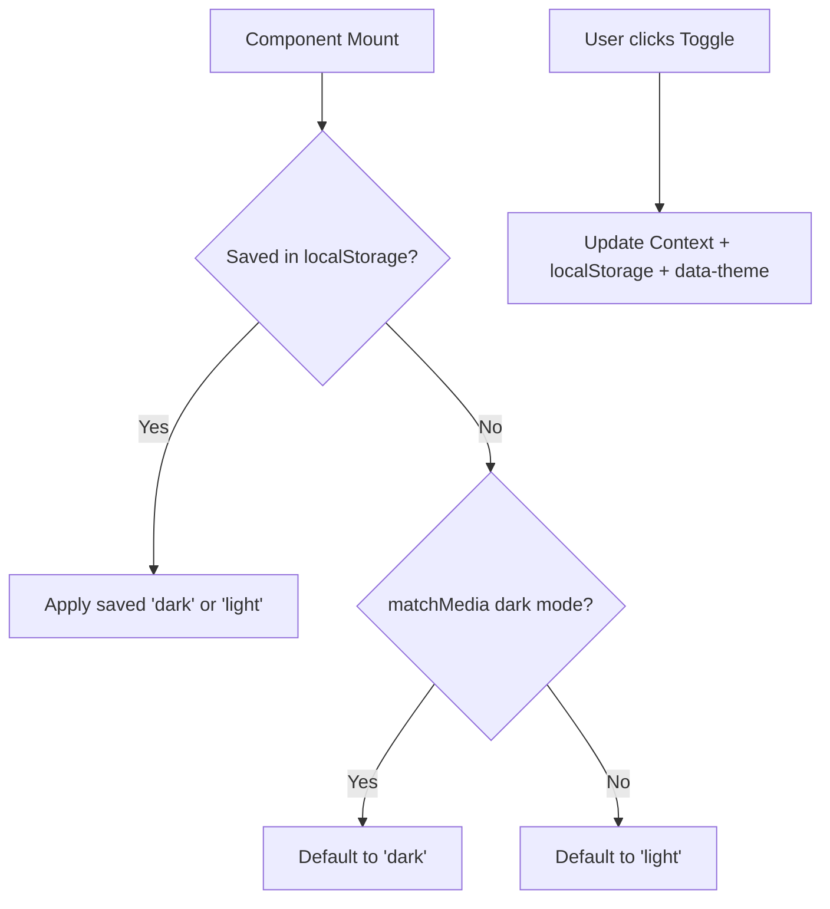

---

### Intuition & Mental Model: Fallback Resolution Hierarchy

```
1. Is there a saved preference in localStorage ("dark" | "light")?
      |-- YES: Use saved preference.
      |-- NO : Check OS preference via window.matchMedia.
                |-- Matches dark: Default to "dark".
                |-- Otherwise   : Default to "light".
```

---

### Component Skeleton (Drafting the Blueprint)

```jsx
const ThemeContext = React.createContext(null);

export function ThemeProviderSkeleton({ children }) {
  // 1. STATE SKELETON
  // const [theme, setTheme] = useState(resolveInitialTheme);

  // 2. EFFECT SKELETONS
  // useEffect(() => { /* Sync to localStorage and document.documentElement */ }, [theme]);
  // useEffect(() => { /* Listen to window 'storage' events for multi-tab sync */ }, []);

  // 3. EXPOSE CONTEXT
  // return <ThemeContext.Provider value={{ theme, toggleTheme }}>{children}</ThemeContext.Provider>;
}

export function useTheme() {
  // Consumer hook with safety check
}
```

---

### Step 1: Complete Implementation

```jsx
import React, { createContext, useContext, useState, useEffect, useCallback } from 'react';

const ThemeContext = createContext(null);

function getInitialTheme() {
  if (typeof window === 'undefined') return 'light';

  // 1. Check local storage
  const saved = localStorage.getItem('app-theme');
  if (saved === 'light' || saved === 'dark') return saved;

  // 2. Check system preferences
  if (window.matchMedia && window.matchMedia('(prefers-color-scheme: dark)').matches) {
    return 'dark';
  }

  return 'light';
}

export function ThemeProvider({ children }) {
  const [theme, setTheme] = useState(getInitialTheme);

  const toggleTheme = useCallback(() => {
    setTheme((prev) => (prev === 'light' ? 'dark' : 'light'));
  }, []);

  // Sync to DOM and localStorage on change
  useEffect(() => {
    localStorage.setItem('app-theme', theme);
    document.documentElement.setAttribute('data-theme', theme);
  }, [theme]);

  // Synchronize across browser tabs via storage event
  useEffect(() => {
    const handleStorageChange = (e) => {
      if (e.key === 'app-theme' && (e.newValue === 'light' || e.newValue === 'dark')) {
        setTheme(e.newValue);
      }
    };

    window.addEventListener('storage', handleStorageChange);
    return () => window.removeEventListener('storage', handleStorageChange);
  }, []);

  return (
    <ThemeContext.Provider value={{ theme, toggleTheme }}>
      {children}
    </ThemeContext.Provider>
  );
}

export function useTheme() {
  const context = useContext(ThemeContext);
  if (!context) {
    throw new Error('useTheme must be used within a <ThemeProvider>');
  }
  return context;
}

// Consumer toggle button
export function ThemeToggleButton() {
  const { theme, toggleTheme } = useTheme();

  return (
    <button
      onClick={toggleTheme}
      style={{
        padding: '8px 16px',
        borderRadius: '20px',
        border: '1px solid #ccc',
        backgroundColor: theme === 'dark' ? '#333' : '#fff',
        color: theme === 'dark' ? '#fff' : '#333',
        cursor: 'pointer',
        display: 'flex',
        alignItems: 'center',
        gap: '8px'
      }}
    >
      <span>{theme === 'dark' ? '🌙' : '☀️'}</span>
      <span>{theme === 'dark' ? 'Dark Mode' : 'Light Mode'}</span>
    </button>
  );
}
```

---

## Paginated Data Table with Column Sorting & Instant Filtering

### The Interview Problem
Build an interactive Data Table that handles client-side search filtering, multi-column sorting (ascending, descending, neutral), and pagination.

**Key Requirements:**
1. Column sorting: clicking a header toggles Ascending $	o$ Descending $	o$ Neutral.
2. Real-time search filter across multiple text fields.
3. Pagination controls: Next, Previous, and items per page selector.
4. Edge cases: No results found screen, pagination resetting when filter query changes.

---

### Visual UI Wireframe & Component Hierarchy

```
+-------------------------------------------------------------+
| [ Search records...      ]              Rows per page: [ 5 v]|
+-------------------------------------------------------------+
| Name ▲             | Email ⇅              | Role ⇅          |
+--------------------+----------------------+-----------------+
| Alice Johnson      | alice@work.com       | Admin           |
| Bob Miller         | bob@work.com         | Engineer        |
| Charlie Davis      | charlie@work.com     | Designer        |
+--------------------+----------------------+-----------------+
| Page 1 of 4 (18 items)                 [ Previous ] [ Next ]|
+-------------------------------------------------------------+
```

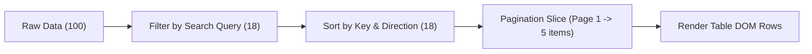

---

### Intuition & Mental Model: The Data Pipeline Architecture

Instead of mutating the original data in-place, treat your data like a unidirectional transformation pipeline:

```
[ Raw Data (100 items) ]
          |
          v (Filter Step: Matches search query?)
[ Filtered Data (15 items) ]
          |
          v (Sort Step: Order by active sortColumn and sortDirection)
[ Sorted Data (15 items) ]
          |
          v (Pagination Slice: slice((page - 1) * pageSize, page * pageSize))
[ Displayed Rows (5 items) ]
```

> [!TIP]
> **Interviewer Trap:** If the user is on page 4 and suddenly types a search query that produces only 3 results, what happens if you don't reset the page index? The screen will show "0 items" because page 4 has no items! Always reset `currentPage = 1` whenever the filter changes.

---

### Component Skeleton (Drafting the Blueprint)

```jsx
export function DataTableSkeleton({ columns, data, initialPageSize = 5 }) {
  // 1. STATE SKELETON
  // const [searchQuery, setSearchQuery] = useState('');
  // const [sortConfig, setSortConfig] = useState({ key: null, direction: 'asc' }); // 'asc' | 'desc' | null
  // const [currentPage, setCurrentPage] = useState(1);
  // const [pageSize, setPageSize] = useState(initialPageSize);

  // 2. DERIVED DATA PIPELINE
  // const filteredData = useMemo(() => ...);
  // const sortedData = useMemo(() => ...);
  // const paginatedData = useMemo(() => ...);

  // 3. HANDLERS
  // const handleSort = (key) => { /* cycle asc -> desc -> null */ };
  // const handleSearchChange = (query) => { setSearchQuery(query); setCurrentPage(1); };

  // 4. RENDER SKELETON
  return (
    <div>
      {/* Search Input & Page Size Dropdown */}
      {/* <table><thead><tr>{sortable headers}</tr></thead><tbody>{rows}</tbody></table> */}
      {/* Pagination Bar (Prev, Page X of Y, Next) */}
    </div>
  );
}
```

---

### Step 1: Complete Implementation

```jsx
import React, { useState, useMemo } from 'react';

export function DataTable({ columns, data, initialPageSize = 5 }) {
  const [searchQuery, setSearchQuery] = useState('');
  const [sortConfig, setSortConfig] = useState({ key: null, direction: null });
  const [currentPage, setCurrentPage] = useState(1);
  const [pageSize, setPageSize] = useState(initialPageSize);

  // 1. Filter pipeline
  const filteredData = useMemo(() => {
    if (!searchQuery.trim()) return data;
    const query = searchQuery.toLowerCase();
    return data.filter((row) =>
      columns.some((col) => {
        const val = row[col.key];
        return val != null && String(val).toLowerCase().includes(query);
      })
    );
  }, [data, columns, searchQuery]);

  // 2. Sort pipeline
  const sortedData = useMemo(() => {
    if (!sortConfig.key || !sortConfig.direction) return filteredData;

    return [...filteredData].sort((a, b) => {
      const aVal = a[sortConfig.key];
      const bVal = b[sortConfig.key];

      if (aVal < bVal) return sortConfig.direction === 'asc' ? -1 : 1;
      if (aVal > bVal) return sortConfig.direction === 'asc' ? 1 : -1;
      return 0;
    });
  }, [filteredData, sortConfig]);

  // 3. Pagination pipeline
  const totalPages = Math.ceil(sortedData.length / pageSize) || 1;
  const paginatedRows = useMemo(() => {
    const start = (currentPage - 1) * pageSize;
    return sortedData.slice(start, start + pageSize);
  }, [sortedData, currentPage, pageSize]);

  const handleSort = (key) => {
    setSortConfig((prev) => {
      if (prev.key !== key) return { key, direction: 'asc' };
      if (prev.direction === 'asc') return { key, direction: 'desc' };
      return { key: null, direction: null }; // reset
    });
  };

  const handleSearch = (e) => {
    setSearchQuery(e.target.value);
    setCurrentPage(1); // Crucial: Reset to page 1 on search
  };

  return (
    <div style={{ maxWidth: '700px', margin: '0 auto', fontFamily: 'sans-serif' }}>
      {/* Controls: Search and Page Size */}
      <div style={{ display: 'flex', justifyContent: 'space-between', marginBottom: '12px' }}>
        <input
          type="text"
          placeholder="Search records..."
          value={searchQuery}
          onChange={handleSearch}
          style={{ padding: '8px 12px', width: '220px', border: '1px solid #ccc', borderRadius: '4px' }}
        />
        <div>
          <label style={{ fontSize: '13px', marginRight: '6px' }}>Rows per page:</label>
          <select
            value={pageSize}
            onChange={(e) => {
              setPageSize(Number(e.target.value));
              setCurrentPage(1);
            }}
            style={{ padding: '6px' }}
          >
            <option value={5}>5</option>
            <option value={10}>10</option>
            <option value={20}>20</option>
          </select>
        </div>
      </div>

      {/* Table */}
      <table style={{ width: '100%', borderCollapse: 'collapse', border: '1px solid #ddd' }}>
        <thead>
          <tr style={{ backgroundColor: '#f3f4f6' }}>
            {columns.map((col) => (
              <th
                key={col.key}
                onClick={() => handleSort(col.key)}
                style={{
                  padding: '10px',
                  textAlign: 'left',
                  borderBottom: '2px solid #ddd',
                  cursor: 'pointer',
                  userSelect: 'none'
                }}
              >
                {col.label}{' '}
                {sortConfig.key === col.key
                  ? sortConfig.direction === 'asc'
                    ? '▲'
                    : sortConfig.direction === 'desc'
                    ? '▼'
                    : ''
                  : '⇅'}
              </th>
            ))}
          </tr>
        </thead>
        <tbody>
          {paginatedRows.length > 0 ? (
            paginatedRows.map((row, idx) => (
              <tr key={row.id || idx} style={{ borderBottom: '1px solid #eee' }}>
                {columns.map((col) => (
                  <td key={col.key} style={{ padding: '10px' }}>
                    {row[col.key]}
                  </td>
                ))}
              </tr>
            ))
          ) : (
            <tr>
              <td colSpan={columns.length} style={{ textAlign: 'center', padding: '24px', color: '#888' }}>
                No records match your search query.
              </td>
            </tr>
          )}
        </tbody>
      </table>

      {/* Pagination Footer */}
      <div style={{ display: 'flex', justifyContent: 'space-between', alignItems: 'center', marginTop: '12px' }}>
        <span style={{ fontSize: '13px', color: '#666' }}>
          Page {currentPage} of {totalPages} ({sortedData.length} total items)
        </span>
        <div style={{ display: 'flex', gap: '8px' }}>
          <button
            onClick={() => setCurrentPage((p) => Math.max(1, p - 1))}
            disabled={currentPage === 1}
            style={{ padding: '6px 12px', cursor: currentPage === 1 ? 'not-allowed' : 'pointer' }}
          >
            Previous
          </button>
          <button
            onClick={() => setCurrentPage((p) => Math.min(totalPages, p + 1))}
            disabled={currentPage === totalPages}
            style={{ padding: '6px 12px', cursor: currentPage === totalPages ? 'not-allowed' : 'pointer' }}
          >
            Next
          </button>
        </div>
      </div>
    </div>
  );
}


# React 18 Intermediate Recipes

---

## Debounced Auto-Complete Search with AbortController

### The Interview Problem
Build a typeahead search component that fetches asynchronous suggestions from an API as the user types into an input field.

**Key Requirements:**
1. **Debounce user keystrokes** (delay API dispatch until 300ms after the user finishes typing).
2. **Prevent race conditions with `AbortController`**: if request A is delayed and request B finishes first, request A must not overwrite newer data.
3. **Keyboard navigation**: `ArrowDown` and `ArrowUp` to navigate suggestion items, `Enter` to select, and `Escape` to close the suggestion menu.
4. **Cache previous queries** in memory to prevent unnecessary network requests.

---

### Visual UI Wireframe & Component Hierarchy

```
+-------------------------------------------------------------+
| Search Frameworks:                                          |
| +---------------------------------------------------------+ |
| | react                                   [ Searching... ]| |
| +---------------------------------------------------------+ |
| | React                                                   | |
| | > React Native (Active highlighted)                     | |
| | React Router                                            | |
| +---------------------------------------------------------+ |
+-------------------------------------------------------------+
```

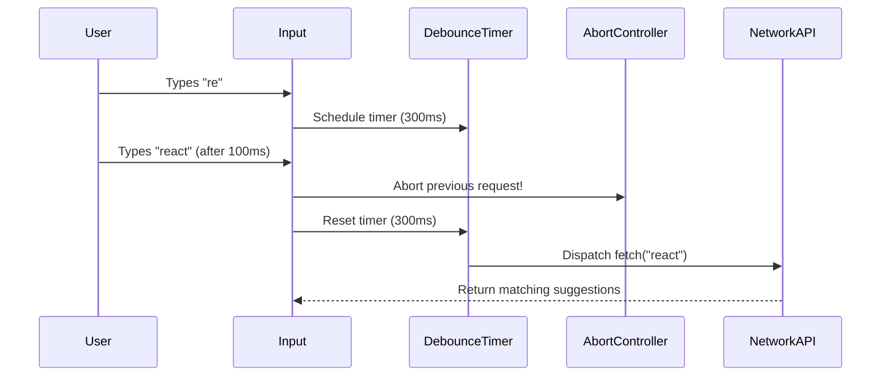

---

### Intuition & Mental Model: The Async Race Condition Trap

Why is a simple `fetch()` inside a `useEffect` a catastrophic failure in an interview?

```
User types "cat" (Request 1 dispatched, takes 1500ms)
User types "cats" (Request 2 dispatched, takes 300ms)

Timeline:
  0ms ------------------> Request 1 ("cat") dispatched
  100ms ----------------> Request 2 ("cats") dispatched
  400ms ----------------> Request 2 ("cats") completes -> UI displays "cats" results
  1500ms ---------------> Request 1 ("cat") completes  -> UI displays "cat" results (BUG!)
```

This is called an **Asynchronous Race Condition**. The user typed "cats", but the screen displays results for "cat" because network latency is non-deterministic.

**The Solution:**
When a new keystroke arrives or the component unmounts, invoke `abortController.abort()`. The browser immediately terminates the pending HTTP socket, preventing out-of-order state overwrites!

---

### Component Skeleton (Drafting the Blueprint)

```jsx
export function AutocompleteSkeleton({ fetchSuggestionsAPI, minChars = 2, debounceMs = 300 }) {
  // 1. STATE SKELETON
  // const [query, setQuery] = useState('');
  // const [suggestions, setSuggestions] = useState([]);
  // const [isLoading, setIsLoading] = useState(false);
  // const [isOpen, setIsOpen] = useState(false);
  // const [activeIndex, setActiveIndex] = useState(-1);

  // 2. CACHE REF & ABORT CONTROLLER REF
  // const cacheRef = useRef(new Map());
  // const abortRef = useRef(null);

  // 3. KEYBOARD HANDLER STUB
  // const handleKeyDown = (e) => {
  //   if (e.key === 'ArrowDown') { /* activeIndex + 1 */ }
  //   if (e.key === 'ArrowUp') { /* activeIndex - 1 */ }
  //   if (e.key === 'Enter') { /* select active */ }
  //   if (e.key === 'Escape') { /* setIsOpen(false) */ }
  // };

  // 4. RENDER SKELETON
  return (
    <div>
      {/* Search Input with ARIA combobox attributes */}
      {/* Loading Spinner / Indicator */}
      {/* Suggestion Dropdown Listbox */}
    </div>
  );
}
```

---

### Step 1: Debounce and AbortController Effect Logic

```javascript
useEffect(() => {
  if (query.trim().length < minChars) {
    setSuggestions([]);
    setIsOpen(false);
    return;
  }

  // 1. Check in-memory cache first
  if (cacheRef.current.has(query)) {
    setSuggestions(cacheRef.current.get(query));
    setIsOpen(true);
    return;
  }

  // 2. Abort any previous in-flight request
  if (abortRef.current) {
    abortRef.current.abort();
  }

  const controller = new AbortController();
  abortRef.current = controller;

  // 3. Debounce timer
  const timer = setTimeout(async () => {
    setIsLoading(true);
    try {
      const results = await fetchSuggestionsAPI(query, controller.signal);
      cacheRef.current.set(query, results);
      setSuggestions(results);
      setIsOpen(true);
      setActiveIndex(-1);
    } catch (err) {
      if (err.name !== 'AbortError') {
        console.error('Search fetch failed:', err);
      }
    } finally {
      setIsLoading(false);
    }
  }, debounceMs);

  // 4. Cleanup: clear timer and abort in-flight fetch
  return () => {
    clearTimeout(timer);
    controller.abort();
  };
}, [query, minChars, debounceMs, fetchSuggestionsAPI]);
```

---

### Step 2: Complete Implementation

```jsx
import React, { useState, useEffect, useRef } from 'react';

// Simulated API with artificial network delay
function mockSearchAPI(term, signal) {
  return new Promise((resolve, reject) => {
    const timer = setTimeout(() => {
      const db = [
        'React', 'React Native', 'React Router', 'Redux', 'Redux Toolkit',
        'Next.js', 'Node.js', 'NestJS', 'Nuxt', 'TypeScript', 'Tailwind CSS'
      ];
      const matches = db.filter((item) =>
        item.toLowerCase().includes(term.toLowerCase())
      );
      resolve(matches);
    }, 400);

    signal.addEventListener('abort', () => {
      clearTimeout(timer);
      reject(new DOMException('Aborted', 'AbortError'));
    });
  });
}

export function AutocompleteSearch() {
  const [query, setQuery] = useState('');
  const [suggestions, setSuggestions] = useState([]);
  const [isLoading, setIsLoading] = useState(false);
  const [isOpen, setIsOpen] = useState(false);
  const [activeIndex, setActiveIndex] = useState(-1);

  const cacheRef = useRef(new Map());
  const abortRef = useRef(null);
  const listboxRef = useRef(null);

  useEffect(() => {
    if (query.trim().length < 2) {
      setSuggestions([]);
      setIsOpen(false);
      return;
    }

    if (cacheRef.current.has(query)) {
      setSuggestions(cacheRef.current.get(query));
      setIsOpen(true);
      return;
    }

    if (abortRef.current) {
      abortRef.current.abort();
    }

    const controller = new AbortController();
    abortRef.current = controller;

    const timer = setTimeout(async () => {
      setIsLoading(true);
      try {
        const results = await mockSearchAPI(query, controller.signal);
        cacheRef.current.set(query, results);
        setSuggestions(results);
        setIsOpen(true);
        setActiveIndex(-1);
      } catch (err) {
        if (err.name !== 'AbortError') {
          console.error('Fetch error:', err);
        }
      } finally {
        setIsLoading(false);
      }
    }, 300);

    return () => {
      clearTimeout(timer);
      controller.abort();
    };
  }, [query]);

  const handleSelect = (item) => {
    setQuery(item);
    setIsOpen(false);
    setActiveIndex(-1);
  };

  const handleKeyDown = (e) => {
    if (!isOpen || suggestions.length === 0) return;

    if (e.key === 'ArrowDown') {
      e.preventDefault();
      setActiveIndex((prev) => (prev + 1) % suggestions.length);
    } else if (e.key === 'ArrowUp') {
      e.preventDefault();
      setActiveIndex((prev) => (prev - 1 + suggestions.length) % suggestions.length);
    } else if (e.key === 'Enter') {
      e.preventDefault();
      if (activeIndex >= 0 && activeIndex < suggestions.length) {
        handleSelect(suggestions[activeIndex]);
      }
    } else if (e.key === 'Escape') {
      setIsOpen(false);
      setActiveIndex(-1);
    }
  };

  return (
    <div style={{ maxWidth: '400px', margin: '20px auto', position: 'relative', fontFamily: 'sans-serif' }}>
      <label htmlFor="search-input" style={{ display: 'block', fontWeight: 600, marginBottom: '6px' }}>
        Search Frameworks:
      </label>

      <div style={{ position: 'relative' }}>
        <input
          id="search-input"
          type="text"
          role="combobox"
          aria-expanded={isOpen}
          aria-autocomplete="list"
          aria-controls="suggestion-listbox"
          aria-activedescendant={activeIndex >= 0 ? `suggestion-${activeIndex}` : undefined}
          value={query}
          onChange={(e) => setQuery(e.target.value)}
          onKeyDown={handleKeyDown}
          placeholder="Type 're' or 'next'..."
          style={{
            width: '100%',
            padding: '10px 12px',
            border: '1px solid #ccc',
            borderRadius: '6px',
            boxSizing: 'border-box',
            fontSize: '15px'
          }}
        />
        {isLoading && (
          <span style={{ position: 'absolute', right: '12px', top: '10px', fontSize: '12px', color: '#888' }}>
            Searching...
          </span>
        )}
      </div>

      {isOpen && suggestions.length > 0 && (
        <ul
          id="suggestion-listbox"
          ref={listboxRef}
          role="listbox"
          style={{
            position: 'absolute',
            top: '100%',
            left: 0,
            right: 0,
            margin: '4px 0 0 0',
            padding: '4px 0',
            listStyle: 'none',
            backgroundColor: '#ffffff',
            border: '1px solid #ddd',
            borderRadius: '6px',
            boxShadow: '0 4px 12px rgba(0,0,0,0.1)',
            zIndex: 100,
            maxHeight: '220px',
            overflowY: 'auto'
          }}
        >
          {suggestions.map((item, index) => {
            const isSelected = activeIndex === index;
            return (
              <li
                key={item}
                id={`suggestion-${index}`}
                role="option"
                aria-selected={isSelected}
                onClick={() => handleSelect(item)}
                onMouseEnter={() => setActiveIndex(index)}
                style={{
                  padding: '8px 14px',
                  cursor: 'pointer',
                  backgroundColor: isSelected ? '#f0f7ff' : '#ffffff',
                  color: isSelected ? '#0066cc' : '#333333',
                  fontWeight: isSelected ? 600 : 400
                }}
              >
                {item}
              </li>
            );
          })}
        </ul>
      )}
    </div>
  );
}
```

---

## Multi-Step Form Wizard with useReducer & Draft Recovery

### The Interview Problem
Build a multi-step checkout or registration wizard (Step 1: Account, Step 2: Shipping, Step 3: Review) with step validation, backward/forward navigation, and draft recovery from `localStorage`.

**Key Requirements:**
1. Step-level isolation: the user cannot advance to Step 2 if Step 1 has invalid inputs.
2. Step navigation: Previous and Next buttons, with a Progress indicator.
3. State persistence: form inputs survive page refresh via `localStorage`.
4. Centralized state management using `useReducer`.

---

### Visual UI Wireframe & Component Hierarchy

```
+-------------------------------------------------------------+
|   (✓) Account  ======  (2) Shipping  ======  (3) Review     |
+-------------------------------------------------------------+
| Step 2: Shipping Details                                    |
|                                                             |
| Street Address:                                             |
| [ 123 Market St                                           ] |
|                                                             |
| Zip Code:                                                   |
| [ 94103                                                   ] |
|                                                             |
| [ Previous Step ]                             [ Next Step ] |
+-------------------------------------------------------------+
```

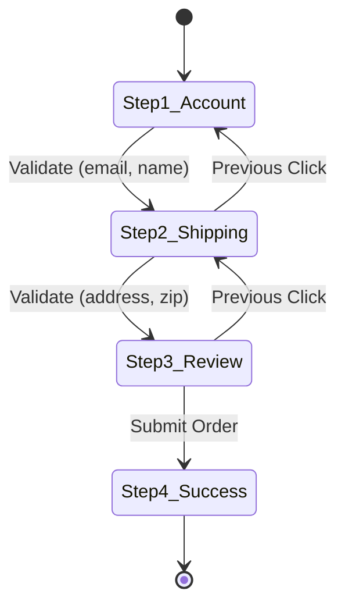

---

### Intuition & Mental Model: The Wizard State Machine

```
[ Step 1: Account Info ] <-------> [ Step 2: Shipping ] <-------> [ Step 3: Review ]
         |                                  |                              |
      Validate                           Validate                       Submit
   (email, name)                     (address, zip)                  (finalize)
```

---

### Component Skeleton (Drafting the Blueprint)

```jsx
export function WizardSkeleton() {
  // 1. STATE SKELETON WITH useReducer
  // const [state, dispatch] = useReducer(wizardReducer, initialWizardState);

  // 2. DRAFT RESTORATION EFFECT
  // useEffect(() => { /* Check localStorage for saved draft */ }, []);

  // 3. STEP VALIDATOR FUNCTION
  // const isCurrentStepValid = () => { /* Check inputs for current step */ };

  // 4. RENDER SKELETON
  return (
    <div>
      {/* Progress Bar (Step X of 3) */}
      {/* Current Step Component (Step1 | Step2 | Step3) */}
      {/* Navigation Buttons (Back, Next / Submit) */}
    </div>
  );
}
```

---

### Step 1: Reducer and Validation Design

```javascript
const initialWizardState = {
  step: 1,
  formData: {
    name: '',
    email: '',
    address: '',
    city: ''
  },
  errors: {}
};

function wizardReducer(state, action) {
  switch (action.type) {
    case 'UPDATE_FIELD':
      return {
        ...state,
        formData: { ...state.formData, [action.field]: action.value },
        errors: { ...state.errors, [action.field]: null }
      };
    case 'SET_STEP':
      return { ...state, step: action.step };
    case 'SET_ERRORS':
      return { ...state, errors: action.errors };
    case 'RESET':
      return initialWizardState;
    default:
      return state;
  }
}
```

---

### Step 2: Complete Implementation

```jsx
import React, { useReducer, useEffect } from 'react';

const STORAGE_KEY = 'checkout-wizard-draft';

const initialState = {
  step: 1,
  formData: {
    fullName: '',
    email: '',
    address: '',
    zipCode: ''
  },
  errors: {}
};

function wizardReducer(state, action) {
  switch (action.type) {
    case 'UPDATE_FIELD':
      return {
        ...state,
        formData: { ...state.formData, [action.field]: action.value },
        errors: { ...state.errors, [action.field]: '' }
      };
    case 'SET_ERRORS':
      return { ...state, errors: action.errors };
    case 'NEXT_STEP':
      return { ...state, step: Math.min(3, state.step + 1) };
    case 'PREV_STEP':
      return { ...state, step: Math.max(1, state.step - 1) };
    case 'RESTORE_DRAFT':
      return { ...state, formData: action.payload };
    case 'SUBMIT_SUCCESS':
      return { ...initialState, step: 4 };
    default:
      return state;
  }
}

export function MultiStepWizard() {
  const [state, dispatch] = useReducer(wizardReducer, initialState);
  const { step, formData, errors } = state;

  // Restore draft on initial mount
  useEffect(() => {
    try {
      const saved = localStorage.getItem(STORAGE_KEY);
      if (saved) {
        dispatch({ type: 'RESTORE_DRAFT', payload: JSON.parse(saved) });
      }
    } catch (e) {
      console.warn('Failed to parse wizard draft', e);
    }
  }, []);

  // Save draft whenever formData changes
  useEffect(() => {
    if (step < 4) {
      localStorage.setItem(STORAGE_KEY, JSON.stringify(formData));
    }
  }, [formData, step]);

  const validateStep = () => {
    const newErrors = {};
    if (step === 1) {
      if (!formData.fullName.trim()) newErrors.fullName = 'Full name is required';
      if (!formData.email.includes('@')) newErrors.email = 'Valid email is required';
    } else if (step === 2) {
      if (!formData.address.trim()) newErrors.address = 'Street address is required';
      if (!formData.zipCode.trim() || formData.zipCode.length < 5) {
        newErrors.zipCode = 'Valid 5-digit zip code is required';
      }
    }

    if (Object.keys(newErrors).length > 0) {
      dispatch({ type: 'SET_ERRORS', errors: newErrors });
      return false;
    }
    return true;
  };

  const handleNext = () => {
    if (validateStep()) {
      dispatch({ type: 'NEXT_STEP' });
    }
  };

  const handleSubmit = () => {
    localStorage.removeItem(STORAGE_KEY);
    dispatch({ type: 'SUBMIT_SUCCESS' });
  };

  if (step === 4) {
    return (
      <div style={{ maxWidth: '420px', margin: '20px auto', padding: '24px', border: '1px solid #10b981', borderRadius: '8px', textAlign: 'center' }}>
        <h3 style={{ color: '#047857' }}>Order Placed Successfully!</h3>
        <p style={{ color: '#4b5563' }}>Thank you, {formData.fullName}. Confirmation sent to {formData.email}.</p>
      </div>
    );
  }

  return (
    <div style={{ maxWidth: '440px', margin: '20px auto', padding: '24px', border: '1px solid #ddd', borderRadius: '8px', fontFamily: 'sans-serif' }}>
      {/* Progress Bar */}
      <div style={{ display: 'flex', justifyContent: 'space-between', marginBottom: '20px' }}>
        {['Account', 'Shipping', 'Review'].map((label, idx) => (
          <div key={label} style={{ textAlign: 'center', flex: 1 }}>
            <div
              style={{
                width: '28px',
                height: '28px',
                borderRadius: '50%',
                backgroundColor: step > idx + 1 ? '#10b981' : step === idx + 1 ? '#2563eb' : '#e5e7eb',
                color: step >= idx + 1 ? '#fff' : '#6b7280',
                display: 'flex',
                alignItems: 'center',
                justifyContent: 'center',
                margin: '0 auto 4px auto',
                fontWeight: 'bold',
                fontSize: '13px'
              }}
            >
              {step > idx + 1 ? '✓' : idx + 1}
            </div>
            <span style={{ fontSize: '12px', color: step === idx + 1 ? '#111' : '#888' }}>{label}</span>
          </div>
        ))}
      </div>

      {/* Step 1: Account */}
      {step === 1 && (
        <div>
          <h4 style={{ margin: '0 0 16px 0' }}>Step 1: Account Information</h4>
          <div style={{ marginBottom: '12px' }}>
            <label style={{ display: 'block', fontSize: '13px', marginBottom: '4px' }}>Full Name:</label>
            <input
              type="text"
              value={formData.fullName}
              onChange={(e) => dispatch({ type: 'UPDATE_FIELD', field: 'fullName', value: e.target.value })}
              style={{ width: '100%', padding: '8px', border: '1px solid #ccc', borderRadius: '4px', boxSizing: 'border-box' }}
            />
            {errors.fullName && <p style={{ color: '#dc2626', fontSize: '12px', margin: '2px 0 0 0' }}>{errors.fullName}</p>}
          </div>
          <div style={{ marginBottom: '12px' }}>
            <label style={{ display: 'block', fontSize: '13px', marginBottom: '4px' }}>Email Address:</label>
            <input
              type="email"
              value={formData.email}
              onChange={(e) => dispatch({ type: 'UPDATE_FIELD', field: 'email', value: e.target.value })}
              style={{ width: '100%', padding: '8px', border: '1px solid #ccc', borderRadius: '4px', boxSizing: 'border-box' }}
            />
            {errors.email && <p style={{ color: '#dc2626', fontSize: '12px', margin: '2px 0 0 0' }}>{errors.email}</p>}
          </div>
        </div>
      )}

      {/* Step 2: Shipping */}
      {step === 2 && (
        <div>
          <h4 style={{ margin: '0 0 16px 0' }}>Step 2: Shipping Details</h4>
          <div style={{ marginBottom: '12px' }}>
            <label style={{ display: 'block', fontSize: '13px', marginBottom: '4px' }}>Street Address:</label>
            <input
              type="text"
              value={formData.address}
              onChange={(e) => dispatch({ type: 'UPDATE_FIELD', field: 'address', value: e.target.value })}
              style={{ width: '100%', padding: '8px', border: '1px solid #ccc', borderRadius: '4px', boxSizing: 'border-box' }}
            />
            {errors.address && <p style={{ color: '#dc2626', fontSize: '12px', margin: '2px 0 0 0' }}>{errors.address}</p>}
          </div>
          <div style={{ marginBottom: '12px' }}>
            <label style={{ display: 'block', fontSize: '13px', marginBottom: '4px' }}>Zip Code:</label>
            <input
              type="text"
              value={formData.zipCode}
              onChange={(e) => dispatch({ type: 'UPDATE_FIELD', field: 'zipCode', value: e.target.value })}
              style={{ width: '100%', padding: '8px', border: '1px solid #ccc', borderRadius: '4px', boxSizing: 'border-box' }}
            />
            {errors.zipCode && <p style={{ color: '#dc2626', fontSize: '12px', margin: '2px 0 0 0' }}>{errors.zipCode}</p>}
          </div>
        </div>
      )}

      {/* Step 3: Review */}
      {step === 3 && (
        <div>
          <h4 style={{ margin: '0 0 16px 0' }}>Step 3: Confirm & Place Order</h4>
          <div style={{ backgroundColor: '#f9fafb', padding: '12px', borderRadius: '6px', fontSize: '14px', lineHeight: 1.6 }}>
            <div><strong>Name:</strong> {formData.fullName}</div>
            <div><strong>Email:</strong> {formData.email}</div>
            <div><strong>Address:</strong> {formData.address}, {formData.zipCode}</div>
          </div>
        </div>
      )}

      {/* Action Buttons */}
      <div style={{ display: 'flex', justifyContent: 'space-between', marginTop: '20px' }}>
        <button
          onClick={() => dispatch({ type: 'PREV_STEP' })}
          disabled={step === 1}
          style={{ padding: '8px 16px', cursor: step === 1 ? 'not-allowed' : 'pointer', opacity: step === 1 ? 0.4 : 1 }}
        >
          Previous
        </button>

        {step < 3 ? (
          <button
            onClick={handleNext}
            style={{ padding: '8px 20px', background: '#2563eb', color: '#fff', border: 'none', borderRadius: '4px', cursor: 'pointer' }}
          >
            Next
          </button>
        ) : (
          <button
            onClick={handleSubmit}
            style={{ padding: '8px 20px', background: '#16a34a', color: '#fff', border: 'none', borderRadius: '4px', cursor: 'pointer' }}
          >
            Confirm Order
          </button>
        )}
      </div>
    </div>
  );
}
```

---

## Star Rating Widget with Precision Half-Stars & Keyboard Slider

### The Interview Problem
Build a 5-star customer review rating widget supporting fractional half-stars on mouse hover/click, and keyboard navigation.

**Key Requirements:**
1. Mouse hover shows visual preview without committing; mouse leave restores committed rating.
2. Left half of star = $X.5$; right half of star = $X.0$.
3. Keyboard accessibility: Left/Right arrows increment/decrement rating by 0.5; Home/End sets to 0 and 5.
4. ARIA slider role: `role="slider"`, `aria-valuenow`, `aria-valuemin="0"`, `aria-valuemax="5"`.

---

### Visual UI Wireframe & Component Hierarchy

```
+-------------------------------------------------------------+
| Product Customer Rating:                                    |
|                                                             |
|   ★    ★    ★   [★|☆]   ☆         3.5 / 5.0 Stars           |
|  (1)  (2)  (3)  (3.5)  (5)                                  |
|                                                             |
|   Hover: Shows preview score  |  Click: Commits rating      |
|   Left/Right arrows adjust by 0.5 points                    |
+-------------------------------------------------------------+
```

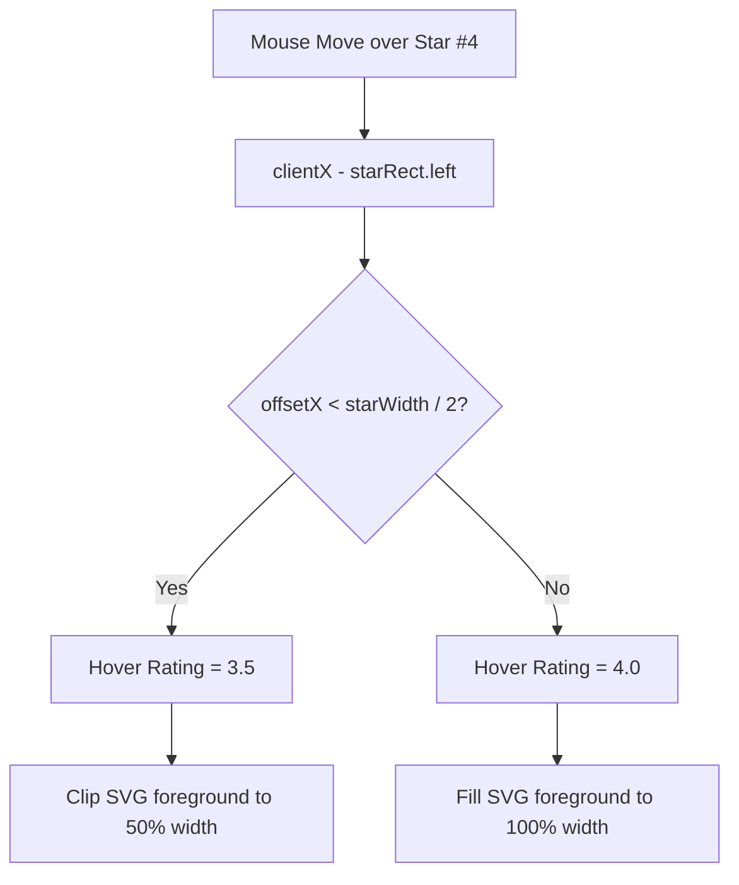

---

### Intuition & Mental Model: Half-Star Coordinate Mathematics

How do we detect if the mouse is on the left half vs right half of a star?
Using `element.getBoundingClientRect()`:

```
[ ★ Star Element: width = 40px ]
| <--- 20px ---> | <--- 20px ---> |
| Left Half      | Right Half     |
| Rating: 3.5    | Rating: 4.0    |

offsetX = event.clientX - starRect.left
if (offsetX < starRect.width / 2) -> rating = starIndex + 0.5
else                              -> rating = starIndex + 1.0
```

---

### Component Skeleton (Drafting the Blueprint)

```jsx
export function StarRatingSkeleton({ maxStars = 5, initialRating = 0, onChange }) {
  // 1. STATE SKELETON
  // const [rating, setRating] = useState(initialRating);
  // const [hoverRating, setHoverRating] = useState(null);

  // 2. COORDINATE CALCULATION HELPER
  // const calculateStarScore = (e, index) => { /* use getBoundingClientRect() */ };

  // 3. KEYBOARD SLIDER HANDLER
  // const handleKeyDown = (e) => { /* ArrowLeft, ArrowRight, Home, End */ };

  // 4. RENDER SKELETON
  return (
    <div role="slider">
      {/* 5 Star SVG elements with fill clip paths or partial highlights */}
      {/* Visual score display (e.g. "3.5 / 5") */}
    </div>
  );
}
```

---

### Step 1: Complete Implementation

```jsx
import React, { useState } from 'react';

export function StarRating({ maxStars = 5, initialRating = 0, onChange }) {
  const [rating, setRating] = useState(initialRating);
  const [hoverRating, setHoverRating] = useState(null);

  const displayRating = hoverRating != null ? hoverRating : rating;

  const calculateScore = (e, index) => {
    const rect = e.currentTarget.getBoundingClientRect();
    const isLeftHalf = e.clientX - rect.left < rect.width / 2;
    return isLeftHalf ? index + 0.5 : index + 1;
  };

  const handleMouseMove = (e, index) => {
    setHoverRating(calculateScore(e, index));
  };

  const handleClick = (e, index) => {
    const finalScore = calculateScore(e, index);
    setRating(finalScore);
    if (onChange) onChange(finalScore);
  };

  const handleKeyDown = (e) => {
    let nextRating = rating;
    if (e.key === 'ArrowRight' || e.key === 'ArrowUp') {
      e.preventDefault();
      nextRating = Math.min(maxStars, rating + 0.5);
    } else if (e.key === 'ArrowLeft' || e.key === 'ArrowDown') {
      e.preventDefault();
      nextRating = Math.max(0, rating - 0.5);
    } else if (e.key === 'Home') {
      e.preventDefault();
      nextRating = 0;
    } else if (e.key === 'End') {
      e.preventDefault();
      nextRating = maxStars;
    }

    if (nextRating !== rating) {
      setRating(nextRating);
      if (onChange) onChange(nextRating);
    }
  };

  return (
    <div
      role="slider"
      tabIndex={0}
      aria-label="Star Rating"
      aria-valuemin={0}
      aria-valuemax={maxStars}
      aria-valuenow={rating}
      aria-valuetext={`${rating} out of ${maxStars} stars`}
      onKeyDown={handleKeyDown}
      onMouseLeave={() => setHoverRating(null)}
      style={{
        display: 'inline-flex',
        alignItems: 'center',
        gap: '6px',
        padding: '8px',
        outline: 'none',
        fontFamily: 'sans-serif',
        userSelect: 'none'
      }}
    >
      <div style={{ display: 'flex', gap: '4px' }}>
        {Array.from({ length: maxStars }, (_, index) => {
          const fillPercentage = Math.max(0, Math.min(100, (displayRating - index) * 100));

          return (
            <div
              key={index}
              onMouseMove={(e) => handleMouseMove(e, index)}
              onClick={(e) => handleClick(e, index)}
              style={{
                position: 'relative',
                width: '32px',
                height: '32px',
                cursor: 'pointer',
                fontSize: '28px',
                lineHeight: '32px',
                textAlign: 'center'
              }}
            >
              {/* Background empty star */}
              <span style={{ color: '#d1d5db' }}>★</span>

              {/* Foreground filled star with CSS clip-path */}
              <span
                style={{
                  position: 'absolute',
                  top: 0,
                  left: 0,
                  color: '#f59e0b',
                  overflow: 'hidden',
                  width: `${fillPercentage}%`,
                  whiteSpace: 'nowrap'
                }}
              >
                ★
              </span>
            </div>
          );
        })}
      </div>

      <span style={{ marginLeft: '8px', fontSize: '15px', fontWeight: 'bold', color: '#4b5563' }}>
        {displayRating.toFixed(1)} / {maxStars}
      </span>
    </div>
  );
}
```

---

## Accessible Modal Dialog with Focus Trap & Portal

### The Interview Problem
Build an accessible Modal Dialog that mounts directly into `document.body` via `createPortal`.

**Key Requirements:**
1. **Focus Trap:** When the modal is open, pressing `Tab` must cycle focus strictly within the modal's focusable elements. It must NEVER leak focus to the page behind.
2. **Focus Restoration:** When the modal closes, focus must immediately return to the exact trigger button that opened it.
3. **Backdrop & Escape Key:** Pressing `Escape` or clicking the backdrop overlay closes the modal.
4. **Scroll Lock:** Prevent background document body scrolling while the modal is open.

---

### Visual UI Wireframe & Component Hierarchy

```
[ Full Browser Viewport - Background dimmed with rgba(0,0,0,0.5) ]
+-----------------------------------------------------------------+
|                                                                 |
|         +---------------------------------------------+         |
|         | Edit Profile                        [  ✕  ] |         |
|         +---------------------------------------------+         |
|         | Full Name: [ Alice Smith                  ] |         |
|         | Role:      [ Principal Architect          ] |         |
|         |                                             |         |
|         | [ Cancel ]                 [ Save Changes ] |         |
|         +---------------------------------------------+         |
|                                                                 |
+-----------------------------------------------------------------+
```

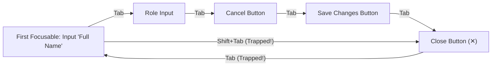

---

### Intuition & Mental Model: Focus Trap Algorithm

```
Focusable elements inside Modal: [ Input A, Button B, Close Button C ]
                                     ^                       ^
                                 FIRST                      LAST

User on LAST element (Close Button C) -> presses Tab:
  e.preventDefault();
  FIRST.focus();  <-- Cycles back to Input A!

User on FIRST element (Input A) -> presses Shift + Tab:
  e.preventDefault();
  LAST.focus();   <-- Cycles back to Close Button C!
```

---

### Component Skeleton (Drafting the Blueprint)

```jsx
export function ModalSkeleton({ isOpen, onClose, title, children }) {
  // 1. REFS SKELETON
  // const modalRef = useRef(null);
  // const previousActiveElement = useRef(null);

  // 2. FOCUS RESTORATION & BODY SCROLL LOCK
  // useEffect(() => {
  //   if (isOpen) {
  //     previousActiveElement.current = document.activeElement;
  //     document.body.style.overflow = 'hidden';
  //   }
  //   return () => {
  //     document.body.style.overflow = '';
  //     previousActiveElement.current?.focus();
  //   };
  // }, [isOpen]);

  // 3. KEYBOARD EVENT LISTENER (ESCAPE + FOCUS TRAP)
  // const handleKeyDown = (e) => { /* Trap Tab and Shift+Tab, close on Escape */ };

  // 4. PORTAL RENDER SKELETON
  // if (!isOpen) return null;
  // return createPortal(<div backdrop><div dialog role="dialog">{children}</div></div>, document.body);
}
```

---

### Step 1: Complete Implementation

```jsx
import React, { useEffect, useRef } from 'react';
import { createPortal } from 'react-dom';

export function Modal({ isOpen, onClose, title, children }) {
  const modalRef = useRef(null);
  const triggerElementRef = useRef(null);

  useEffect(() => {
    if (!isOpen) return;

    // 1. Capture currently focused element to restore later
    triggerElementRef.current = document.activeElement;

    // 2. Lock body scroll
    const originalOverflow = document.body.style.overflow;
    document.body.style.overflow = 'hidden';

    // 3. Move focus to the first focusable element inside modal
    const focusableElements = modalRef.current?.querySelectorAll(
      'button, [href], input, select, textarea, [tabindex]:not([tabindex="-1"])'
    );
    if (focusableElements && focusableElements.length > 0) {
      focusableElements[0].focus();
    }

    // 4. Keyboard trap handler
    const handleKeyDown = (e) => {
      if (e.key === 'Escape') {
        onClose();
        return;
      }

      if (e.key === 'Tab' && focusableElements && focusableElements.length > 0) {
        const first = focusableElements[0];
        const last = focusableElements[focusableElements.length - 1];

        if (e.shiftKey) {
          // Shift + Tab
          if (document.activeElement === first) {
            e.preventDefault();
            last.focus();
          }
        } else {
          // Regular Tab
          if (document.activeElement === last) {
            e.preventDefault();
            first.focus();
          }
        }
      }
    };

    document.addEventListener('keydown', handleKeyDown);

    // Cleanup: restore overflow, restore focus, remove listener
    return () => {
      document.body.style.overflow = originalOverflow;
      document.removeEventListener('keydown', handleKeyDown);
      if (triggerElementRef.current) {
        triggerElementRef.current.focus();
      }
    };
  }, [isOpen, onClose]);

  if (!isOpen || typeof document === 'undefined') return null;

  return createPortal(
    <div
      onClick={onClose}
      style={{
        position: 'fixed',
        top: 0,
        left: 0,
        right: 0,
        bottom: 0,
        backgroundColor: 'rgba(0, 0, 0, 0.5)',
        display: 'flex',
        alignItems: 'center',
        justifyContent: 'center',
        zIndex: 9999
      }}
    >
      <div
        ref={modalRef}
        role="dialog"
        aria-modal="true"
        aria-labelledby="modal-title"
        onClick={(e) => e.stopPropagation()} // Prevent backdrop click when clicking inside
        style={{
          backgroundColor: '#ffffff',
          borderRadius: '8px',
          padding: '24px',
          maxWidth: '480px',
          width: '90%',
          boxShadow: '0 20px 25px -5px rgba(0, 0, 0, 0.1)',
          fontFamily: 'sans-serif'
        }}
      >
        <div style={{ display: 'flex', justifyContent: 'space-between', alignItems: 'center', marginBottom: '16px' }}>
          <h3 id="modal-title" style={{ margin: 0, fontSize: '18px' }}>
            {title}
          </h3>
          <button
            onClick={onClose}
            aria-label="Close modal"
            style={{
              border: 'none',
              background: 'transparent',
              fontSize: '20px',
              cursor: 'pointer',
              color: '#666'
            }}
          >
            ×
          </button>
        </div>

        <div>{children}</div>
      </div>
    </div>,
    document.body
  );
}
```

---

## Compound Component Tabs with Sliding Indicator

### The Interview Problem
Build an accessible Tabs component using the Compound Component Pattern (similar to Radix UI or Headless UI) featuring an animated sliding underline indicator.

**Key Requirements:**
1. Ergonomic compound syntax:
   ```jsx
   <Tabs defaultValue="tab1">
     <TabList>
       <Tab value="tab1">Account</Tab>
       <Tab value="tab2">Password</Tab>
     </TabList>
     <TabPanels>
       <TabPanel value="tab1">Account Form</TabPanel>
       <TabPanel value="tab2">Password Form</TabPanel>
     </TabPanels>
   </Tabs>
   ```
2. Hardware-accelerated sliding underline tracking the active tab button's `offsetLeft` and `clientWidth`.
3. WAI-ARIA compliance: `role="tablist"`, `role="tab"`, `role="tabpanel"`, `aria-selected`, `aria-controls`.

---

### Visual UI Wireframe & Component Hierarchy

```
+-------------------------------------------------------------+
| [ Account ]     [ Notifications ]     [ Security ]          |
| ═══════════ (Sliding Underline: offsetLeft, clientWidth)    |
+-------------------------------------------------------------+
| Account Preferences:                                        |
| Manage your public email and linked authentication devices. |
+-------------------------------------------------------------+
```

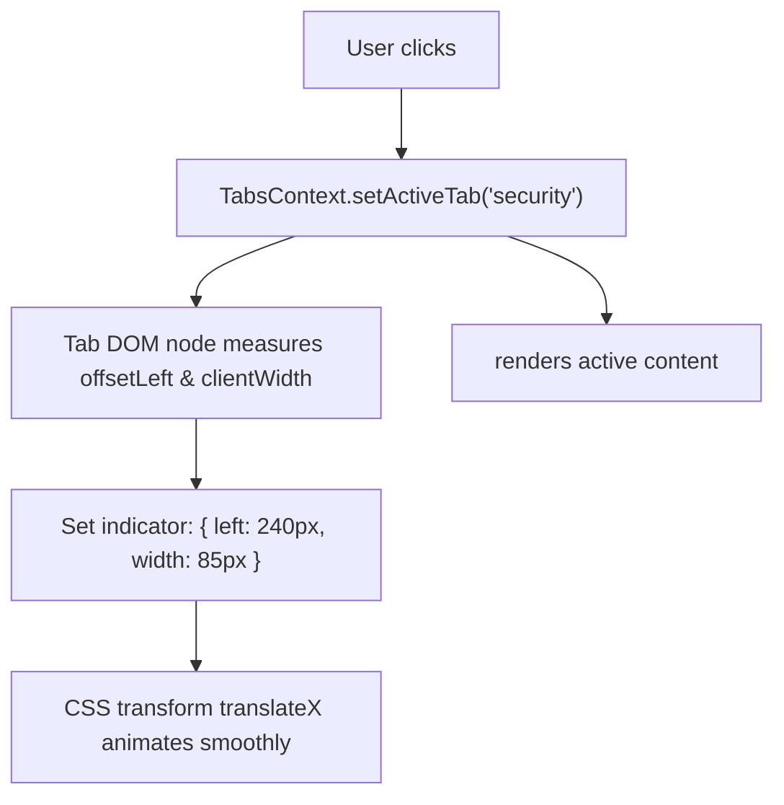

---

### Intuition & Mental Model: Compound Component Coordination

How do deep children (`<Tab>` and `<TabPanel>`) talk to each other without prop drilling?
Through a shared React Context:

```
[ Tabs Context Provider ]
  State: { activeTab, setActiveTab, indicatorStyle, setIndicatorStyle }
    |
    +---> <TabList>
    |       |---> <Tab value="1"> (registers click & calculates DOM offset)
    |       |---> <Tab value="2">
    |       |---> <div sliding-indicator /> (reads indicatorStyle)
    |
    +---> <TabPanels>
            |---> <TabPanel value="1"> (renders if activeTab === "1")
            |---> <TabPanel value="2">
```

---

### Component Skeleton (Drafting the Blueprint)

```jsx
const TabsContext = React.createContext(null);

export function TabsSkeleton({ defaultValue, children }) {
  // const [activeTab, setActiveTab] = useState(defaultValue);
  // const [indicator, setIndicator] = useState({ left: 0, width: 0 });
  // return <TabsContext.Provider value={...}>{children}</TabsContext.Provider>;
}

export function TabListSkeleton({ children }) { /* Renders tablist container + indicator */ }
export function TabSkeleton({ value, children }) { /* Renders tab button */ }
export function TabPanelsSkeleton({ children }) { /* Renders wrapper */ }
export function TabPanelSkeleton({ value, children }) { /* Renders panel if active */ }
```

---

### Step 1: Complete Implementation

```jsx
import React, { createContext, useContext, useState, useRef, useEffect } from 'react';

const TabsContext = createContext(null);

export function Tabs({ defaultValue, children }) {
  const [activeTab, setActiveTab] = useState(defaultValue);
  const [indicatorStyle, setIndicatorStyle] = useState({ left: 0, width: 0 });

  return (
    <TabsContext.Provider value={{ activeTab, setActiveTab, indicatorStyle, setIndicatorStyle }}>
      <div style={{ fontFamily: 'sans-serif' }}>{children}</div>
    </TabsContext.Provider>
  );
}

export function TabList({ children }) {
  const { indicatorStyle } = useContext(TabsContext);

  return (
    <div
      role="tablist"
      style={{
        display: 'flex',
        position: 'relative',
        borderBottom: '2px solid #e5e7eb',
        gap: '8px'
      }}
    >
      {children}
      {/* Dynamic Sliding Underline */}
      <div
        style={{
          position: 'absolute',
          bottom: '-2px',
          left: `${indicatorStyle.left}px`,
          width: `${indicatorStyle.width}px`,
          height: '2px',
          backgroundColor: '#2563eb',
          transition: 'all 0.25s cubic-bezier(0.4, 0, 0.2, 1)'
        }}
      />
    </div>
  );
}

export function Tab({ value, children }) {
  const { activeTab, setActiveTab, setIndicatorStyle } = useContext(TabsContext);
  const tabRef = useRef(null);
  const isSelected = activeTab === value;

  useEffect(() => {
    if (isSelected && tabRef.current) {
      setIndicatorStyle({
        left: tabRef.current.offsetLeft,
        width: tabRef.current.clientWidth
      });
    }
  }, [isSelected, setIndicatorStyle]);

  return (
    <button
      ref={tabRef}
      role="tab"
      aria-selected={isSelected}
      onClick={() => setActiveTab(value)}
      style={{
        padding: '10px 16px',
        border: 'none',
        background: 'transparent',
        cursor: 'pointer',
        fontWeight: isSelected ? 600 : 400,
        color: isSelected ? '#2563eb' : '#6b7280',
        fontSize: '14px'
      }}
    >
      {children}
    </button>
  );
}

export function TabPanels({ children }) {
  return <div style={{ paddingTop: '16px' }}>{children}</div>;
}

export function TabPanel({ value, children }) {
  const { activeTab } = useContext(TabsContext);
  if (activeTab !== value) return null;

  return (
    <div role="tabpanel" style={{ fontSize: '14px', color: '#374151' }}>
      {children}
    </div>
  );
}
```


## Toast Notification System (Context + Portal)

### The Interview Problem
Build a global toast alert notification system in React 18. Any component anywhere in the tree must be able to trigger a toast, which renders fixed on top of the screen via a Portal and automatically dismisses itself after $N$ seconds.

**Key Requirements:**
1. Global triggering via `const { showToast } = useToast()`.
2. Stacked alerts rendered in `document.body` via `createPortal`.
3. Auto-dismissal timers: each toast schedules a `setTimeout` to remove itself.
4. Hover pause: hovering over a toast pauses its timer so long messages can be read.

---

### Visual UI Wireframe & Component Hierarchy

```
[ Application Viewport ]
+-------------------------------------------------------------+
| Any page content, tables, or buttons                        |
|                                                             |
|                               +---------------------------+ |
|                               | ✓ Account updated!    [✕] | |
|                               +---------------------------+ |
|                               | ⚠️ Network retry in 5s [✕] | |
|                               +---------------------------+ |
+-------------------------------------------------------------+
  (Toasts fixed at bottom-right | Auto-dismiss in 4s | Hover pauses)
```

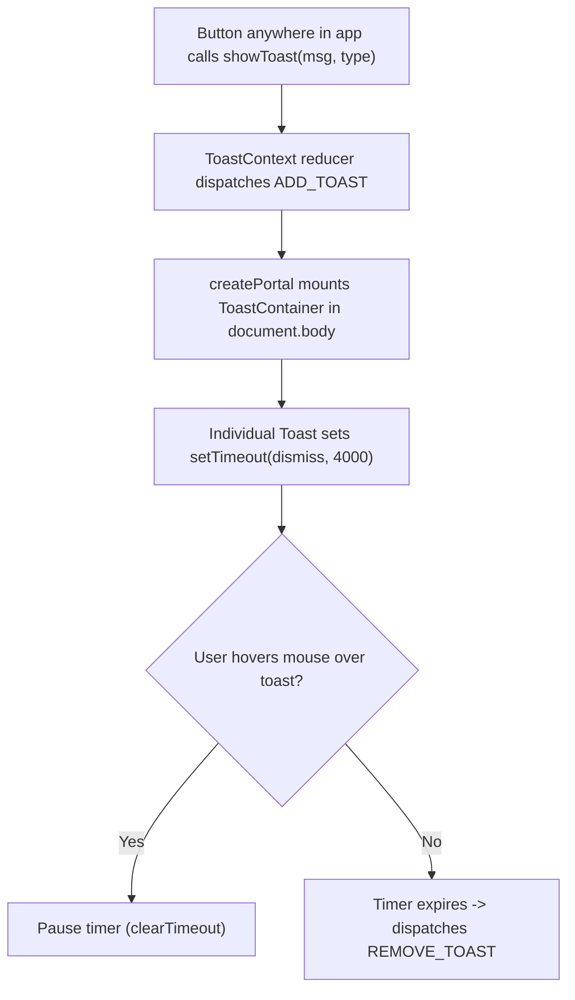

---

### Intuition & Mental Model: Context + Portal Separation

Where does the state live, and where does the DOM live?

```
[ Deeply Nested Component ] ---> calls showToast("Saved!", "success")
                                        |
                                        v
                            [ ToastContext.Provider ]
                              State: [ { id, message, type, duration } ]
                                        |
                                        v (createPortal)
                            <div id="toast-root"> (fixed at bottom-right)
                              [ Toast 1 ] [ Toast 2 ]
                            </div>
```

---

### Component Skeleton (Drafting the Blueprint)

```jsx
const ToastContext = React.createContext(null);

export function ToastProviderSkeleton({ children }) {
  // 1. STATE SKELETON
  // const [toasts, dispatch] = useReducer(toastReducer, []);

  // 2. DISPATCH ACTIONS
  // const showToast = (message, type, duration) => { ... };
  // const removeToast = (id) => { ... };

  // 3. RENDER SKELETON WITH PORTAL
  // return (
  //   <ToastContext.Provider value={{ showToast, removeToast }}>
  //     {children}
  //     {createPortal(<ToastContainer toasts={toasts} onDismiss={removeToast} />, document.body)}
  //   </ToastContext.Provider>
  // );
}

export function ToastItemSkeleton({ toast, onDismiss }) {
  // Timer with pause-on-hover state
  // const [isPaused, setIsPaused] = useState(false);
  // useEffect timer setup...
}
```

---

### Step 1: Self-Dismissing Toast Item with Hover-Pause

```javascript
function ToastItem({ toast, onDismiss }) {
  const { id, message, type = 'info', duration = 4000 } = toast;
  const [isPaused, setIsPaused] = useState(false);
  const timerRef = useRef(null);

  useEffect(() => {
    if (isPaused) return;

    timerRef.current = setTimeout(() => {
      onDismiss(id);
    }, duration);

    // Crucial cleanup: clear timer on unmount or pause
    return () => {
      if (timerRef.current) clearTimeout(timerRef.current);
    };
  }, [id, duration, isPaused, onDismiss]);

  return (
    <div
      role="alert"
      onMouseEnter={() => setIsPaused(true)}
      onMouseLeave={() => setIsPaused(false)}
      style={{
        padding: '12px 16px',
        borderRadius: '6px',
        backgroundColor: type === 'error' ? '#dc2626' : '#2563eb',
        color: '#fff',
        display: 'flex',
        alignItems: 'center',
        justifyContent: 'space-between',
        gap: '12px',
        minWidth: '280px',
        boxShadow: '0 4px 12px rgba(0,0,0,0.15)'
      }}
    >
      <span>{message}</span>
      <button
        onClick={() => onDismiss(id)}
        aria-label="Close alert"
        style={{ background: 'transparent', border: 'none', color: '#fff', cursor: 'pointer', fontSize: '16px' }}
      >
        ×
      </button>
    </div>
  );
}
```

---

### Step 2: Complete Implementation

```jsx
import React, { createContext, useContext, useReducer, useCallback, useEffect, useRef, useState } from 'react';
import { createPortal } from 'react-dom';

const ToastContext = createContext(null);

function toastReducer(state, action) {
  switch (action.type) {
    case 'ADD_TOAST':
      return [...state, action.payload];
    case 'REMOVE_TOAST':
      return state.filter((t) => t.id !== action.payload);
    default:
      return state;
  }
}

function ToastItemComponent({ toast, onDismiss }) {
  const { id, message, type = 'info', duration = 4000 } = toast;
  const [isPaused, setIsPaused] = useState(false);
  const timerRef = useRef(null);

  useEffect(() => {
    if (isPaused) return;

    timerRef.current = setTimeout(() => {
      onDismiss(id);
    }, duration);

    return () => {
      if (timerRef.current) clearTimeout(timerRef.current);
    };
  }, [id, duration, isPaused, onDismiss]);

  const bgColors = {
    info: '#2563eb',
    success: '#16a34a',
    warning: '#d97706',
    error: '#dc2626'
  };

  return (
    <div
      role="alert"
      onMouseEnter={() => setIsPaused(true)}
      onMouseLeave={() => setIsPaused(false)}
      style={{
        backgroundColor: bgColors[type] || bgColors.info,
        color: '#ffffff',
        padding: '12px 16px',
        borderRadius: '6px',
        boxShadow: '0 4px 12px rgba(0,0,0,0.15)',
        display: 'flex',
        alignItems: 'center',
        justifyContent: 'space-between',
        gap: '12px',
        minWidth: '260px',
        maxWidth: '400px'
      }}
    >
      <span style={{ fontSize: '14px' }}>{message}</span>
      <button
        onClick={() => onDismiss(id)}
        aria-label="Dismiss alert"
        style={{
          background: 'transparent',
          border: 'none',
          color: '#ffffff',
          cursor: 'pointer',
          fontWeight: 'bold',
          fontSize: '16px'
        }}
      >
        ×
      </button>
    </div>
  );
}

export function ToastProvider({ children }) {
  const [toasts, dispatch] = useReducer(toastReducer, []);

  const removeToast = useCallback((id) => {
    dispatch({ type: 'REMOVE_TOAST', payload: id });
  }, []);

  const showToast = useCallback((message, type = 'info', duration = 4000) => {
    const id = Date.now().toString(36) + Math.random().toString(36).slice(2);
    dispatch({ type: 'ADD_TOAST', payload: { id, message, type, duration } });
    return id;
  }, []);

  return (
    <ToastContext.Provider value={{ showToast, removeToast }}>
      {children}
      {typeof document !== 'undefined' &&
        createPortal(
          <div
            aria-live="polite"
            style={{
              position: 'fixed',
              bottom: '24px',
              right: '24px',
              display: 'flex',
              flexDirection: 'column',
              gap: '10px',
              zIndex: 9999
            }}
          >
            {toasts.map((toast) => (
              <ToastItemComponent key={toast.id} toast={toast} onDismiss={removeToast} />
            ))}
          </div>,
          document.body
        )}
    </ToastContext.Provider>
  );
}

export function useToast() {
  const context = useContext(ToastContext);
  if (!context) {
    throw new Error('useToast must be used within a <ToastProvider>');
  }
  return context;
}
```

---

## Recursive File and Folder Tree Explorer

### The Interview Problem
Build a recursive tree view component (like the VS Code file explorer or OS file system) supporting expand/collapse, nested indentation, and adding child files or folders at any directory depth.

**Key Requirements:**
1. Recursive component rendering (a component that renders instances of itself).
2. Deep immutable state traversal: adding a node inside a deeply nested folder without mutating parent objects.
3. Independent folder open/close state per directory.

---

### Visual UI Wireframe & Component Hierarchy

```
+-------------------------------------------------------------+
| WORKSPACE EXPLORER                                          |
+-------------------------------------------------------------+
| 📂 my-project                               [ +File ] [ +Dir]|
|   📂 src                                    [ +File ] [ +Dir]|
|     📄 App.jsx                                              |
|     📄 styles.css                                           |
|   📁 node_modules                                           |
|   📄 package.json                                           |
|   📄 README.md                                              |
+-------------------------------------------------------------+
```

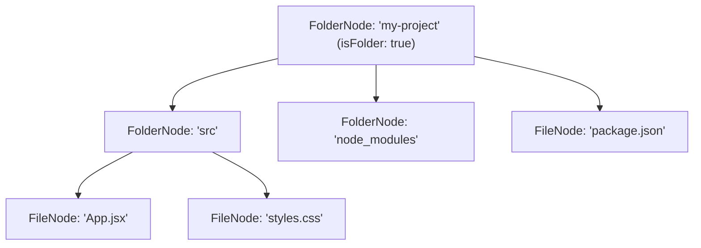

---

### Intuition & Mental Model: The Recursive Rendering Step

```
FolderNode (id: "root", name: "my-project")
  |-- Renders folder name + toggle arrow
  |-- If open:
        Children.map(child =>
          child.isFolder
            ? <FolderNode key={child.id} item={child} />  <-- Recursive call!
            : <FileNode key={child.id} item={child} />
        )
```

---

### Component Skeleton (Drafting the Blueprint)

```jsx
export function FileTreeNodeSkeleton({ item, onAddChild, depth = 0 }) {
  // 1. INDEPENDENT STATE SKELETON
  // const [isOpen, setIsOpen] = useState(false);
  // const [isCreating, setIsCreating] = useState(false); // file or folder

  // 2. BASE CASE
  // if (!item.isFolder) { return <div>📄 {item.name}</div>; }

  // 3. RECURSIVE CASE
  // return (
  //   <div>
  //     <div onClick={() => setIsOpen(!isOpen)}>📁 {item.name}</div>
  //     {isOpen && item.children.map(child => (
  //       <FileTreeNodeSkeleton key={child.id} item={child} depth={depth + 1} />
  //     ))}
  //   </div>
  // );
}
```

---

### Step 1: Pure Recursive Tree Mutation Helper

```javascript
function insertNodeIntoTree(tree, parentId, newNode) {
  // Base Case 1: Found target folder
  if (tree.id === parentId && tree.isFolder) {
    return {
      ...tree,
      children: [...(tree.children || []), newNode]
    };
  }

  // Base Case 2: Leaf node with no children
  if (!tree.children) return tree;

  // Recursive Step: Walk children
  return {
    ...tree,
    children: tree.children.map((child) =>
      insertNodeIntoTree(child, parentId, newNode)
    )
  };
}
```

---

### Step 2: Complete Implementation

```jsx
import React, { useState } from 'react';

const initialFileSystem = {
  id: 'root',
  name: 'my-project',
  isFolder: true,
  children: [
    {
      id: 'src',
      name: 'src',
      isFolder: true,
      children: [
        { id: 'app-jsx', name: 'App.jsx', isFolder: false },
        { id: 'styles-css', name: 'styles.css', isFolder: false }
      ]
    },
    { id: 'package-json', name: 'package.json', isFolder: false },
    { id: 'readme-md', name: 'README.md', isFolder: false }
  ]
};

function insertNode(tree, parentId, newNode) {
  if (tree.id === parentId && tree.isFolder) {
    return { ...tree, children: [...(tree.children || []), newNode] };
  }
  if (!tree.children) return tree;
  return {
    ...tree,
    children: tree.children.map((child) => insertNode(child, parentId, newNode))
  };
}

export function FileTreeNode({ item, onAddNode, depth = 0 }) {
  const [isOpen, setIsOpen] = useState(false);
  const [isAdding, setIsAdding] = useState(false);
  const [isNewFolder, setIsNewFolder] = useState(false);
  const [nameInput, setNameInput] = useState('');

  const handleStartAdd = (e, isFolder) => {
    e.stopPropagation();
    setIsOpen(true);
    setIsNewFolder(isFolder);
    setIsAdding(true);
  };

  const handleConfirmAdd = () => {
    const trimmed = nameInput.trim();
    if (trimmed) {
      onAddNode(item.id, {
        id: Date.now().toString(),
        name: trimmed,
        isFolder: isNewFolder,
        children: isNewFolder ? [] : undefined
      });
    }
    setIsAdding(false);
    setNameInput('');
  };

  if (!item.isFolder) {
    return (
      <div style={{ paddingLeft: `${depth * 20 + 20}px`, padding: '4px 0', fontSize: '14px', color: '#444' }}>
        📄 {item.name}
      </div>
    );
  }

  return (
    <div>
      <div
        onClick={() => setIsOpen(!isOpen)}
        style={{
          paddingLeft: `${depth * 20}px`,
          padding: '6px 8px',
          cursor: 'pointer',
          display: 'flex',
          alignItems: 'center',
          gap: '6px',
          fontSize: '14px',
          fontWeight: 600,
          backgroundColor: '#f8fafc',
          borderRadius: '4px',
          marginBottom: '2px'
        }}
      >
        <span>{isOpen ? '📂' : '📁'}</span>
        <span>{item.name}</span>

        <div style={{ marginLeft: 'auto', display: 'flex', gap: '4px' }}>
          <button
            onClick={(e) => handleStartAdd(e, false)}
            style={{ fontSize: '11px', padding: '1px 6px', cursor: 'pointer' }}
          >
            + File
          </button>
          <button
            onClick={(e) => handleStartAdd(e, true)}
            style={{ fontSize: '11px', padding: '1px 6px', cursor: 'pointer' }}
          >
            + Folder
          </button>
        </div>
      </div>

      {isOpen && (
        <div>
          {isAdding && (
            <div style={{ paddingLeft: `${(depth + 1) * 20 + 10}px`, margin: '4px 0' }}>
              <span style={{ marginRight: '4px' }}>{isNewFolder ? '📁' : '📄'}</span>
              <input
                autoFocus
                value={nameInput}
                onChange={(e) => setNameInput(e.target.value)}
                onKeyDown={(e) => {
                  if (e.key === 'Enter') handleConfirmAdd();
                  if (e.key === 'Escape') setIsAdding(false);
                }}
                onBlur={handleConfirmAdd}
                placeholder={isNewFolder ? 'Folder name...' : 'File name...'}
                style={{ padding: '2px 6px', fontSize: '13px' }}
              />
            </div>
          )}

          {item.children &&
            item.children.map((child) => (
              <FileTreeNode key={child.id} item={child} onAddNode={onAddNode} depth={depth + 1} />
            ))}
        </div>
      )}
    </div>
  );
}

export function FileExplorer() {
  const [tree, setTree] = useState(initialFileSystem);

  const handleAdd = (parentId, newNode) => {
    setTree((prev) => insertNode(prev, parentId, newNode));
  };

  return (
    <div style={{ width: '320px', border: '1px solid #ccc', borderRadius: '8px', padding: '12px', fontFamily: 'monospace' }}>
      <div style={{ fontWeight: 'bold', borderBottom: '1px solid #eee', paddingBottom: '6px', marginBottom: '8px' }}>
        WORKSPACE EXPLORER
      </div>
      <FileTreeNode item={tree} onAddNode={handleAdd} depth={0} />
    </div>
  );
}
```

---

## Infinite Feed with Intersection Observer

### The Interview Problem
Build an infinite scroll feed that automatically loads the next page of posts as the user scrolls towards the bottom.

**Key Requirements:**
1. Use `IntersectionObserver` instead of raw window scroll event listeners.
2. Sentinel element pattern: observe an invisible anchor element at the bottom of the feed.
3. Concurrency guard: prevent duplicate page fetches while a request is currently in-flight.
4. Clean disconnect of the observer on unmount.

---

### Visual UI Wireframe & Component Hierarchy

```
+-------------------------------------------------------------+
| Community Activity Feed                                     |
+-------------------------------------------------------------+
| [ Card #1: Architecture review submitted ]                  |
+-------------------------------------------------------------+
| [ Card #2: Migrated modal dialog to Radix UI ]              |
+-------------------------------------------------------------+
| [ Card #3: Benchmarked virtual scroll windowing ]           |
+-------------------------------------------------------------+
|  ... (cards continue down the page)                         |
+-------------------------------------------------------------+
| [ Sentinel Element: ⟳ Loading next 10 stories... ]          |
+-------------------------------------------------------------+
```

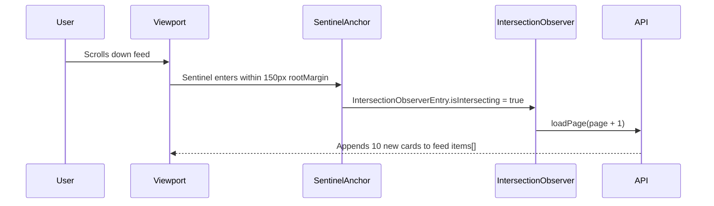

---

### Intuition & Mental Model: The Sentinel Target

```
[ Visible Viewport Window ]
| Post #1                 |
| Post #2                 |
| Post #3                 |
+-------------------------+
| Post #4                 |
| ...                     |
| Post #10                |
+-------------------------+  <-- rootMargin (trigger 150px early!)
| [ Sentinel Anchor Ref ] |  <-- When this intersects: fetchNextPage()
+-------------------------+
```

---

### Component Skeleton (Drafting the Blueprint)

```jsx
export function InfiniteFeedSkeleton() {
  // 1. STATE SKELETON
  // const [items, setItems] = useState([]);
  // const [page, setPage] = useState(1);
  // const [isLoading, setIsLoading] = useState(false);
  // const [hasMore, setHasMore] = useState(true);

  // 2. SENTINEL REF
  // const sentinelRef = useRef(null);

  // 3. INTERSECTION OBSERVER EFFECT SKELETON
  // useEffect(() => {
  //   const observer = new IntersectionObserver((entries) => {
  //     if (entries[0].isIntersecting && !isLoading && hasMore) {
  //       loadPage(page + 1);
  //     }
  //   }, { rootMargin: '150px' });
  //   if (sentinelRef.current) observer.observe(sentinelRef.current);
  //   return () => observer.disconnect();
  // }, [hasMore, isLoading, page]);

  // 4. RENDER SKELETON
  // return <div>{items.map(...)}<div ref={sentinelRef}>{loading indicator}</div></div>;
}
```

---

### Step 1: Complete Implementation

```jsx
import React, { useState, useEffect, useRef, useCallback } from 'react';

function mockFeedAPI(pageNum, pageSize = 10) {
  return new Promise((resolve) => {
    setTimeout(() => {
      const offset = (pageNum - 1) * pageSize;
      const newItems = Array.from({ length: pageSize }, (_, i) => ({
        id: offset + i + 1,
        title: `Community Update #${offset + i + 1}`,
        body: `Detailed engineering log for item ${offset + i + 1}.`
      }));
      resolve({ items: newItems, hasMore: pageNum < 4 }); // End at page 4 (40 items total)
    }, 700);
  });
}

export function InfiniteFeed() {
  const [items, setItems] = useState([]);
  const [page, setPage] = useState(1);
  const [isLoading, setIsLoading] = useState(false);
  const [hasMore, setHasMore] = useState(true);

  const sentinelRef = useRef(null);

  const loadPage = useCallback(async (targetPage) => {
    setIsLoading(true);
    try {
      const data = await mockFeedAPI(targetPage);
      setItems((prev) => [...prev, ...data.items]);
      setHasMore(data.hasMore);
    } catch (err) {
      console.error('Failed to load feed page:', err);
    } finally {
      setIsLoading(false);
    }
  }, []);

  // Fetch initial page 1
  useEffect(() => {
    loadPage(1);
  }, [loadPage]);

  // Setup IntersectionObserver on the bottom sentinel
  useEffect(() => {
    if (!hasMore || isLoading) return;

    const observer = new IntersectionObserver(
      (entries) => {
        if (entries[0].isIntersecting) {
          setPage((prev) => {
            const next = prev + 1;
            loadPage(next);
            return next;
          });
        }
      },
      { root: null, rootMargin: '150px', threshold: 0.1 }
    );

    const currentSentinel = sentinelRef.current;
    if (currentSentinel) {
      observer.observe(currentSentinel);
    }

    return () => {
      if (currentSentinel) observer.unobserve(currentSentinel);
      observer.disconnect();
    };
  }, [hasMore, isLoading, loadPage]);

  return (
    <div style={{ maxWidth: '520px', margin: '20px auto', fontFamily: 'sans-serif' }}>
      <h2>Activity Feed</h2>

      <div style={{ display: 'flex', flexDirection: 'column', gap: '12px' }}>
        {items.map((item) => (
          <div
            key={item.id}
            style={{
              padding: '16px',
              border: '1px solid #e2e8f0',
              borderRadius: '8px',
              backgroundColor: '#ffffff',
              boxShadow: '0 1px 3px rgba(0,0,0,0.05)'
            }}
          >
            <h4 style={{ margin: '0 0 6px 0' }}>{item.title}</h4>
            <p style={{ margin: 0, color: '#64748b', fontSize: '14px' }}>{item.body}</p>
          </div>
        ))}
      </div>

      {/* Sentinel Element */}
      <div
        ref={sentinelRef}
        style={{
          padding: '20px 0',
          textAlign: 'center',
          color: '#888',
          fontSize: '13px'
        }}
      >
        {isLoading && <span>Loading more stories...</span>}
        {!hasMore && <span>You are all caught up!</span>}
      </div>
    </div>
  );
}
```

---

## Drag-and-Drop Kanban Board (Native HTML5 API)

### The Interview Problem
Build a Kanban project management board with draggable cards across columns (e.g. *Todo* $	o$ *In Progress* $	o$ *Done*) using the browser's native HTML5 Drag and Drop API.

**Key Requirements:**
1. Native HTML5 API: `draggable`, `onDragStart`, `onDragOver`, and `onDrop`.
2. Move cards cleanly between columns.
3. Visual feedback during drag operations (e.g. reduced opacity of dragged item).
4. Zero third-party drag-and-drop library dependencies.

---

### Visual UI Wireframe & Component Hierarchy

```
+-------------------------------------------------------------+
| Sprint Kanban Board                                         |
+--------------------+-------------------+--------------------+
| To Do (2)          | In Progress (1)   | Done (1)           |
+--------------------+-------------------+--------------------+
| [ Card 1: Tests  ] | [ Card 3: Debounce]| [ Card 4: CI/CD ] |
| [ Card 2: Modal  ] |                   |                    |
|                    | [ Drop area ]     |                    |
+--------------------+-------------------+--------------------+
```

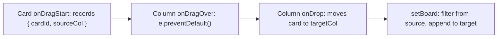

---

### Intuition & Mental Model: Native DnD Triad

```
Card (draggable) ---> onDragStart: records { cardId, sourceColumnId }
                             |
                             v
Column (drop target) -> onDragOver: MUST call e.preventDefault()
                             |
                             v
Column (drop target) -> onDrop: extracts dragged info and updates state
```

---

### Component Skeleton (Drafting the Blueprint)

```jsx
export function KanbanSkeleton() {
  // 1. STATE SKELETON
  // const [columns, setColumns] = useState(initialBoardData);
  // const [draggedInfo, setDraggedInfo] = useState(null); // { cardId, sourceColId }

  // 2. DND EVENT HANDLERS
  // const handleDragStart = (cardId, colId) => setDraggedInfo({ cardId, sourceColId: colId });
  // const handleDragOver = (e) => e.preventDefault(); // REQUIRED!
  // const handleDrop = (targetColId) => { /* Move card in state */ };

  // 3. RENDER SKELETON
  // return <div columns-container>{Object.values(columns).map(col => <div onDragOver onDrop>{cards}</div>)}</div>;
}
```

---

### Step 1: Complete Implementation

```jsx
import React, { useState } from 'react';

const initialBoard = {
  todo: {
    id: 'todo',
    title: 'To Do',
    items: [
      { id: 'task-1', title: 'Write unit tests' },
      { id: 'task-2', title: 'Audit focus trap in Modal' }
    ]
  },
  inProgress: {
    id: 'inProgress',
    title: 'In Progress',
    items: [
      { id: 'task-3', title: 'Implement debounce hook' }
    ]
  },
  done: {
    id: 'done',
    title: 'Done',
    items: [
      { id: 'task-4', title: 'Setup repository & CI' }
    ]
  }
};

export function KanbanBoard() {
  const [board, setBoard] = useState(initialBoard);
  const [draggedItem, setDraggedItem] = useState(null);

  const handleDragStart = (cardId, sourceColId) => {
    setDraggedItem({ cardId, sourceColId });
  };

  const handleDragOver = (e) => {
    e.preventDefault(); // Unlocks dropping in browser
  };

  const handleDrop = (targetColId) => {
    if (!draggedItem) return;
    const { cardId, sourceColId } = draggedItem;

    if (sourceColId === targetColId) {
      setDraggedItem(null);
      return;
    }

    setBoard((prev) => {
      const sourceCol = prev[sourceColId];
      const targetCol = prev[targetColId];

      const itemToMove = sourceCol.items.find((i) => i.id === cardId);
      if (!itemToMove) return prev;

      return {
        ...prev,
        [sourceColId]: {
          ...sourceCol,
          items: sourceCol.items.filter((i) => i.id !== cardId)
        },
        [targetColId]: {
          ...targetCol,
          items: [...targetCol.items, itemToMove]
        }
      };
    });

    setDraggedItem(null);
  };

  return (
    <div style={{ display: 'flex', gap: '16px', padding: '16px', fontFamily: 'sans-serif' }}>
      {Object.values(board).map((col) => (
        <div
          key={col.id}
          onDragOver={handleDragOver}
          onDrop={() => handleDrop(col.id)}
          style={{
            flex: 1,
            backgroundColor: '#f1f5f9',
            borderRadius: '8px',
            padding: '12px',
            minHeight: '320px'
          }}
        >
          <h3 style={{ fontSize: '15px', margin: '0 0 12px 0', color: '#1e293b' }}>
            {col.title} ({col.items.length})
          </h3>

          <div style={{ display: 'flex', flexDirection: 'column', gap: '8px' }}>
            {col.items.map((item) => (
              <div
                key={item.id}
                draggable
                onDragStart={() => handleDragStart(item.id, col.id)}
                style={{
                  backgroundColor: '#ffffff',
                  padding: '12px',
                  borderRadius: '6px',
                  boxShadow: '0 1px 3px rgba(0,0,0,0.1)',
                  cursor: 'grab',
                  border: '1px solid #cbd5e1',
                  opacity: draggedItem?.cardId === item.id ? 0.4 : 1
                }}
              >
                {item.title}
              </div>
            ))}
            {col.items.length === 0 && (
              <div style={{ textAlign: 'center', padding: '30px 0', color: '#94a3b8', fontSize: '13px' }}>
                Drop items here
              </div>
            )}
          </div>
        </div>
      ))}
    </div>
  );
}
```

---

## React 18 Optimistic Mutation with Manual Rollback

### The Interview Problem
Build an optimistic like/bookmark button in React 18 that immediately updates the UI upon clicking, sends an asynchronous mutation to the server in the background, and automatically rolls back to a saved state snapshot if the network request fails.

**Key Requirements:**
1. Instant feedback: zero latency on user click.
2. Snapshot capture: save previous counts/states before dispatching mutation.
3. Rollback on failure: revert to snapshot and display error banner.
4. Prevention of concurrent spamming while mutation is pending.

---

### Visual UI Wireframe & Component Hierarchy

```
+-------------------------------------------------------------+
| Optimistic Like Counter                                     |
|                                                             |
| +---------------------------------------------------------+ |
| | ❤️ 43 Likes  (Saving...)                                 | |
| +---------------------------------------------------------+ |
|                                                             |
| [ ⚠️ Network timeout: Could not record like. Reverted.   ]  |
+-------------------------------------------------------------+
```

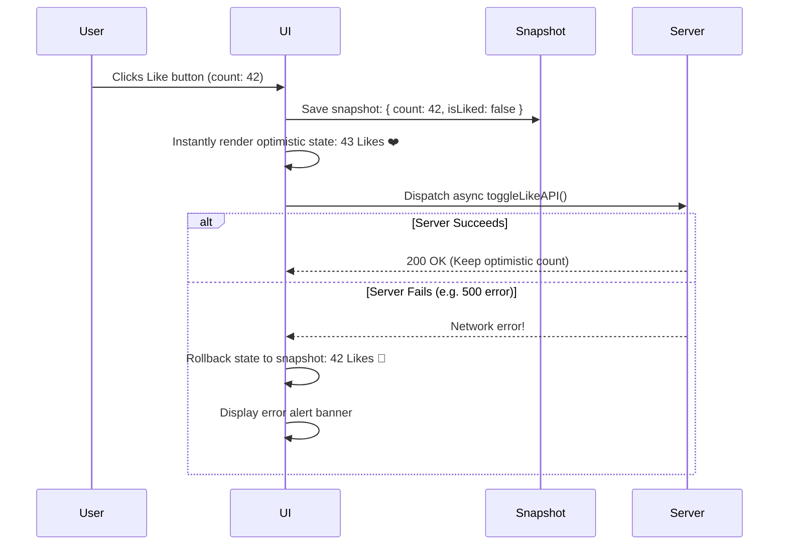

---

### Intuition & Mental Model: Snapshot and Rollback Cycle

```
User clicks "Like":
  1. Capture snapshot: { previousLikes, previousIsLiked }
  2. Optimistic update: setLikes(likes + 1), setIsLiked(true)
  3. API mutation dispatched in background:
        |
        +---> [SUCCESS]: Keep state, nothing more to do!
        |
        +---> [ERROR]  : setLikes(previousLikes), setIsLiked(previousIsLiked)
                         Show error toast: "Failed to like post"
```

---

### Component Skeleton (Drafting the Blueprint)

```jsx
export function OptimisticButtonSkeleton({ postId, initialLikes = 10, initialIsLiked = false }) {
  // 1. STATE SKELETON
  // const [likes, setLikes] = useState(initialLikes);
  // const [isLiked, setIsLiked] = useState(initialIsLiked);
  // const [isPending, setIsPending] = useState(false);
  // const [error, setError] = useState(null);

  // 2. MUTATION HANDLER STUB
  // const handleToggle = async () => {
  //   const snapshot = { likes, isLiked };
  //   // 1. Optimistic update
  //   // 2. try/catch async api call
  //   // 3. Rollback on error
  // };

  // 3. RENDER SKELETON
  return <div>{/* Like button with pending indicator and error banner */}</div>;
}
```

---

### Step 1: Complete Implementation

```jsx
import React, { useState } from 'react';

// Simulated API with 40% random failure
function mockLikeAPI(postId, nextLiked) {
  return new Promise((resolve, reject) => {
    setTimeout(() => {
      const isSuccess = Math.random() > 0.4;
      if (isSuccess) {
        resolve({ success: true, isLiked: nextLiked });
      } else {
        reject(new Error('Network timeout: could not record like.'));
      }
    }, 800);
  });
}

export function OptimisticLikeButton({ postId = 'post-101', initialLikes = 42, initialIsLiked = false }) {
  const [likes, setLikes] = useState(initialLikes);
  const [isLiked, setIsLiked] = useState(initialIsLiked);
  const [isPending, setIsPending] = useState(false);
  const [errorMessage, setErrorMessage] = useState(null);

  const handleToggle = async () => {
    if (isPending) return;

    // 1. Snapshot previous state
    const previousLikes = likes;
    const previousIsLiked = isLiked;

    // 2. Optimistic update
    const nextIsLiked = !previousIsLiked;
    const nextLikes = nextIsLiked ? previousLikes + 1 : previousLikes - 1;

    setIsLiked(nextIsLiked);
    setLikes(nextLikes);
    setIsPending(true);
    setErrorMessage(null);

    // 3. Send async request
    try {
      await mockLikeAPI(postId, nextIsLiked);
    } catch (err) {
      // 4. Rollback to original snapshot
      setIsLiked(previousIsLiked);
      setLikes(previousLikes);
      setErrorMessage(err.message || 'Failed to update like. Rolled back.');
    } finally {
      setIsPending(false);
    }
  };

  return (
    <div style={{ maxWidth: '300px', padding: '16px', border: '1px solid #ccc', borderRadius: '8px', fontFamily: 'sans-serif' }}>
      <button
        onClick={handleToggle}
        disabled={isPending}
        style={{
          display: 'flex',
          alignItems: 'center',
          gap: '8px',
          padding: '8px 16px',
          borderRadius: '20px',
          border: isLiked ? '1px solid #e11d48' : '1px solid #ccc',
          backgroundColor: isLiked ? '#ffe4e6' : '#ffffff',
          color: isLiked ? '#e11d48' : '#333333',
          cursor: isPending ? 'wait' : 'pointer',
          fontWeight: 600
        }}
      >
        <span>{isLiked ? '❤️' : '🤍'}</span>
        <span>{likes} {likes === 1 ? 'Like' : 'Likes'}</span>
        {isPending && <span style={{ fontSize: '11px', color: '#888' }}>(Saving...)</span>}
      </button>

      {errorMessage && (
        <div style={{ marginTop: '10px', fontSize: '12px', color: '#dc2626', backgroundColor: '#fef2f2', padding: '8px', borderRadius: '4px' }}>
          ⚠️ {errorMessage}
        </div>
      )}
    </div>
  );
}
```


# React 18 Advanced Recipes

---

## Virtualized List Windowing from Scratch

### The Interview Problem
Build a Virtualized List component from scratch without third-party dependencies (like `react-window` or `react-virtualized`). It must smoothly render a dataset of 50,000 items while keeping only ~15 DOM nodes mounted at any time.

**Key Requirements:**
1. Phantom scroll container that forces the scrollbar to match the total dataset height.
2. Calculate visible start and end indices dynamically based on container `scrollTop`.
3. Overscan buffer: render 2-3 extra items above and below to prevent blank flashes during fast scrolling.
4. Absolute positioning and CSS `translateY` offset calculation.

---

### Visual UI Wireframe & Component Hierarchy

```
[ Virtual Scroll Container: height = 384px, overflowY = 'auto' ]
+-------------------------------------------------------------+
|                                                             |
| Top Spacer Offset: startIndex * itemHeight                  |
|                                                             |
+-------------------------------------------------------------+  <-- Visible Slice
| Customer Account #45                 client45@corp.com      |
| Customer Account #46                 client46@corp.com      |
| Customer Account #47                 client47@corp.com      |
| ...                                                         |
| Customer Account #54                 client54@corp.com      |
+-------------------------------------------------------------+
|                                                             |
| Bottom Spacer: (total - endIndex) * itemHeight              |
|                                                             |
+-------------------------------------------------------------+
Total Phantom Scrollbar Scale = 25,000 items * 48px = 1,200,000px
```

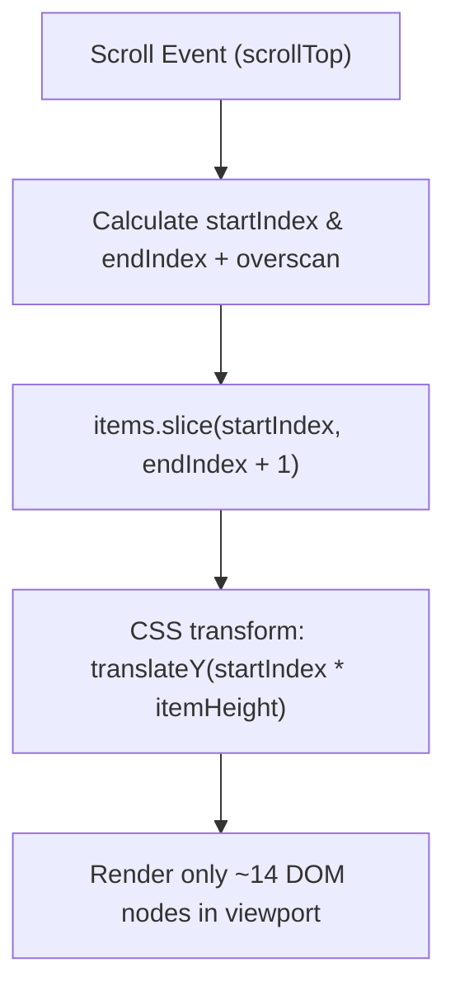

---

### Intuition & Mental Model: Windowing Mathematics

```
[ Virtual Scroll Container: height = 400px, overflowY = 'auto' ]
+-------------------------------------------------------------+
|                                                             |
| Top Offset (Phantom Spacer): startIndex * itemHeight        |
|                                                             |
+-------------------------------------------------------------+  <-- Visible Slice
| Item 45 (visible)                                           |
| Item 46 (visible)                                           |
| ...                                                         |
| Item 55 (visible)                                           |
+-------------------------------------------------------------+
|                                                             |
| Bottom Offset: (totalItems - endIndex - 1) * itemHeight     |
|                                                             |
+-------------------------------------------------------------+
Total Phantom Height = totalItems * itemHeight
```

The mathematical formulas:
1. `totalHeight = items.length * itemHeight`
2. `startIndex = Math.max(0, Math.floor(scrollTop / itemHeight) - overscan)`
3. `endIndex = Math.min(items.length - 1, Math.floor((scrollTop + viewportHeight) / itemHeight) + overscan)`
4. `offsetY = startIndex * itemHeight`

---

### Component Skeleton (Drafting the Blueprint)

```jsx
export function VirtualizedListSkeleton({ items, itemHeight = 50, viewportHeight = 400, renderRow }) {
  // 1. STATE SKELETON
  // const [scrollTop, setScrollTop] = useState(0);

  // 2. MATH DERIVATIONS
  // const totalHeight = items.length * itemHeight;
  // const startIndex = Math.max(0, Math.floor(scrollTop / itemHeight) - 3);
  // const endIndex = Math.min(items.length - 1, Math.floor((scrollTop + viewportHeight) / itemHeight) + 3);
  // const visibleSlice = items.slice(startIndex, endIndex + 1);
  // const offsetY = startIndex * itemHeight;

  // 3. SCROLL LISTENER STUB
  // const handleScroll = (e) => setScrollTop(e.currentTarget.scrollTop);

  // 4. RENDER SKELETON
  // return (
  //   <div onScroll={handleScroll} style={{ height: viewportHeight, overflowY: 'auto' }}>
  //     <div style={{ height: totalHeight, position: 'relative' }}>
  //       <div style={{ transform: `translateY(${offsetY}px)`, position: 'absolute' }}>
  //         {visibleSlice.map(renderRow)}
  //       </div>
  //     </div>
  //   </div>
  // );
}
```

---

### Step 1: Complete Implementation

```jsx
import React, { useState } from 'react';

export function VirtualizedList({
  items,
  itemHeight = 48,
  viewportHeight = 384,
  overscan = 3,
  renderItem
}) {
  const [scrollTop, setScrollTop] = useState(0);

  const totalHeight = items.length * itemHeight;

  const startIndex = Math.max(0, Math.floor(scrollTop / itemHeight) - overscan);
  const endIndex = Math.min(
    items.length - 1,
    Math.floor((scrollTop + viewportHeight) / itemHeight) + overscan
  );

  const visibleItems = items.slice(startIndex, endIndex + 1);
  const offsetY = startIndex * itemHeight;

  const handleScroll = (e) => {
    setScrollTop(e.currentTarget.scrollTop);
  };

  return (
    <div
      onScroll={handleScroll}
      style={{
        height: `${viewportHeight}px`,
        overflowY: 'auto',
        position: 'relative',
        border: '1px solid #ccc',
        borderRadius: '6px'
      }}
    >
      {/* Outer phantom container representing full dataset height */}
      <div style={{ height: `${totalHeight}px`, width: '100%', position: 'relative' }}>
        {/* Rendered window slice translated to current scroll offset */}
        <div
          style={{
            transform: `translateY(${offsetY}px)`,
            position: 'absolute',
            top: 0,
            left: 0,
            right: 0
          }}
        >
          {visibleItems.map((item, index) => {
            const actualIndex = startIndex + index;
            return (
              <div key={actualIndex} style={{ height: `${itemHeight}px`, boxSizing: 'border-box' }}>
                {renderItem(item, actualIndex)}
              </div>
            );
          })}
        </div>
      </div>
    </div>
  );
}

// Demo usage with 25,000 items
export function VirtualListDemo() {
  const bigDataset = Array.from({ length: 25000 }, (_, i) => ({
    id: i + 1,
    name: `Customer Account #${i + 1}`,
    email: `client${i + 1}@enterprise.io`
  }));

  return (
    <div style={{ maxWidth: '480px', margin: '20px auto', fontFamily: 'sans-serif' }}>
      <h3>Virtualized Table (25,000 Records)</h3>
      <p style={{ fontSize: '13px', color: '#666' }}>
        Notice instantaneous 60fps scrolling: only ~14 DOM nodes exist at any given moment.
      </p>
      <VirtualizedList
        items={bigDataset}
        itemHeight={48}
        viewportHeight={384}
        renderItem={(item) => (
          <div
            style={{
              padding: '0 16px',
              height: '100%',
              display: 'flex',
              alignItems: 'center',
              justifyContent: 'space-between',
              borderBottom: '1px solid #eee'
            }}
          >
            <span style={{ fontWeight: 500 }}>{item.name}</span>
            <span style={{ color: '#888', fontSize: '12px' }}>{item.email}</span>
          </div>
        )}
      />
    </div>
  );
}
```

---

## React 18 Concurrent Rendering: useTransition vs useDeferredValue

### The Interview Problem
Demonstrate how React 18 Concurrent Mode prevents UI freezing when filtering a large in-memory dataset of 15,000 complex items upon user typing.

**Key Requirements:**
1. Split updates into **urgent** (text input value) and **non-urgent** (heavy list filter transition).
2. Show pending state feedback while the background transition render is calculating.
3. Compare when to choose `useTransition` vs `useDeferredValue`.

---

### Visual UI Wireframe & Component Hierarchy

```
+-------------------------------------------------------------+
| Instant Search (15,000 Items)                               |
|                                                             |
| [ Type rapidly: "Electronics"        ] [ Updating list... ] |
+-------------------------------------------------------------+
| Found 3,000 matches (opacity: 0.6 while calculating)        |
| - Product #14 - Electronics                                 |
| - Product #19 - Electronics                                 |
| - Product #24 - Electronics                                 |
+-------------------------------------------------------------+
```

```mermaid
sequenceDiagram
    participant User
    participant UrgentLane
    participant TransitionLane
    participant BrowserThread

    User->>UrgentLane: Types character 'E'
    UrgentLane->>BrowserThread: Update <input value="E"> (Priority: Immediate, 16ms)
    UrgentLane->>TransitionLane: startTransition: filter 15,000 items
    Note over TransitionLane,BrowserThread: Non-blocking render; yields if user types again!
    TransitionLane->>BrowserThread: Commit filtered list to screen
```

---

### Intuition & Mental Model: Priority Lanes in React 18

```
[ User Keystroke ]
       |
       +---> [ Urgent Lane ]: setInputValue(val) -> Re-renders input box within 16ms!
       |
       +---> [ Transition Lane (Low Priority) ]: setSearchFilter(val)
                   |
                   +---> React yields main thread to keep animations smooth
                   +---> If user types AGAIN: React discards old transition and starts fresh!
```

---

### Component Skeleton (Drafting the Blueprint)

```jsx
export function ConcurrentSearchSkeleton() {
  // 1. STATE SKELETON
  // const [inputValue, setInputValue] = useState('');
  // const [searchQuery, setSearchQuery] = useState('');
  // const [isPending, startTransition] = useTransition();

  // 2. INPUT HANDLER WITH SPLIT PRIORITY
  // const handleChange = (e) => {
  //   setInputValue(e.target.value); // Urgent
  //   startTransition(() => setSearchQuery(e.target.value)); // Non-urgent
  // };

  // 3. RENDER SKELETON
  // return <div><input /> {isPending && <spinner />} <HeavyList query={searchQuery} /></div>;
}
```

---

### Step 1: Complete Implementation

```jsx
import React, { useState, useTransition } from 'react';

const largeProductCatalog = Array.from({ length: 15000 }, (_, i) => ({
  id: i + 1,
  name: `Product #${i + 1} - ${['Electronics', 'Books', 'Home', 'Toys', 'Sports'][i % 5]}`
}));

export function ConcurrentProductSearch() {
  const [inputValue, setInputValue] = useState('');
  const [filterQuery, setFilterQuery] = useState('');
  const [isPending, startTransition] = useTransition();

  const handleInputChange = (e) => {
    const nextVal = e.target.value;

    // 1. Urgent priority: update text input immediately so typing never lags
    setInputValue(nextVal);

    // 2. Transition priority: filter list without blocking main thread
    startTransition(() => {
      setFilterQuery(nextVal);
    });
  };

  const filteredItems = largeProductCatalog.filter((item) =>
    item.name.toLowerCase().includes(filterQuery.toLowerCase())
  );

  return (
    <div style={{ maxWidth: '480px', margin: '20px auto', fontFamily: 'sans-serif' }}>
      <h3>Instant Search (15,000 Items)</h3>

      <div style={{ position: 'relative', marginBottom: '12px' }}>
        <input
          type="text"
          value={inputValue}
          onChange={handleInputChange}
          placeholder="Type rapidly (e.g. 'Books', '123')..."
          style={{
            width: '100%',
            padding: '10px 12px',
            fontSize: '15px',
            border: '1px solid #ccc',
            borderRadius: '6px',
            boxSizing: 'border-box'
          }}
        />
        {isPending && (
          <span style={{ position: 'absolute', right: '12px', top: '12px', fontSize: '12px', color: '#0284c7' }}>
            Updating list...
          </span>
        )}
      </div>

      <div
        style={{
          opacity: isPending ? 0.6 : 1,
          transition: 'opacity 0.15s ease',
          height: '300px',
          overflowY: 'auto',
          border: '1px solid #eee',
          borderRadius: '6px',
          padding: '8px'
        }}
      >
        <p style={{ margin: '4px 0 8px 0', fontSize: '12px', color: '#666' }}>
          Found {filteredItems.length} matches
        </p>
        {filteredItems.slice(0, 100).map((product) => (
          <div key={product.id} style={{ padding: '6px 0', borderBottom: '1px solid #f0f0f0', fontSize: '14px' }}>
            {product.name}
          </div>
        ))}
        {filteredItems.length > 100 && (
          <p style={{ color: '#888', fontSize: '12px', textAlign: 'center' }}>
            Showing first 100 matches...
          </p>
        )}
      </div>
    </div>
  );
}
```

---

## Custom Hooks Suite (The Core 4)

Interviewers frequently ask candidates to build essential utility hooks from first principles:

---

### Visual UI Wireframe & Component Hierarchy

```
+-------------------------------------------------------------+
| Reusable Custom Hooks Architecture                          |
+-------------------------------------------------------------+
| 1. useDebounce(value, 300)      : Keystroke delay throttle  |
| 2. usePrevious(value)           : Render snapshot memory    |
| 3. useOnClickOutside(ref, fn)   : Modal / Dropdown dismiss  |
| 4. useLocalStorage(key, init)   : Local persistence sync    |
+-------------------------------------------------------------+
```

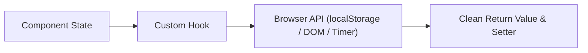

---

### 1. `useDebounce`

Delays updating a state value until the user pauses for $N$ milliseconds.

```jsx
import { useState, useEffect } from 'react';

export function useDebounce(value, delay = 300) {
  const [debouncedValue, setDebouncedValue] = useState(value);

  useEffect(() => {
    const handler = setTimeout(() => {
      setDebouncedValue(value);
    }, delay);

    return () => {
      clearTimeout(handler);
    };
  }, [value, delay]);

  return debouncedValue;
}
```

---

### 2. `usePrevious`

Returns the value from the previous render cycle using a `useRef`.

```jsx
import { useRef, useEffect } from 'react';

export function usePrevious(value) {
  const ref = useRef();

  useEffect(() => {
    // Runs AFTER render commits
    ref.current = value;
  }, [value]);

  // Returns value stored during previous render
  return ref.current;
}
```

---

### 3. `useOnClickOutside`

Detects clicks outside of a referenced DOM container to close dropdowns, popovers, or modals.

```jsx
import { useEffect } from 'react';

export function useOnClickOutside(ref, handler) {
  useEffect(() => {
    const listener = (event) => {
      if (!ref.current || ref.current.contains(event.target)) {
        return;
      }
      handler(event);
    };

    document.addEventListener('mousedown', listener);
    document.addEventListener('touchstart', listener);

    return () => {
      document.removeEventListener('mousedown', listener);
      document.removeEventListener('touchstart', listener);
    };
  }, [ref, handler]);
}
```

---

### 4. `useLocalStorage`

Synchronizes React state with browser `localStorage`, with lazy initial reading, JSON serialization, and cross-tab synchronization.

```jsx
import { useState, useEffect, useCallback } from 'react';

export function useLocalStorage(key, initialValue) {
  const readValue = useCallback(() => {
    if (typeof window === 'undefined') return initialValue;
    try {
      const item = window.localStorage.getItem(key);
      return item ? JSON.parse(item) : initialValue;
    } catch (err) {
      console.warn(`Error reading localStorage key "${key}":`, err);
      return initialValue;
    }
  }, [key, initialValue]);

  const [storedValue, setStoredValue] = useState(readValue);

  const setValue = useCallback(
    (value) => {
      try {
        const nextValue = value instanceof Function ? value(storedValue) : value;
        setStoredValue(nextValue);
        if (typeof window !== 'undefined') {
          window.localStorage.setItem(key, JSON.stringify(nextValue));
        }
      } catch (err) {
        console.warn(`Error setting localStorage key "${key}":`, err);
      }
    },
    [key, storedValue]
  );

  useEffect(() => {
    const handleStorageChange = (e) => {
      if (e.key === key && e.newValue) {
        setStoredValue(JSON.parse(e.newValue));
      }
    };

    window.addEventListener('storage', handleStorageChange);
    return () => window.removeEventListener('storage', handleStorageChange);
  }, [key]);

  return [storedValue, setValue];
}
```


# React 19 Modernizations

In a senior frontend interview today, solving the problem using **React 18 fundamentals first** proves your deep knowledge of raw state lifecycles and concurrency.

Then, showing how to refactor your solution using **React 19 primitives** demonstrates that you stay on the cutting edge of the ecosystem.

Here is how the core patterns transform:

---

## Modernizing Optimistic Updates: useOptimistic

In React 18, optimistic mutations required manually keeping snapshots (`previousLikes`), juggling boolean `isPending` flags, and writing rollback logic in `try / catch` blocks.

In React 19, the `useOptimistic` hook handles this automatically alongside an async Action.

### Component Skeleton (Drafting the Blueprint)

```jsx
export function ModernOptimisticSkeleton({ initialLikes, initialIsLiked }) {
  // 1. ASYNC TRANSITION HOOK
  // const [isPending, startTransition] = useTransition();

  // 2. OPTIMISTIC STATE SKELETON
  // const [optimisticState, setOptimistic] = useOptimistic(
  //   { likes: initialLikes, isLiked: initialIsLiked },
  //   (currentState, updateArg) => ({ ... })
  // );

  // 3. ACTION HANDLER
  // const handleToggle = () => {
  //   startTransition(async () => {
  //     setOptimistic(!optimisticState.isLiked);
  //     await serverAction(...);
  //   });
  // };

  // 4. RENDER SKELETON
  // return <button onClick={handleToggle}>{optimisticState.likes}</button>;
}
```

### Complete Implementation

```jsx
import React, { useOptimistic, useTransition } from 'react';

async function updateLikeAction(postId, nextStatus) {
  await new Promise((r) => setTimeout(r, 800));
  return nextStatus;
}

export function ModernLikeButton({ postId, initialLikes = 10, initialIsLiked = false }) {
  const [isPending, startTransition] = useTransition();

  const [optimisticState, setOptimisticState] = useOptimistic(
    { likes: initialLikes, isLiked: initialIsLiked },
    (current, nextLiked) => ({
      likes: nextLiked ? current.likes + 1 : current.likes - 1,
      isLiked: nextLiked
    })
  );

  const handleToggle = () => {
    startTransition(async () => {
      const nextLiked = !optimisticState.isLiked;
      setOptimisticState(nextLiked);
      await updateLikeAction(postId, nextLiked);
    });
  };

  return (
    <button
      onClick={handleToggle}
      disabled={isPending}
      style={{
        padding: '8px 16px',
        borderRadius: '20px',
        border: '1px solid #ccc',
        backgroundColor: optimisticState.isLiked ? '#ffe4e6' : '#fff',
        cursor: 'pointer'
      }}
    >
      {optimisticState.isLiked ? '❤️' : '🤍'} {optimisticState.likes} Likes
      {isPending && ' (saving...)'}
    </button>
  );
}
```

---

## Modernizing Form Handling: useActionState and useFormStatus

In React 18, handling forms required controlling every input, managing `isSubmitting` / `error` / `success` states, and wiring up `onSubmit={(e) => { e.preventDefault(); ... }}`.

In React 19, HTML forms natively accept asynchronous functions (`action`), and `useActionState` manages the pending and return state.

### Component Skeleton (Drafting the Blueprint)

```jsx
// 1. ACTION SIGNATURE: (previousState, formData) => Promise<nextState>
async function formActionHandler(prevState, formData) { ... }

// 2. SUBMIT BUTTON SKELETON WITH useFormStatus
function SubmitButtonSkeleton() {
  // const { pending } = useFormStatus();
  // return <button type="submit" disabled={pending}>{pending ? 'Saving...' : 'Submit'}</button>;
}

// 3. MAIN FORM SKELETON WITH useActionState
export function ModernFormSkeleton() {
  // const [state, formAction, isPending] = useActionState(formActionHandler, initialState);
  // return <form action={formAction}><input /><SubmitButtonSkeleton /></form>;
}
```

### Complete Implementation

```jsx
import React, { useActionState } from 'react';
import { useFormStatus } from 'react-dom';

function SubmitButton() {
  const { pending } = useFormStatus();
  return (
    <button
      type="submit"
      disabled={pending}
      style={{ padding: '8px 16px', cursor: pending ? 'not-allowed' : 'pointer' }}
    >
      {pending ? 'Saving Changes...' : 'Save Profile'}
    </button>
  );
}

async function updateProfile(previousState, formData) {
  const username = formData.get('username');
  if (!username || username.length < 3) {
    return { error: 'Username must be at least 3 characters', success: false };
  }

  await new Promise((r) => setTimeout(r, 600));
  return { error: null, success: true, username };
}

export function ModernProfileForm() {
  const [state, formAction, isPending] = useActionState(updateProfile, {
    error: null,
    success: false,
    username: ''
  });

  return (
    <form action={formAction} style={{ display: 'flex', flexDirection: 'column', gap: '12px', maxWidth: '320px' }}>
      <label>
        Username:
        <input name="username" defaultValue={state.username} style={{ display: 'block', width: '100%', padding: '6px' }} />
      </label>

      {state.error && <div style={{ color: 'red', fontSize: '13px' }}>{state.error}</div>}
      {state.success && <div style={{ color: 'green', fontSize: '13px' }}>Profile saved successfully!</div>}

      <SubmitButton />
    </form>
  );
}
```

---

## Modernizing Refs: Eliminating forwardRef

In React 18, passing a `ref` to a custom component required wrapping it with `forwardRef`:

```jsx
// React 18: Required forwardRef boilerplate
const CustomInput = React.forwardRef((props, ref) => {
  return <input ref={ref} {...props} />;
});
```

In React 19, `ref` is simply passed as a standard prop, eliminating the wrapper entirely:

```jsx
// React 19: Clean, natural prop passing
export function CustomInput({ label, ref, ...props }) {
  return (
    <div>
      <label>{label}</label>
      <input ref={ref} {...props} />
    </div>
  );
}
```

---

## Modernizing Async Data: The use() Hook with Suspense

In React 18, fetching data inside components meant boilerplate: `useEffect`, `useState` for loading, `useState` for error, and handling cleanup flags for race conditions.

In React 19, the `use()` hook unwraps Promises directly inside rendering:

```jsx
import React, { use, Suspense } from 'react';

function UserProfile({ userPromise }) {
  // use() suspends the component until userPromise resolves!
  const user = use(userPromise);

  return (
    <div style={{ padding: '16px', border: '1px solid #ccc' }}>
      <h3>{user.name}</h3>
      <p>Email: {user.email}</p>
    </div>
  );
}

export function App() {
  const fetchUserPromise = fetch('/api/user').then((res) => res.json());

  return (
    <Suspense fallback={<div>Loading user profile...</div>}>
      <UserProfile userPromise={fetchUserPromise} />
    </Suspense>
  );
}
```

---

# Common Interview Follow-Up Questions

When you finish coding your initial solution, strong interviewers will test your depth with targeted follow-up scenarios:

### 1. "How do you prevent memory leaks when components unmount before async requests finish?"
*Answer:*
- For `fetch` requests: instantiate an `AbortController` in `useEffect` and invoke `abortController.abort()` in the cleanup return function.
- For timers (`setTimeout` / `setInterval`): store timer IDs in `useRef` and invoke `clearTimeout` / `clearInterval` in the cleanup function.
- In React 18 / 19, updating state on unmounted components no longer produces the old "Can't perform a React state update on an unmounted component" warning, but aborting requests is still essential to save network bandwidth and prevent CPU work.

### 2. "Why use useReducer instead of multiple useStates?"
*Answer:*
- When two or more state variables change together in response to a single event (e.g. `isLoading`, `data`, `error`).
- When the next state depends on complex previous state logic.
- When passing a `dispatch` function down to child components deep in the tree avoids triggering re-renders because `dispatch` has a stable reference identity that never changes across renders.

### 3. "What is the difference between controlled and uncontrolled components?"
*Answer:*
- **Controlled:** State lives in React memory (`useState`). Every keystroke triggers a re-render. Best for immediate validation, dynamic character counters, or disabling buttons conditionally.
- **Uncontrolled:** State lives in the browser DOM (`useRef` or native `FormData`). Fast, lightweight, and requires no re-renders during user typing. React 19 form actions heavily leverage uncontrolled DOM forms.

### 4. "How does React distinguish between urgent and non-urgent updates?"
*Answer:*
- Urgent updates (clicks, keystrokes) run at discrete priority and interrupt ongoing non-urgent work.
- Non-urgent updates wrapped in `startTransition` or deferred via `useDeferredValue` are placed in the transition lane. React yields to the browser main thread between chunks of work, ensuring animations and typing never drop below 60fps.

---

# The Candidate's Final Pre-Interview Checklist

Before submitting your code or walking into an interview:

1. [ ] **Clean JSX:** Are you relying on clean, semantic HTML (`<dialog>`, `<nav>`, `<button>`, `<fieldset>`) rather than a dozen nested `<div>`s?
2. [ ] **Accessibility (a11y):** Did you include proper `aria-` attributes (`aria-expanded`, `aria-label`, `role="alert"`, `aria-live`)?
3. [ ] **Keyboard Navigation:** Can a user navigate your component using only `Tab`, `Enter`, `Space`, `Escape`, and arrow keys?
4. [ ] **Cleanups:** Are all event listeners, intervals, timeouts, and `AbortController` handles cleaned up in their respective `useEffect` return statements?
5. [ ] **Edge Cases Covered:** Have you tested empty lists, 0 results, 10,000 items, rapid double-clicks, and network errors?
6. [ ] **React 18 vs 19 Context:** Can you articulate why your React 18 solution works, and how you would simplify it using React 19's `useActionState`, `useOptimistic`, or `use()`?


